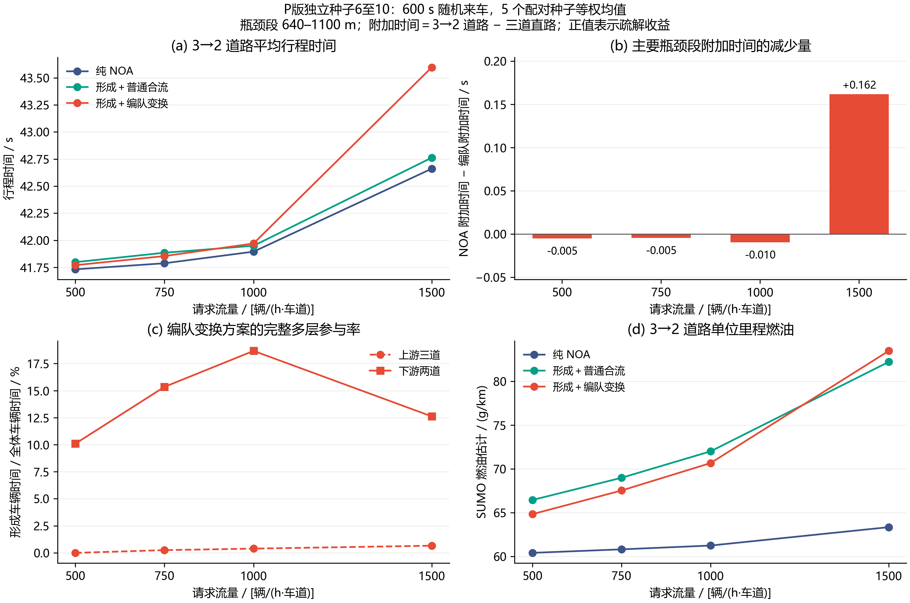

# P 独立验收报告

P 在本次四流量独立验收中没有实现全程交通提效：500、750、1000、1500 辆/(h·车道)下，全程平均行程时间均高于同输入 NOA。1500 流量下，640–1100 米主要段的直路差分改善 0.161616 秒，800–1000 米低速积聚也明显减少；这些局部作用没有抵消全程成本。同种子严格消融进一步显示，形成跟驰和补位对主要段及低速积聚有实际贡献，但 P 在 1500 下仍比该消融慢 0.102345 秒，四个流量的燃油均更高。当前结果支持“存在局部组织作用”，不支持“已经由有效编队带来整体交通效率提升”。

## 1. 验收条件与数据范围

本报告使用预先登记的 [P 协议](experiments/2026-10-29-four-flow-attribution/P_protocol.md)和已经冻结的 [portable_P](experiments/2026-10-29-four-flow-attribution/portable_P/PACKAGE.txt)、[portable_C1_P](experiments/2026-10-29-four-flow-attribution/portable_C1_P/PACKAGE.txt)。四个每车道需求流量固定为 500、750、1000、1500 辆/h，独立种子固定为 **6、7、8、9、10**；请求持续 600 秒，绝对仿真上限 900 秒。上游道路长 1000 米、三车道，随后 200 米为两车道；对照直路全长 1200 米、三车道。准备边界为 640 米，物理车道终止点为 1000 米。

P100 包含四流量×五种子×五工况：直路 NOA/P，缩减道路 NOA/F/P。F 表示基本形成加普通合流，P 表示形成加提前编队变换。另有四流量×五种子的 C1_P 缩减道路严格消融 20 例，实际模式元数据为 `cooperative`。P100 累计执行 **48,060 次车辆运行**，C1_P20 累计 **9,612 次**；同一流量、种子的基础请求在方案间复用，每个缩减道路方案的五种子请求数依次为 1296、1916、2546、3854，合计 9612。这里累计运行次数并非互不重复的独立随机车辆样本。120 例全部安全排空、审计合格；统计保留全部尝试，没有成功案例筛选。

各方案使用同一车型、路网、随机发车输入与执行规则：巡航 28.8 m/s、物理最高速度 33.3 m/s、加速能力 5 m/s²、制动能力 10 m/s²、响应参数 0.2 s，车长 4 米，统一 `HBEFA3/PC_G_EU4` 燃油模型。车辆由 SUMO 插入并执行运动，Python 每 0.1 秒提出本车速度和相邻换道请求。每道每步按 `flow×0.1/3600` 的伯努利概率提出请求，不设置等待成组后发车的入口门槛。控制和执行细节见 [原生 SUMO 系统说明](原生SUMO编队变换系统说明.md)。

行程时间 TT 是实际进入到驶出的时间，不含入口等待。交通、燃油、参与率均沿用五个逐种子结果的算术平均；计数单独标注五种子合计。主要段时间依据实测首次越过 640/1100 米门的位置计算，只在正常相邻 0.1 秒帧之间线性插值，漏帧、未通过和删失规则保持冻结口径。定义同模式附加时间为“缩减道路−直路”，DID 为“NOA 附加时间−P 附加时间”：**DID 为正才表示 P 减少了瓶颈附加时间**。F 未配置直路，因此不计算 DID。

## 2. 全程结果与主要段归因

图 1 汇总 P 的四流量全程时间、主段附加时间减少量、完整多层参与率和燃油。图中均使用固定五种子的等权均值。

下表均为秒；P−NOA 为缩减道路全程 TT 的直接差，正值表示 P 更慢。主段与全程 DID 使用同种子、同模式直路控制。

| 流量 | NOA TT | F TT | P TT | P−NOA TT | 640–1100 米 DID | 全程 DID |
| --- | --- | --- | --- | --- | --- | --- |
| 500 | 41.731506 | 41.797655 | 41.769688 | +0.038182 | -0.005184 | -0.003788 |
| 750 | 41.787264 | 41.884550 | 41.853895 | +0.066631 | -0.004519 | -0.007602 |
| 1000 | 41.894584 | 41.948917 | 41.970283 | +0.075699 | -0.009587 | -0.018194 |
| 1500 | 42.660825 | 42.762266 | 43.596960 | +0.936135 | +0.161616 | -0.815962 |

原始来源：[冻结交通表](experiments/2026-10-29-four-flow-attribution/portable_P/tables/traffic_and_attribution.csv)、[完整四流量 JSON](experiments/2026-10-29-four-flow-attribution/portable_P/tables/results.json)、[逐次归因 JSON（gzip）](experiments/2026-10-29-four-flow-attribution/portable_P/data/attribution_summary.json.gz)。

主要段的绝对时间和直路附加时间如下。前三个流量的 DID 小且为负；1500 下 P 的主要段平均时间比 NOA 短，但全程平均时间仍更长。

| 流量 | NOA 主段 | F 主段 | P 主段 | NOA 主段附加 | P 主段附加 |
| --- | --- | --- | --- | --- | --- |
| 500 | 15.998557 | 16.044596 | 16.011516 | 0.026319 | 0.031503 |
| 750 | 16.048319 | 16.099089 | 16.061363 | 0.076064 | 0.080583 |
| 1000 | 16.151203 | 16.147487 | 16.164105 | 0.178934 | 0.188521 |
| 1500 | 16.903661 | 16.502902 | 16.736598 | 0.931342 | 0.769726 |

直路控制也保留了 P 的运行成本。1500 下，P 直路比 NOA 慢 0.120173 秒；100–600 米上游段的附加时间差分为 −0.693194 秒。这一实测上游成本与主要段局部收益同时存在，不能只截取瓶颈附近的改善解释全程结果。

| 流量 | NOA 直路 TT | P 直路 TT | 直路 P−NOA | 100–600 米 DID |
| --- | --- | --- | --- | --- |
| 500 | 41.704978 | 41.739372 | +0.034393 | -0.000561 |
| 750 | 41.710425 | 41.769454 | +0.059029 | -0.000941 |
| 1000 | 41.714307 | 41.771811 | +0.057505 | -0.003986 |
| 1500 | 41.724534 | 41.844707 | +0.120173 | -0.693194 |

来源：[直路原表](experiments/2026-10-29-four-flow-attribution/portable_P/tables/straight_controls.csv)。1500 流量的五个配对值如下，种子按预登记顺序完整列出；均值不能代替这些方向和幅度不同的结果。

| 种子 | NOA TT | P TT | P−NOA TT |
| --- | --- | --- | --- |
| 6 | 42.824847 | 44.934027 | +2.109180 |
| 7 | 42.444372 | 44.948298 | +2.503927 |
| 8 | 42.888472 | 42.712565 | -0.175907 |
| 9 | 42.342339 | 42.327823 | -0.014516 |
| 10 | 42.804095 | 43.062087 | +0.257992 |

这五个差的均值为 +0.936135 秒。来源：[1500 逐次与配对 JSON（gzip）](experiments/2026-10-29-four-flow-attribution/portable_P/data/native_flow_1500.json.gz)。五个种子中三次变慢、两次变快。

## 3. 燃油、低速积聚与断面通过量

低速车辆秒是 [100,600) 秒内、800≤x<1000 米区域中 `v<5 m/s` 的车辆数积分；低速占比的分母为同区域全部车辆秒。区域速度是同窗内车辆时间加权平均，不是全路段平均速度。1000 米断面流量为 [100,600] 秒首次实测通过数除以 500 秒再换算为辆/h，是有限时窗通过量，不称为饱和通行能力。燃油为 SUMO 实测总燃油 mg/实际行驶距离 m，数值单位 g/km。

| 流量 | 方案 | 燃油 g/km | 低速车辆秒 | 低速占比 % | 区域速度 m/s | 1000 米通过量 辆/h |
| --- | --- | --- | --- | --- | --- | --- |
| 500 | NOA | 60.401 | 0.00 | 0.0000 | 28.765 | 1552.32 |
| 500 | F | 66.438 | 0.00 | 0.0000 | 28.855 | 1552.32 |
| 500 | P | 64.821 | 0.00 | 0.0000 | 28.861 | 1550.88 |
| 750 | NOA | 60.802 | 1.98 | 0.0878 | 28.701 | 2322.72 |
| 750 | F | 68.971 | 0.00 | 0.0000 | 28.886 | 2321.28 |
| 750 | P | 67.519 | 1.06 | 0.0499 | 28.861 | 2321.28 |
| 1000 | NOA | 61.236 | 7.44 | 0.2513 | 28.596 | 3055.68 |
| 1000 | F | 71.993 | 0.00 | 0.0000 | 29.003 | 3052.80 |
| 1000 | P | 70.652 | 9.44 | 0.3121 | 28.726 | 3055.68 |
| 1500 | NOA | 63.336 | 213.10 | 4.4042 | 27.065 | 4658.40 |
| 1500 | F | 82.206 | 1.60 | 0.0378 | 29.342 | 4651.20 |
| 1500 | P | 83.462 | 13.68 | 0.3012 | 29.064 | 4641.12 |

1500 下 P 将低速车辆秒从 NOA 的 213.10 降至 13.68，但断面通过量从 4658.40 变为 4641.12 辆/h，全程 TT 从 42.660825 升至 43.596960 秒，燃油从 63.336 升至 83.462 g/km。局部少停车的作用清楚可见，整体效率和燃油结果却没有同步改善。750 下 P 的低速量略低于 NOA，1000 下则略高，低流量本身没有强拥挤可消除。原值见 [交通与归因表](experiments/2026-10-29-four-flow-attribution/portable_P/tables/traffic_and_attribution.csv)。

## 4. 实际多层参与、规模与持续性

冻结几何评价要求至少两层完整结构：三道上游至少六车、两道下游至少四车，并持续确认 1 秒。参与率 PP 是确认成组车辆秒/区域全部车辆秒；stable PP 在同一口径上要求关系保持达到 5 秒。上游区域为 [0,640) 米，下游为 [1000,1200) 米。下列 PP 与 stable PP 单位为百分比；条件平均规模只在存在已确认组的组时间上计算，再平均各个有定义种子的结果，`n` 是有定义种子数，不能将它当作全体车辆的平均队长。逐种子峰值按 6/7/8/9/10 排列，`—` 表示该种子没有满足条件的结构。

上游结果如下。表中 NOA 行仅表示几何检测，不称为主动编队：

| 流量 | 方案 | PP % | stable PP % | 条件平均规模（种子 n） | 逐种子窗口峰值 |
| --- | --- | --- | --- | --- | --- |
| 500 | NOA | 0.0000 | 0.0000 | —（n=0） | — / — / — / — / — |
| 500 | F | 0.0000 | 0.0000 | —（n=0） | — / — / — / — / — |
| 500 | P | 0.0000 | 0.0000 | —（n=0） | — / — / — / — / — |
| 750 | NOA | 0.0000 | 0.0000 | —（n=0） | — / — / — / — / — |
| 750 | F | 0.2519 | 0.0637 | 6.0000（n=4） | — / 6 / 6 / 6 / 6 |
| 750 | P | 0.2519 | 0.0637 | 6.0000（n=4） | — / 6 / 6 / 6 / 6 |
| 1000 | NOA | 0.0000 | 0.0000 | —（n=0） | — / — / — / — / — |
| 1000 | F | 0.3918 | 0.0918 | 6.0000（n=4） | 6 / 6 / — / 6 / 6 |
| 1000 | P | 0.3918 | 0.0918 | 6.0000（n=4） | 6 / 6 / — / 6 / 6 |
| 1500 | NOA | 0.0000 | 0.0000 | —（n=0） | — / — / — / — / — |
| 1500 | F | 0.7933 | 0.2919 | 6.3211（n=5） | 9 / 6 / 6 / 6 / 9 |
| 1500 | P | 0.6616 | 0.2440 | 6.3470（n=5） | 9 / 6 / 6 / 6 / 12 |

下游结果：

| 流量 | 方案 | PP % | stable PP % | 条件平均规模（种子 n） | 逐种子窗口峰值 |
| --- | --- | --- | --- | --- | --- |
| 500 | NOA | 0.0000 | 0.0000 | —（n=0） | — / — / — / — / — |
| 500 | F | 0.0134 | 0.0000 | 4.0000（n=1） | — / — / — / 4 / — |
| 500 | P | 10.0973 | 0.6775 | 4.3115（n=5） | 6 / 6 / 8 / 6 / 6 |
| 750 | NOA | 0.0000 | 0.0000 | —（n=0） | — / — / — / — / — |
| 750 | F | 0.0060 | 0.0000 | 4.0000（n=1） | — / — / — / — / 4 |
| 750 | P | 15.3432 | 0.9468 | 4.3947（n=5） | 8 / 8 / 8 / 6 / 8 |
| 1000 | NOA | 0.0000 | 0.0000 | —（n=0） | — / — / — / — / — |
| 1000 | F | 0.0357 | 0.0000 | 4.0000（n=3） | 4 / 4 / — / — / 4 |
| 1000 | P | 18.6693 | 1.1353 | 4.6546（n=5） | 10 / 12 / 8 / 10 / 12 |
| 1500 | NOA | 0.0601 | 0.0042 | 4.0000（n=1） | — / — / 4 / — / — |
| 1500 | F | 0.1720 | 0.0000 | 4.1240（n=3） | — / 4 / 6 / 4 / — |
| 1500 | P | 12.6170 | 0.6738 | 5.0157（n=5） | 10 / 12 / 12 / 10 / 12 |

P 的下游 PP 为 10.0973%、15.3432%、18.6693%、12.6170%，高于 F；但下游 stable PP 仅为 0.6775%、0.9468%、1.1353%、0.6738%。P 的上游 PP 则为 0、0.2519%、0.3918%、0.6616%，连续流在 640 米长上游区域中的完整成组仍不足。不能把下游结构的存在，写成上游已形成的同一整队成功保持并通过瓶颈。NOA 的检测值仅表示偶然的物理几何结构；例如 1500 下游一个种子出现四车结构，不称为 NOA 主动编队。

这里需要同时保留 200 米下游观察窗的限制。以七层十四车的目标为例，同道层距 30 米、交错相位 15 米对应纵向跨度 `6×30+15=195` 米。在 28.8 m/s 下，该结构完整落入 200 米窗的时间只有 `(200−195)/28.8≈0.17` 秒，小于 1 秒确认时间。因此峰值是**窗口内确认规模**，五秒指标也受空间边界删失影响，不能直接据此判定整条长队的全程规模和寿命。这个限制不改变上游 640 米区域 PP 仍低的实测结论。

内部关系断裂和边界删失保留为不同计数。前者表示曾参与已确认结构的物理同层/邻层关系在区域内部消失；后者表示关系因成员跨出观察边界而不再可见。两者计数单位都是“关系”，不是车辆或整队次数。下表为五种子合计，不能把边界删失加作内部断裂，也不能仅凭低 stable PP 推断控制在整个道路上失稳。

| 流量 | 方案 | 上游内部断裂 | 上游边界删失 | 下游内部断裂 | 下游边界删失 |
| --- | --- | --- | --- | --- | --- |
| 500 | NOA | 0 | 0 | 0 | 0 |
| 500 | F | 0 | 0 | 1 | 2 |
| 500 | P | 0 | 0 | 77 | 104 |
| 750 | NOA | 0 | 0 | 0 | 0 |
| 750 | F | 4 | 8 | 1 | 2 |
| 750 | P | 4 | 8 | 192 | 232 |
| 1000 | NOA | 0 | 0 | 0 | 0 |
| 1000 | F | 10 | 20 | 4 | 8 |
| 1000 | P | 10 | 20 | 371 | 324 |
| 1500 | NOA | 0 | 0 | 0 | 3 |
| 1500 | F | 59 | 34 | 17 | 14 |
| 1500 | P | 49 | 28 | 501 | 283 |

来源：[编队质量 CSV](experiments/2026-10-29-four-flow-attribution/portable_P/tables/formation_quality.csv)和每流量冻结原始 JSON（[500](experiments/2026-10-29-four-flow-attribution/portable_P/data/native_flow_500.json.gz)、[750](experiments/2026-10-29-four-flow-attribution/portable_P/data/native_flow_750.json.gz)、[1000](experiments/2026-10-29-four-flow-attribution/portable_P/data/native_flow_1000.json.gz)、[1500](experiments/2026-10-29-four-flow-attribution/portable_P/data/native_flow_1500.json.gz)）。

## 5. 原上游成员的恢复与删失

恢复沿用冻结评价器的实际定义：车辆首次被观测到 x≥640 米时开始计时，随后在 [640,1200) 米内确认其属于两道完整结构即记为恢复事件。因此它可能发生在物理瓶颈之前，也不要求原有组员保持同一组身份。“原上游成员”只包括开始调整前已经在三道区域确认过完整结构的车辆；“全部调整车辆”还包含此前未成组、在后段才新形成结构的车辆。这两个分母必须区分。

下表计数合并五种子。条件均值仅对观察到事件的**原上游成员**计算，从首次实测进入准备区到首次两道确认的延迟；其样本数就是该列恢复分子。未恢复者一直保留在分母并列为删失，不设延迟为零，也不进入条件均值。`—` 表示没有事件，不能解释成零秒恢复。此次安全排空并不等于结构恢复：车辆驶出道路之前没有确认事件，仍为恢复指标删失。

| 流量 | 方案 | 全部调整：恢复/分母 | 全部删失 | 原上游：恢复/分母 | 原上游删失 | 原上游条件均值 s |
| --- | --- | --- | --- | --- | --- | --- |
| 500 | NOA | 0/1296 | 1296 | 0/0 | 0 | — |
| 500 | F | 8/1296 | 1288 | 0/0 | 0 | — |
| 500 | P | 234/1296 | 1062 | 0/0 | 0 | — |
| 750 | NOA | 0/1916 | 1916 | 0/0 | 0 | — |
| 750 | F | 24/1916 | 1892 | 0/24 | 24 | — |
| 750 | P | 542/1916 | 1374 | 24/24 | 0 | 12.4625 |
| 1000 | NOA | 0/2546 | 2546 | 0/0 | 0 | — |
| 1000 | F | 79/2546 | 2467 | 3/60 | 57 | 11.0000 |
| 1000 | P | 875/2546 | 1671 | 57/60 | 3 | 12.0018 |
| 1500 | NOA | 4/3854 | 3850 | 0/0 | 0 | — |
| 1500 | F | 155/3854 | 3699 | 12/183 | 171 | 10.6000 |
| 1500 | P | 962/3854 | 2892 | 76/150 | 74 | 12.8605 |

P 的原上游恢复结果依次为 0/0、24/24、57/60、76/150，删失为 0、0、3、74。500 没有原上游成组成员，不能用全部调整车辆中的 234 个两道事件宣称上游整队恢复。1500 中 962 个全部调整事件也不等于 962 个原队成员恢复；原上游实际确认恢复的只有 76 个。条件均值不衡量那些未恢复成员的真实恢复时间。

来源：[恢复计数表](experiments/2026-10-29-four-flow-attribution/portable_P/tables/recovery_counts.csv)及原始恢复记录（[500](experiments/2026-10-29-four-flow-attribution/portable_P/data/recovery_flow_500.json.gz)、[750](experiments/2026-10-29-four-flow-attribution/portable_P/data/recovery_flow_750.json.gz)、[1000](experiments/2026-10-29-four-flow-attribution/portable_P/data/recovery_flow_1000.json.gz)、[1500](experiments/2026-10-29-four-flow-attribution/portable_P/data/recovery_flow_1500.json.gz)）。条件均值合并这五个种子中实际观察到的事件，按事件数加权，并与原逐次条件均值、恢复数交叉核对。

## 6. C1_P 严格消融

C1_P 从最终 P 冻结源独立复制，仅在 cooperative 决策中关闭形成跟驰 `_following` 和自由补位 `_fill`；普通超车仍只允许 NOA，P 与 C1_P 的协作模式均不启用普通超车。helper、接收开隙、合流、joining、pending、本车执行反馈、安全及共同构型定义保持 P 的实现。引擎只增加 cooperative 模式枚举，规则变化限于 `_decide` 选择。八项静态测试检查固定局部状态下 C1_P 与旧 C1_H 的动作/记忆一致，并确认新 pair/follow/fill 分支在 cooperative 下不执行；旧病例没有复用到本批统计。

20 个新病例均来自种子 6–10，与对应 P 缩减道路病例逐一具有**完全相同的原始共同参数 SHA256**，包括浮点流量的 JSON 表示；随机需求 SHA、车辆请求也逐一相同。普通超车动作总数为零，未采用整数/浮点规范化例外。cooperative 直路仍完整委派 NOA，继承的旧直路证明单独注明来源，不冒充本批新的直路病例。来源：[逐对配对及原 SHA](experiments/2026-10-29-four-flow-attribution/portable_C1_P/tables/pairs.csv)、[冻结 source](experiments/2026-10-29-four-flow-attribution/portable_C1_P/provenance/freeze.json)、[独立核验](experiments/2026-10-29-four-flow-attribution/portable_C1_P/independent_verification.json)。

下表“P 主段增量收益”是 P 相对 C1_P 的同模式直路附加时间减少，正值表示 P 更好；C1_P−P TT 的正值表示 C1_P 更慢。TT 与主段增量收益单位为秒，燃油为 g/km。

| 流量 | C1_P TT | P TT | C1_P−P TT | P 主段增量收益 | C1_P 低速车辆秒 | P 低速车辆秒 | C1_P 燃油 | P 燃油 |
| --- | --- | --- | --- | --- | --- | --- | --- | --- |
| 500 | 41.767300 | 41.769688 | -0.002388 | +0.021191 | 2.88 | 0.00 | 61.271 | 64.821 |
| 750 | 41.925911 | 41.853895 | +0.072016 | +0.125468 | 15.26 | 1.06 | 62.188 | 67.519 |
| 1000 | 42.047930 | 41.970283 | +0.077647 | +0.135442 | 37.28 | 9.44 | 62.886 | 70.652 |
| 1500 | 43.494615 | 43.596960 | -0.102345 | +0.987646 | 493.88 | 13.68 | 67.590 | 83.462 |

形成跟驰和补位的联合启用在四个流量均改善主段附加时间，并减少低速积聚，1500 的主段增量收益为 0.987646 秒；但其全程 TT 并非四个流量都更好，1500 的 P 仍比 C1_P 慢 0.102345 秒，燃油从 67.590 增至 83.462 g/km。这个对照隔离的是形成跟驰与补位两类规则的联合开关，不能进一步把全部收益分配给其中某一条，也不能用它代替“完整成组结构导致全程提效”的结论。

C1_P 的同口径区域速度、低速占比和断面通过量如下：

| 流量 | 区域速度 m/s | 低速占比 % | 1000 米通过量 辆/h |
| --- | --- | --- | --- |
| 500 | 28.700 | 0.1916 | 1550.88 |
| 750 | 28.334 | 0.6517 | 2321.28 |
| 1000 | 28.015 | 1.2309 | 3052.80 |
| 1500 | 24.210 | 8.7874 | 4639.68 |

C1_P 的上游没有确认多层结构；下游也只有很低的几何参与。以下 C1_P 表中的 PP、条件规模和峰值仅为几何检测结果，不称为主动编队；指标定义与 P 完全相同：

| 流量 | 区域 | PP % | stable PP % | 条件平均规模（种子 n） | 逐种子窗口峰值 |
| --- | --- | --- | --- | --- | --- |
| 500 | 上游 | 0.0000 | 0.0000 | —（n=0） | — / — / — / — / — |
| 500 | 下游 | 0.0000 | 0.0000 | —（n=0） | — / — / — / — / — |
| 750 | 上游 | 0.0000 | 0.0000 | —（n=0） | — / — / — / — / — |
| 750 | 下游 | 0.0000 | 0.0000 | —（n=0） | — / — / — / — / — |
| 1000 | 上游 | 0.0000 | 0.0000 | —（n=0） | — / — / — / — / — |
| 1000 | 下游 | 0.0951 | 0.0066 | 4.0000（n=1） | — / — / — / — / 4 |
| 1500 | 上游 | 0.0000 | 0.0000 | —（n=0） | — / — / — / — / — |
| 1500 | 下游 | 0.0625 | 0.0044 | 4.0000（n=1） | — / — / — / 4 / — |

C1_P 的内部关系断裂与边界删失为五种子合计：

| 流量 | 上游内部断裂 | 上游边界删失 | 下游内部断裂 | 下游边界删失 |
| --- | --- | --- | --- | --- |
| 500 | 0 | 0 | 0 | 0 |
| 750 | 0 | 0 | 0 | 0 |
| 1000 | 0 | 0 | 0 | 3 |
| 1500 | 0 | 0 | 1 | 2 |

恢复口径也相同。C1_P 没有开始调整前已在上游确认成组的成员，其全部调整车辆中的少量两道事件属于新结构检测，不能称为原队恢复：

| 流量 | 全部调整：恢复/分母 | 全部删失 | 原上游：恢复/分母 | 原上游删失 | 原上游条件均值 s |
| --- | --- | --- | --- | --- | --- |
| 500 | 0/1296 | 1296 | 0/0 | 0 | — |
| 750 | 0/1916 | 1916 | 0/0 | 0 | — |
| 1000 | 4/2546 | 2542 | 0/0 | 0 | — |
| 1500 | 8/3854 | 3846 | 0/0 | 0 | — |

全部对照、逐次记录和删失数据见 [C1_P 流量均值](experiments/2026-10-29-four-flow-attribution/portable_C1_P/tables/flow_means.csv)、[逐次 CSV](experiments/2026-10-29-four-flow-attribution/portable_C1_P/tables/runs.csv)、[恢复原记录](experiments/2026-10-29-four-flow-attribution/portable_C1_P/data/recovery_summary.json.gz)。

## 7. 源、工程证据与可复核范围

P 规则 SHA256 为 `8d112d79dce42b68fc4aba986aa52b5241c3ee4e8b6d8061cd04b80bcdb75864`，执行器为 `6a530098146e85a637b4f29d580d61877c7a54b3a7e15858724651d80e8956b0`，wrapper 为 `cf7a371677a08dd312ae904f410d26070452d464314b12b0a2b5943f0b2d1385`。C1_P 规则为 `bbd5857e6f951183743f51ed280c8a7a58de666c541f2232222fefd34672d0aa`，来源差异和独立标签在包中明示。归因、原生比较、多层和恢复评价器沿用既有冻结版本，不为 P 调整阈值或指标；跨流量分别评价，未将不同流量混入旧分组键。

已审核的 [P 工程证据归档](experiments/2026-10-29-four-flow-attribution/implementation_evidence/P_implementation_evidence.tar.gz)及其 [文件与源码 SHA 清单](experiments/2026-10-29-four-flow-attribution/implementation_evidence/P_manifest.json)记录：主线规则与最终 release 逐字节一致，187 项核心测试及其中 29 个子测试通过，9 项根 GUI 测试通过，11 项新增规则测试迁移保持方法一致；两个真实六车门均 6/6 安全排空并确认峰值六车，原始轨迹和逐车记录一并归档。这些是工程功能与集成回归证据，不把本批全程阴性结果改写为研究提效成功。

两个便携包的 JSON/CSV 保持原字节，逐车 CSV/JSON 无损压缩，源码去重，原 0.1 秒大轨迹以路径和 SHA 绑定。便携核验脚本复核保存字节、原始车辆运行、已有指标和配对；从位置轨迹重新计算几何仍需读取所绑定的原轨迹。P 包 manifest SHA256 为 `5622ced9d322ca8df061adf2a6a49d7b0625f4ca5686ce832d4d1b3b4949b15b`，C1_P 为 `2eb98e062b7806fc2794777747d1f90e2fcec014c6241d3314373e07404394ed`。各源表 SHA、逐种子差、条件均值和表格取值保存在 [原始数值核对包（tar.gz）](experiments/2026-10-29-four-flow-attribution/implementation_evidence/P_report_numeric_evidence.tar.gz)，其中逐字节保留原报告、原 51 源审计及生成和核验脚本，原报告 SHA256 为 `fc4bfb195d49b95bf594421046d70ec2c5a5f0121e8a563f73d1ffc98753b980`。本次公开链接编辑前后报告 SHA、全部表格相等证明和公开源链接核验见 [公开交接审计 JSON](experiments/2026-10-29-four-flow-attribution/implementation_evidence/P_report_public_audit.json)。

旧 D/H/C0/C1 的种子 1–5 属于另一批校准和方法诊断，见 [旧四流量归因报告](2026-10-29-四流量瓶颈归因报告.md)，不与本批新种子合并平均。系统整体接口见 [原生 SUMO 说明](原生SUMO编队变换系统说明.md)；旧运动后端的边界见 [纯规则系统说明](纯规则编队系统说明.md)。[MATLAB 车辆控制调用链核查](2026-10-29-MATLAB车辆控制调用链核查.md)是静态源码证据，不是 Cai 方法在本工况下的重跑性能。没有原始、同工况实测数据，因此本报告不给 Cai 排列数值，也不以自建集中式代码替代原方法比较。
