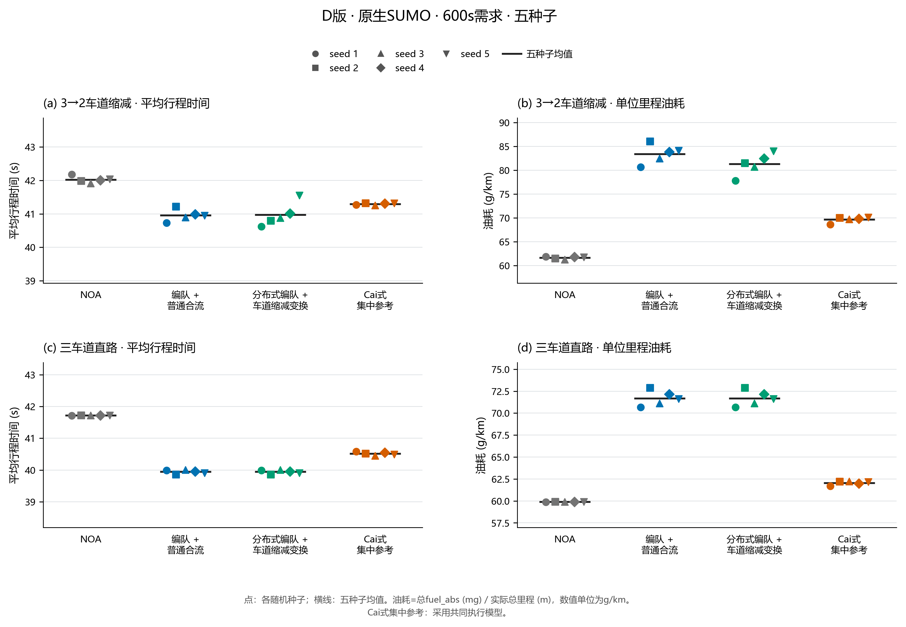
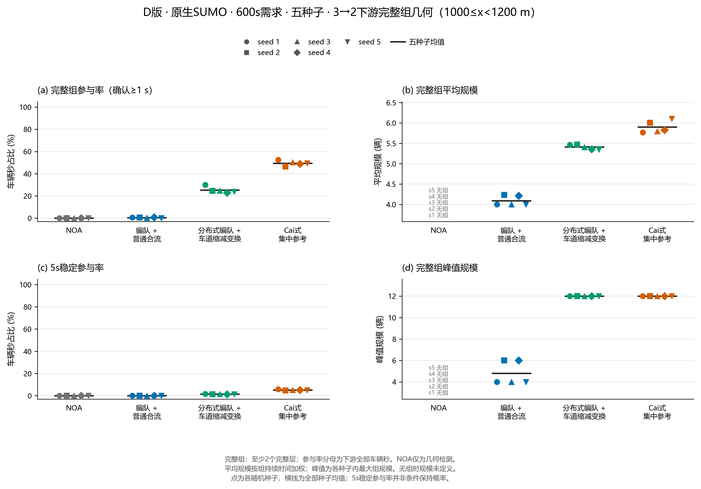
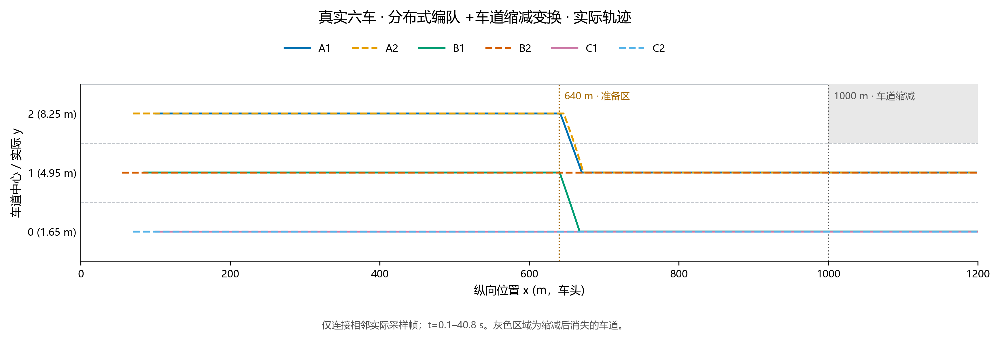
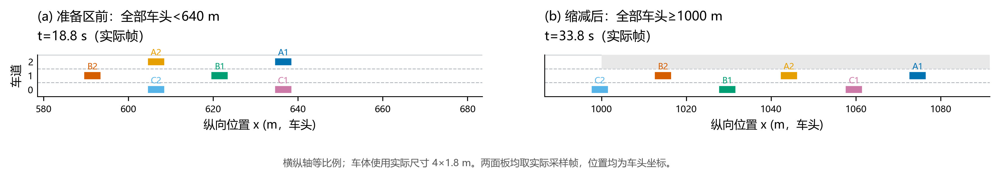

# 原生 SUMO 编队形成与 3→2 变换验证报告

日期：2026-10-29。正式数据版本：D40，方法代码提交`931a005`。本轮40个条件全部安全排空，60组同种子方法配对有效，240份运行源码快照与冻结协议一致。

在3→2场景，分布式变换平均行程为40.971秒，比NOA少1.052秒，即2.50%；五个种子都更快。它相对普通形成的平均行程却多0.01563秒，主动变换没有额外的平均行程收益。主要增量是下游参与率由0.44%提高到25.25%，上游已形成成员有243/279恢复为两道成员。燃油仍从NOA的61.636增至81.314克/公里，增加31.93%。通行、结构与能耗呈现不同取舍。

## 1. 实验设计与公平NOA

D40为两种道路×四种模式×五个种子。缩减道路0–1000米三道、1000–1200米两道，640米开始准备；直路全长1200米保持三道。每道独立伯努利请求，期望1250辆/小时，持续600秒，最多再排空300秒。同种子的请求时刻、起始车道和初速在各模式及两道路中相同。五条序列分别572、633、611、627、615辆，共3058辆，在八种条件中重复，共24464次车辆运行。

| 模式 | D批次控制内容 |
| --- | --- |
| NOA | 相同CAV的巡航、安全跟驰、受阻超车和必要合流；没有交错队形目标 |
| 普通形成 `formation` | 真实同道前车后30米、跨道头车相位及自由补位；准备区继续实际三道基本形成，以共同物理间隙合流，无主动让位、接收开隙或提前两道相位 |
| 分布式变换 `transform` | 在基本形成上增加中道让位、接收开隙和保留道提前两道相位；终止道等待车仍按真实同道关系跟驰 |
| Cai式集中参考 `global` | 读取全体当前实车，按组生成交错目标、每5秒联合分配，共享本轮反馈与SUMO物理安全执行 |

车辆均为IDM CAV：长4米、宽1.8米、静止净距1.5米、安全响应0.2秒；物理加速/常规制动/紧急制动上限5/10/30米/秒²，巡航28.8、最高33.3米/秒，速度因子1、无速度随机偏差。步长0.1秒，横移请求1秒。所有请求直接交SUMO原生插入，没有Python入口放行门；实际插入等待完整计入系统时间。

NOA保留普通超车和必要合流，使用相同车型及安全检查，不拿论文全HDV的0%CAV组作慢基线。非必要自由补位与NOA超车都向冲突的必要合流让行；8米检查比较车头位置差。局部观测覆盖前200、后100米全部车道，50米只用于形成组件，组件外可见车仍参与安全判断。邻车编号是各车私有track，控制器不读真实ID、全局槽位或邻车意图。两种局部形成模式在准备区均不再向终止道自由补位。

种子1–3已参与600秒校准，4–5为新增验证种子。正式表完整保留五种子。交通与结构表除明确写合计/最大值外，均为五个单例统计值的算术平均；配对先在同种子、同场景内相减。恢复表则合并逐车事件，单独说明分母。

## 2. D方法与执行边界

D撤去C的共同±2米/秒²执行限幅，恢复原物理5/10/30执行。位置接近和跟驰的`_request`为：

`desired = reference_speed + 0.3 × (target_x − ego.x)`

`request = clip(ego.speed + 0.2 × (desired − ego.speed), 0, 33.3)`

`SPEED_RELAXATION=0.2`。在0.1秒步长且未触及速度上下限或安全裁剪时，名义加速度为`a=0.6×位置误差+2×(参考速度−本车速度)`。速度差增益2/秒对应0.5秒名义响应，与车型0.2秒安全响应分开；当前实速直接提供阻尼，不增加历史跟驰状态，也没有硬加速度门。共同停止位置安全上限随后裁剪，SUMO负责实际运动。

同道只跟真实最近前车；跨道头车使用其他道实际最前头车的未取模相位误差均值，速度请求仍为28.8±2米/秒，不复制跨道车速。邻车相位随实测横向位置连续变化。NOA必要合流的接近也用同一`_request`；NOA持续横移返回巡航请求并服从共同安全。

三种局部模式的必要合流共用真实F/R物理间隙，双边取中点、单侧用开放端规则。边界失效、插入新车或本车越出边界区间时重选。两种形成模式横移前/中保持该间隙，居中后再按实际前车后30米入列；`joining`在位置误差及速度收敛后解除。没有恢复已被负30米依赖环证伪的持久跨道相位引用。

## 3. 完成、安全和独立审计

| 项目 | D40结果 |
| --- | ---: |
| 预定、实际完成条件 | 40/40 |
| 安全且全部请求完成的条件 | 40/40 |
| 请求、实际发车、离场 | 24464/24464/24464次车辆运行 |
| 最终待发车、在网余车 | 0、0 |
| 接触、瞬移、执行错误 | 0、0、0 |
| 有效同种子方法配对 | 60/60 |
| 冻结源码快照检查 | 240/240一致 |
| 审计问题 | 0 |
| 实际仿真结束时刻 | 637.9–649.2秒 |

独立分析核对请求、车型与执行参数、SUMO版本、源码字节及哈希、行程计数和轨迹覆盖。每0.1秒保存实测状态。全部40例进入比较，没有只平均成功种子。运行、源码及数据包复核见[source_audit.json](experiments/2026-10-29-native-pd-final/source_audit.json)和[data_package_verification.json](experiments/2026-10-29-native-pd-final/data_package_verification.json)。

瓶颈前完成率要求2→1横移在1000米前到达目标道中心且横向静止，不以车道号在横移中点翻转代替完成：

| 模式 | 曾观察到终止道的车辆 | 1000米前严格完成 | 五种子完成率均值 |
| --- | --- | --- | --- |
| NOA | 1022 | 985 | 96.39% |
| 普通形成 | 1393 | 1383 | 99.29% |
| 分布式变换 | 1403 | 1403 | 100.00% |
| Cai式集中参考 | 1560 | 1560 | 100.00% |

分母包括曾在上游换入终止道的车辆，因而各模式不同。NOA有37车未在严格位置门槛前完成居中，但最终均安全离场；路网完成和瓶颈前横移完成是两件事。

## 4. 通行、入口等待与燃油

### 4.1 车道缩减与逐种子配对

| 模式 | 行程时间(s) | 入口等待(s) | 系统时间(s) | 燃油(g/km) | 窗口出口流量(辆/h) |
| --- | --- | --- | --- | --- | --- |
| NOA | 42.024 | 0.0256 | 42.049 | 61.636 | 3418.8 |
| 普通形成 | 40.956 | 0.0485 | 41.004 | 83.430 | 3424.8 |
| 分布式变换 | 40.971 | 0.0485 | 41.020 | 81.314 | 3428.4 |
| Cai式集中参考 | 41.294 | 0.0267 | 41.321 | 69.656 | 3423.6 |

行程时间为实际进入到离场，系统时间为请求到离场。分布式变换比NOA多等0.0229秒入场，计入后系统时间仍少1.029秒。出口流量只数[0,600]秒离场车辆并换算每小时，包含启动和窗口末尚未驶出的车辆；它不是饱和容量。3428.4对3418.8辆/小时的差，相当于每例这个窗口平均多离场1.6辆。

下表行程单位为秒，右两列为同一种子的差值：

| 种子 | NOA | 普通形成 | 分布式变换 | 集中参考 | 变换−NOA | 变换−普通形成 |
| --- | --- | --- | --- | --- | --- | --- |
| 1 | 42.182 | 40.729 | 40.617 | 41.269 | -1.5647 | -0.1114 |
| 2 | 41.982 | 41.212 | 40.796 | 41.315 | -1.1852 | -0.4156 |
| 3 | 41.914 | 40.897 | 40.879 | 41.259 | -1.0344 | -0.0172 |
| 4 | 42.003 | 40.991 | 41.012 | 41.313 | -0.9906 | +0.0215 |
| 5 | 42.037 | 40.950 | 41.551 | 41.317 | -0.4865 | +0.6008 |

| 同种子配对 | 行程差(s) | 系统时间差(s) | 燃油差(g/km) | 下游参与率差(百分点) |
| --- | --- | --- | --- | --- |
| 分布式变换 − NOA | -1.0523 | -1.0293 | +19.678 | +25.25 |
| 分布式变换 − 普通形成 | +0.0156 | +0.0156 | -2.116 | +24.81 |
| Cai式集中参考 − 分布式变换 | +0.3232 | +0.3014 | -11.658 | +24.22 |

分布式变换对NOA五次均更快，改善范围0.487–1.565秒；对普通形成，种子1–3更快，种子4/5分别慢0.0215/0.6008秒，五种子均值慢0.01563秒。它也没有在每个种子都快于集中参考。主动变换提高结构恢复，不能据此写成所有交通指标普遍最优。

### 4.2 三道直路控制

| 模式 | 行程时间(s) | 入口等待(s) | 系统时间(s) | 燃油(g/km) | 窗口出口流量(辆/h) |
| --- | --- | --- | --- | --- | --- |
| NOA | 41.717 | 0.0256 | 41.742 | 59.894 | 3422.4 |
| 普通形成 | 39.944 | 0.0485 | 39.993 | 71.680 | 3430.8 |
| 分布式变换 | 39.944 | 0.0485 | 39.993 | 71.680 | 3430.8 |
| Cai式集中参考 | 40.518 | 0.0267 | 40.544 | 62.058 | 3429.6 |

[直路核对](experiments/2026-10-29-native-pd-final/straight_control.json)确认五个种子的普通形成与分布式变换逐车账本、解压后的逐帧物理轨迹完全相同，行程及燃油差均为零。两者相对直路NOA的行程少1.773秒、燃油增加19.68%，属于基本形成控制的影响。缩减道路与直路分别配对，不把跨场景均值差当成主动变换收益。

### 4.3 能耗代价

燃油统一采用HBEFA3/PC_G_EU4排放模型，使用最终tripinfo的`fuel_abs`覆盖逐步积分，包含离场步。总毫克除以实际路线米数，数值即克/公里，无额外密度换算；40例全部完成，统计不依赖较快完成子集。

D变换燃油比NOA多19.678克/公里，即31.93%；比普通形成少2.116克/公里，即2.54%。集中参考比D变换少11.658克/公里，但平均行程多0.323秒。NOA的固定巡航请求与形成车辆的位置修正、追赶速度不同，更快旅行和组织队形仍付出能耗代价。直路已有19.68%增耗，不能把全部成本归给瓶颈横移。

图1：每点为一个种子，横线为五种子均值；上排缩减道路、下排直路。[SVG](experiments/2026-10-29-native-pd-final/figures/performance_by_seed.svg)。

## 5. 规模、参与和稳定性

检测器只读实际位置与速度，不读控制器目标。完整层每道恰有一车，交错相位和同道30米层距误差≤2米、距道中心≤0.3米、组内速度极差≤0.5米/秒，纵向包络里没有额外车辆。主指标至少两连续层，关系保持1秒确认、5秒计稳定。平均规模按多层组时间加权，参与率以评价区全部车辆秒为分母；没有形成暴露的规模和RMS为未定义，表中记“—”。NOA匹配几何也只称检测结构。

| 区域、模式 | 平均规模(辆) | 五例最大规模(辆) | 参与率 | 5秒稳定参与率 |
| --- | --- | --- | --- | --- |
| 上游0–640米：NOA | — | — | 0.00% | 0.00% |
| 上游0–640米：普通形成 | 6.40 | 12 | 1.85% | 0.59% |
| 上游0–640米：分布式变换 | 6.37 | 12 | 1.76% | 0.53% |
| 上游0–640米：Cai式集中参考 | 6.73 | 15 | 3.88% | 1.21% |
| 下游1000–1200米：NOA | — | — | 0.00% | 0.00% |
| 下游1000–1200米：普通形成 | 4.09 | 6 | 0.44% | 0.008% |
| 下游1000–1200米：分布式变换 | 5.41 | 12 | 25.25% | 1.39% |
| 下游1000–1200米：Cai式集中参考 | 5.90 | 12 | 49.47% | 5.15% |

D变换下游五种子的参与率为22.99%–30.07%，每例峰值均为12辆。相对普通形成，下游参与率增加24.81个百分点，5秒稳定参与率由0.008%增至1.39%。

下游只有200米。两道三层六车纵向包络75米，以约29米/秒行驶时，六车全部同时在区内的时长约`(200−75)/29=4.3秒`；两层四车的45米包络也只有约5.3秒。5秒稳定窗口明显受空间观察窗影响，规模越大越受限。关系年龄及边界删失能区分成员离开窗口，却不能延长共同可见时长；C、D采用同一观察窗。因此需把5秒参与率与内部断裂及边界删失一起看，不能单由较低5秒参与率判定长时稳定失败。

| 下游模式 | 几何RMS(m) | 速度RMS(m/s) | 内部断裂/100形成车辆秒 | 边界删失关系(五例合计) |
| --- | --- | --- | --- | --- |
| NOA | — | — | — | 0 |
| 普通形成 | 0.304 | 0.081 | 24.76 | 26 |
| 分布式变换 | 0.223 | 0.053 | 14.44 | 434 |
| Cai式集中参考 | 0.139 | 0.035 | 3.52 | 1670 |

几何RMS包括相位及层距残差；速度RMS相对各组均速。内部断裂是曾参加确认结构的层内/相邻层关系在区域内部消失的次数，按形成车辆秒归一化；表中该率为五种子均值，边界删失为五例关系条数合计，不是未完成车辆。变换的内部断裂率低于普通形成，集中参考仍更低。

直路按全长0–1200米评价，空间分母与缩减道路分区不同：

| 直路全程模式 | 平均规模 | 五例最大规模 | 参与率 | 5秒稳定参与率 | 内部断裂/100形成车辆秒 |
| --- | --- | --- | --- | --- | --- |
| NOA | — | — | 0.00% | 0.00% | — |
| 普通形成 | 7.04 | 15 | 12.42% | 9.05% | 2.02 |
| 分布式变换 | 7.04 | 15 | 12.42% | 9.05% | 2.02 |
| Cai式集中参考 | 7.42 | 30 | 23.19% | 17.44% | 0.32 |

图2：1000–1200米下游各种子的确认参与、规模、5秒参与和峰值。[SVG](experiments/2026-10-29-native-pd-final/figures/downstream_geometry_by_seed.svg)。

## 6. 调整后的两道结构与恢复

每车第一次实测x≥640为调整起点，不插值推算跨越；在[640,1200)中寻找它第一次参加保持1秒的两道多层结构，允许瓶颈前已组织完成。以下合并五种子的逐车记录；延迟均值、中位数和P95只包含观察到事件者，没有事件的车在出口删失，延迟不记零。

| 模式 | 车辆 | 观察到事件 | 出口删失 | 观察比例 | 条件均值(s) | 条件中位数(s) | 条件P95(s) |
| --- | --- | --- | --- | --- | --- | --- | --- |
| NOA | 3058 | 0 | 3058 | 0.00% | — | — | — |
| 普通形成 | 3058 | 150 | 2908 | 4.91% | 13.18 | 11.90 | 18.00 |
| 分布式变换 | 3058 | 1410 | 1648 | 46.11% | 12.50 | 12.50 | 16.50 |
| Cai式集中参考 | 3058 | 2428 | 630 | 79.40% | 10.39 | 10.60 | 13.90 |

逐车事件比例46.11%表示离场前至少参加过一次，与下游车辆秒参与率25.25%不同。其中D变换有1167/2779名上游未形成成员出现新的两道形成事件。真正的变换恢复另限定为准备区前已参加过确认三道结构的成员：

| 模式 | 本方案调整前已形成成员 | 观察到事件 | 出口删失 | 观察比例 | 条件均值(s) | 条件中位数(s) | 条件P95(s) |
| --- | --- | --- | --- | --- | --- | --- | --- |
| NOA | 0 | 0 | 0 | — | — | — | — |
| 普通形成 | 288 | 29 | 259 | 10.07% | 11.44 | 11.50 | 12.56 |
| 分布式变换 | 279 | 243 | 36 | 87.10% | 12.49 | 12.50 | 13.50 |
| Cai式集中参考 | 588 | 567 | 21 | 96.43% | 10.44 | 10.60 | 13.10 |

D变换243/279恢复、36车出口删失，条件均值12.486秒；普通形成29/288恢复。成员集合由各自实际轨迹识别，两个上游集合不完全相同，不能把恢复人数当作逐车配对。条件延迟要和事件覆盖一起解释，普通形成仅少数恢复者的较短延迟不代表它更快恢复全体。

D变换全部1648个恢复删失都发生在道路出口：车辆交通行程已经完成，只是离场前未进入确认两道多层结构，不是路网残车。零事件的NOA延迟保持未定义。[汇总统计](experiments/2026-10-29-native-pd-final/recovery/summary_compact.json)及[逐车事件压缩表](experiments/2026-10-29-native-pd-final/recovery/per_vehicle.csv.gz)保留了事件与删失。

## 7. 六车过程与安装核验

[D六车独立核验](experiments/2026-10-29-native-pd-final/functional_six_verified.json)从两层三道交错结构经SUMO原生插入，6/6安全离场，接触0、瞬移0，平均行程39.367秒、燃油68.797克/公里。严格横移完成为A1在20.0秒、673.121米由2→1；B1在20.5秒、669.880米由1→0；A2在21.2秒、674.802米由2→1。两辆终止道车均在瓶颈前完成。

下游峰值6辆，即三层两道，平均规模5.43辆，参与率59.81%、5秒参与3.83%。六名上游已形成成员均恢复为两道成员，删失0，平均延迟12.333秒、中位数12.25秒、P95为13.0秒。安装到主目录后再次运行，账本与解压轨迹与冻结包一致，记录见[integration_evidence.json](experiments/2026-10-29-native-pd-final/integration_evidence.json)。

图3：真实轨迹显示两次必要合流与一次让位。[SVG](experiments/2026-10-29-native-pd-final/figures/six_vehicle_trajectories.svg)。

图4：准备区前与全部车头进入下游后的实际帧。[SVG](experiments/2026-10-29-native-pd-final/figures/six_vehicle_snapshots.svg)。

## 8. 方法更新对照与Cai来源

| 批次 | 位置/速度请求 | 必要合流空隙 | 额外执行限幅 | 结果用途 |
| --- | --- | --- | --- | --- |
| A40 | 参考速度加0.3位置误差，直接请求 | 普通分支要求内部候选≥30米，变换分支跟当前间隙 | 无；物理5/10/30 | 无显式速度差阻尼的历史方法对照 |
| C40 | 同A的直接位置反馈 | 局部模式统一当前F/R | 共同常规±2米/秒² | 安全排空但性能候选被否决 |
| D40 | 位置反馈加当前实速的0.2松弛，即位置/速度差反馈 | 局部模式统一当前F/R | 无；物理5/10/30 | 本报告正式主数据 |

A和D的原生SUMO运行器SHA相同，都是`27e2de0941e019d4fb548c6e2b5f2427a0b4e1ee415d16ccd832d53902438e31`，物理车型、完整层与恢复统计定义相同；控制规则分别冻结。A变换燃油88.510、D为81.314克/公里，下降8.13%；下游参与由22.52%到25.25%，行程从40.839到40.971秒。这里同时改变了速度差反馈和普通间隙分支，是两套实现的对照，不把全部差异归给单一参数。A相对其NOA仍增耗42.95%，原数据见[A40方法对照](experiments/2026-10-29-native-lane-drop/A40方法对照.md)。

旧间隙反例是E718米、F730/R706米、三车同速28.8米/秒：24米车头间隙前后各12米，本可通过8米检查，旧普通分支却跳到745米并请求33.3米/秒。统一当前间隙后，C仍在600秒种子2出现普通形成79.127秒、变换50.110秒，对NOA42.195秒。C40完整40例也安全排空，但未满足性能目标；[C完整分析](experiments/2026-10-29-native-current-gap/analysis_summary.json)、[逐例及配对](experiments/2026-10-29-native-current-gap/comparison_verified/summary.json)和[C协议](experiments/2026-10-29-native-current-gap/protocol.json)保留失败证据。[37条校准](experiments/2026-10-29-native-pd-final/calibration.csv)保留34条排空、3条未排空及各自源码摘要。

Cai等的《Multi-lane Formation Control in Mixed Traffic Environment》（IEEE IV 2024，[DOI 10.1109/IV55156.2024.10588701](https://doi.org/10.1109/IV55156.2024.10588701)）Fig.5(a)是时空速度热图，1250辆/(车道·小时)、100%CAV在1000米、200/400/550秒附近的图上局部速度约29±2米/秒，±2为读图误差。论文没有公布本次四模式表所需的平均行程和燃油标量；0%CAV图为全HDV。原图与参数定位见[Cai2024全局方案对照依据](Cai2024全局方案对照依据.md)。

本机集中参考保留全体当前状态、交错目标、联合最小成本分配，使用适配SUMO反馈；没有运行论文A*/CBS/Bezier或MATLAB GPOPS/SNOPT。表中的41.294秒、69.656克/公里、49.47%下游参与率属于这个工程参考。它比D变换结构覆盖更高、燃油更低，但平均旅行较慢；这与原论文性能排名是不同证据。

## 9. 工程验收与数据来源

D完成40例正式矩阵及独立复算，主目录六份运行源码与冻结包一致。受影响回归为156项核心、9项根入口、83项legacy GUI，共248项通过；另一次60项质量复审与核心重叠，不额外加总。[legacy GUI操作记录](experiments/2026-10-29-native-pd-final/verification/legacy_gui.json)可查。方法代码已纳入`931a005`，安装核验与本轮数据摘要单独保存。

[最终根控证据检查](experiments/2026-10-29-native-pd-final/verification/release_evidence.json)退出0，核对了40例/24464车次、60组配对、主目录及Git HEAD六份源码与D协议、248项回归日志、300DPI PNG/SVG图形，以及压缩恢复明细、精简统计和安装六车等价。

| 证据 | 文件 |
| --- | --- |
| 冻结协议、40例清单 | [protocol.json](experiments/2026-10-29-native-pd-final/protocol.json)、[manifest.json](experiments/2026-10-29-native-pd-final/manifest.json) |
| 运行状态、源码与数据包复核 | [run_status.json](experiments/2026-10-29-native-pd-final/run_status.json)、[source_audit.json](experiments/2026-10-29-native-pd-final/source_audit.json)、[data_package_verification.json](experiments/2026-10-29-native-pd-final/data_package_verification.json) |
| 逐例、同种子配对、均值 | [comparison_verified/summary.json](experiments/2026-10-29-native-pd-final/comparison_verified/summary.json) |
| 可读统计表 | [mode_summary.csv](experiments/2026-10-29-native-pd-final/mode_summary.csv)、[tt_seed_differences.csv](experiments/2026-10-29-native-pd-final/tt_seed_differences.csv)、[recovery_counts.csv](experiments/2026-10-29-native-pd-final/recovery_counts.csv) |
| 分析总览、直路对照 | [analysis_summary.json](experiments/2026-10-29-native-pd-final/analysis_summary.json)、[straight_control.json](experiments/2026-10-29-native-pd-final/straight_control.json) |
| 恢复统计和逐车明细 | [summary_compact.json](experiments/2026-10-29-native-pd-final/recovery/summary_compact.json)、[per_vehicle.csv.gz](experiments/2026-10-29-native-pd-final/recovery/per_vehicle.csv.gz) |
| 图形来源 | [figure_manifest.json](experiments/2026-10-29-native-pd-final/figures/figure_manifest.json) |
| 原始物理证据 | `variants/phase5g_pure_formation/results/native_pd_final_validation_20261029T0624`，逐例含输入、源快照、SUMO日志、轨迹、事件、tripinfo与行程 |

正式清单SHA256为`f9a54a5208149f57f6d9efe2b3cd8690f1d00b552e60fdfd28984b992ae9b4f5`，控制规则为`e170488265fcaa1814af28c80ca775f8193fdcc510cad721c680f35539d61ba5`，独立比较摘要为`411c7b17a99a5507be797c7c53f522f15b05f782b034ef207e983a8bac96316f`。恢复精简版与完整统计逐字段一致，压缩逐车表无损保存明细。

本轮已完成可复查的真实局部变换系统和共同条件比较：对NOA五种子通行更快、必要合流全部在瓶颈前完成，主动变换增加下游重组和恢复；对基本形成没有额外平均行程收益，燃油也仍高于NOA。后续改进应继续降低组织成本，并保留这些安全、结构与逐种子配对结果。
