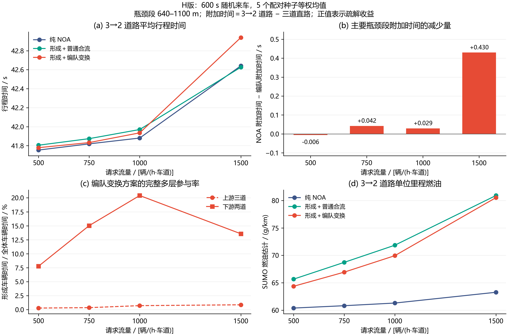
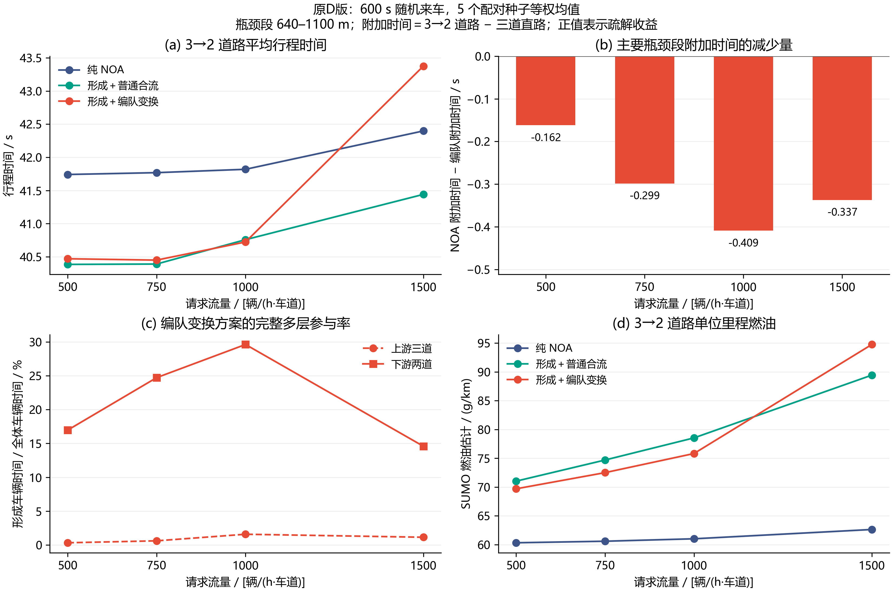

# 四流量交通效率与编队变换归因

本轮针对每车道每小时 500、750、1000、1500 辆的持续随机车流，比较纯 NOA、基本形成加普通合流、形成加编队变换。D 和更新后的 H 已分别完成 100 例正式实验。H 在中、高流量的主要瓶颈段有局部改善，但四个流量的全程平均时间均未低于 NOA，连续流上游完整成组率也低。当前仍没有通过“由有效编队带来整体交通提效”的验收，此前的成功解释撤回。

本报告按源码版本区分诊断和更新验证。两批正式均值分别计算；仅协作合流消融与准备区相位一致性更新另行验证。Cai 的 MATLAB 控制调用链已核查，原集中式算法尚无本工况重跑数据，因此本轮不列集中式效率数值。

## 实验条件

道路长 1200 米，上游三车道，1000 米处减为两车道；另设全程三车道直路。每个流量使用种子 1–5，同种子的各方案读取完全相同的随机发车请求。请求持续 600 秒，随后最多排空 300 秒。每车道每 0.1 秒以 `flow×0.1/3600` 的概率提出一次请求，沿用 MATLAB 的逐道伯努利来车方式。

NOA 和编队使用同一车型：巡航 28.8 m/s、物理最高速度 33.3 m/s、加速能力 5 m/s²、制动能力 10 m/s²、响应参数 0.2 s。车辆的插入、运动和横移由 SUMO 执行。Python 没有入口限流、等待编队后再发车的门槛或人为停车指令。

在 H 版 1500 流量下，缩减道路的平均实际插入等待为 NOA 0.032 秒、编队变换 0.083 秒。表中的行程时间从实际发车算起，入口等待另列。

每个流量包含直路 NOA、直路编队变换，以及缩减道路 NOA、基本形成、编队变换，共 25 例；四个流量共 100 例。D 版全部安全排空，45,790 次请求全部完成，碰撞和 teleport 均为零。统计先在每个种子内求均值，再对五个种子等权平均。

## H 版正式结果

H 使用 50 米内实际前车链、相邻道真实局部队首互选和按制动距离差计算的插入距离。共同执行器另修复本车换道请求反馈。该版本 100 例也全部安全完成，共 45,790 次车辆请求，碰撞和 teleport 均为零。

| 每道流量 / (辆/h) | NOA 行程 / s | 基本形成 / s | 编队变换 / s | 变换相对 NOA / s | 主要瓶颈附加时间减少 / s | 全程附加时间减少 / s |
| ---: | ---: | ---: | ---: | ---: | ---: | ---: |
| 500 | 41.754 | 41.805 | 41.779 | +0.025 | −0.006 | −0.005 |
| 750 | 41.819 | 41.874 | 41.832 | +0.013 | +0.042 | +0.044 |
| 1000 | 41.880 | 41.970 | 41.935 | +0.055 | +0.029 | +0.022 |
| 1500 | 42.641 | 42.626 | 42.939 | +0.298 | +0.430 | −0.187 |

H 的直路编队均值为 41.726、41.766、41.790、41.832 秒，接近 NOA 的约 41.71 秒，已经消除旧版整串追赶带来的明显全程优势。750 和 1000 的瓶颈收益很小；1500 的主要段确实改善，但 100–600 米上游的附加时间增加约 0.446 秒，收益被准备区之前传播的调整代价抵消。1500 种子 4 的变换行程为 44.250 秒，NOA 为 42.983 秒，该不利结果完整保留。

| 每道流量 | H 上游完整参与 / % | H 下游完整参与 / % | 下游平均组规模 / 辆 | 下游各种子峰值 / 辆 | 下游稳定参与 / % | NOA 燃油 / g/km | H 燃油 / g/km |
| ---: | ---: | ---: | ---: | :--- | ---: | ---: | ---: |
| 500 | 0.289 | 7.771 | 4.24 | 6 / 6 / 6 / 4 / 4 | 0.441 | 60.40 | 64.37 |
| 750 | 0.364 | 15.023 | 4.31 | 6 / 8 / 6 / 6 / 8 | 0.990 | 60.83 | 66.94 |
| 1000 | 0.722 | 20.414 | 4.61 | 10 / 10 / 8 / 8 / 12 | 1.307 | 61.32 | 69.94 |
| 1500 | 0.873 | 13.572 | 4.84 | 12 / 10 / 10 / 12 / 10 | 0.775 | 63.28 | 80.51 |

H 的六车功能检验可以形成并变换完整六车，但这一能力没有充分转化为连续来车的上游多层成组。上游曾成组车辆的恢复分别为 4/6、24/24、29/63、65/129，其余 2、0、34、64 辆为观察删失。不能把下游所有新结构都记作原编队恢复。

NOA 区域低速车辆时间依次为 1.20、2.58、5.30、201.86 辆·秒，H 均为零；1500 的断面流量却从 NOA 4443.84 变为 H 4432.32 辆/h。因此，本轮证据支持“消除了部分局部低速等待”，尚不支持整体提效或通行能力提升。

## 协作合流与编队的区分

C0 保留相同的让位、接收开隙、物理空隙保持和必要合流，关闭形成跟驰与自由补位，并允许 NOA 的普通超车。该独立方案完成四流量、五种子的 20 次缩减道路实验，9,158 个请求全部安全完成。其直路完整委派相同 NOA 决策；两个流量的实际短直路请求、账本和解压轨迹逐字节一致。

| 每道流量 | C0 行程时间 / s | H 行程时间 / s | C0−H 行程 / s | C0−H 主要段 / s | C0 低速车辆时间 / 辆·s | H / 辆·s |
| ---: | ---: | ---: | ---: | ---: | ---: | ---: |
| 500 | 41.771 | 41.779 | −0.007 | +0.006 | 4.64 | 0 |
| 750 | 41.778 | 41.832 | −0.055 | −0.020 | 3.72 | 0 |
| 1000 | 42.008 | 41.935 | +0.073 | +0.140 | 45.96 | 0 |
| 1500 | 44.287 | 42.939 | +1.347 | +2.049 | 724.52 | 0 |

低流量下，普通协作即可取得近似甚至更低的时间；高流量下，H 相对 C0 的组织规则确实减少了延误和低速积聚。C0 还发生了 834 次普通超车决策，因此这一比较同时包含超车策略差别，不能单独归因为已形成的多道完整编队。正在补充 C1：保持 H 的超车政策，只关闭形成跟驰和补位，以分离这两项作用。

H 相对完整 NOA 仍没有全程优势，且上游多层参与不足 1%。本轮继续检验准备区两侧如何使用同一相位构型，保留所有试验版本，不把局部段改善写成整体成功。

## 旧 D 版：交通效率与瓶颈损失

| 每道流量 / (辆/h) | NOA 行程时间 / s | 基本形成 / s | 编队变换 / s | 编队变换相对 NOA / s | 主要瓶颈附加时间减少 / s |
| ---: | ---: | ---: | ---: | ---: | ---: |
| 500 | 41.741 | 40.386 | 40.471 | −1.270 | −0.162 |
| 750 | 41.769 | 40.392 | 40.451 | −1.318 | −0.299 |
| 1000 | 41.820 | 40.759 | 40.724 | −1.096 | −0.409 |
| 1500 | 42.398 | 41.442 | 43.375 | +0.977 | −0.337 |

主要瓶颈段从 640 米的变换准备起点算到 1100 米，把提前调距和并入后的恢复都算进去。对每个方案，先计算“缩减道路段时间减直路同段时间”，得到车道减少带来的附加时间；再用 NOA 的附加时间减编队的附加时间。正值才表示编队减少了瓶颈损失。

这四个均值均为负，20 个配对种子中有 19 个为负。原方法在准备区付出的代价，超过了后半段的局部改善。只看瓶颈附近的一小段，或只比较全程时间，会漏掉这部分代价。

编队允许追赶目标，直路平均行程时间为 40.267、40.058、40.132、39.825 秒；NOA 直路约为 41.71 秒。这表明全程更快与自由流追赶有关，不能直接归因为瓶颈疏解。新方法必须同时通过直路控制和实际成组检查。

## 拥挤程度与燃油

以下低速车辆时间统计 100–600 秒内、800–1000 米区域中速度低于 5 m/s 的车辆时间总和。断面流量是同一时窗通过 1000 米的车辆数折算值。

| 每道流量 | NOA 低速车辆时间 / 辆·s | 编队变换 / 辆·s | NOA 断面流量 / 辆/h | 编队变换 / 辆/h | NOA 燃油 / g/km | 编队变换 / g/km |
| ---: | ---: | ---: | ---: | ---: | ---: | ---: |
| 500 | 0.54 | 0 | 1499.04 | 1499.04 | 60.32 | 69.69 |
| 750 | 1.38 | 0 | 2229.12 | 2230.56 | 60.59 | 72.50 |
| 1000 | 3.20 | 0 | 2967.84 | 2964.96 | 61.01 | 75.82 |
| 1500 | 120.32 | 0 | 4443.84 | 4425.12 | 62.63 | 94.77 |

500–1000 流量下，NOA 本身几乎没有低速积聚。1500 下编队消除了本区域内的低速等待，但断面通过量没有增加，全程和主要瓶颈附加时间也未改善。减少局部停车与提高整体效率是两项不同的实测结果。燃油由 SUMO 的统一 HBEFA3 车型计算；D 版反复追赶和调整伴随更高燃油。

## 编队规模、参与和稳定性

完整多层编队至少包含两层，每层的所有实际车道都有车：上游至少 6 辆，下游至少 4 辆。检测使用实测位置和速度，确认时间为 1 秒。参与率是成组车辆时间占全部车辆时间的比例；5 秒稳定参与率统计其中持续保持的部分。5 秒是评价观察长度，没有重新设置形成期限或运行结束条件。

| 每道流量 | 变换方案上游参与 / % | 下游参与 / % | 下游条件平均规模 / 辆 | 五种子各自下游峰值 / 辆 | 下游稳定参与 / % |
| ---: | ---: | ---: | ---: | :--- | ---: |
| 500 | 0.323 | 16.965 | 4.32 | 8 / 6 / 6 / 6 / 8 | 1.033 |
| 750 | 0.611 | 24.711 | 4.83 | 10 / 10 / 10 / 8 / 8 | 1.386 |
| 1000 | 1.581 | 29.611 | 5.22 | 10 / 12 / 12 / 12 / 12 | 1.622 |
| 1500 | 1.139 | 14.580 | 5.62 | 12 / 12 / 12 / 12 / 12 | 0.752 |

条件平均规模只平均实际存在的组，须与参与率一起阅读。上游参与率很低，说明大多数来车在进入准备区前没有形成完整三道多层结构。因而，不能把下游新出现的整齐车辆全部称为原编队的变换恢复。

真正曾在上游成组的车辆中，500、750、1000、1500 流量分别有 6、42、210、240 辆；下游观察到恢复的分别为 6、42、202、161 辆，另有 0、0、8、79 辆离开观察范围前尚未确认恢复。纯 NOA 的几何检测不作为自主编队效果，也不参与编队恢复评价。

## MATLAB 借鉴与方法更新

完整静态核查见 [MATLAB 车辆控制调用链](2026-10-29-MATLAB车辆控制调用链核查.md)。实际主链是 `mainmain → formationControl → formationControlNormal → singleVehicleCalculate`：以全组状态联合分配交错目标，每 5 秒重算，允许最高 33.33 m/s 的阶段追赶，执行第一阶段速度和换道。局部分布式方法可以借鉴提前重排、实际间隙并入和末端队形恢复的思路；全组分配不能直接移作单车局部规则。

本轮已经完成的工程修复是本车换道请求反馈：SUMO 接受横移后，物理横向运动可能晚一个采样步出现。旧代码会在这一步把目标改到另一条车道，随后留下无法执行的跨两道请求。现在，本车保留自己已提交的动作直到物理完成或未启动请求失效；邻车不携带这一内部信息。真实失败帧已加入回归测试。

方法更新逐项在独立源码包中验证。所有候选保留失败结果，主目录不累加被否决的分支。验证重点是：真实同道跟驰、跨道层位匹配、局部车群的边界、接收车辆的安全插入距离，以及连续随机来车下的实际多层参与。六车测试另设打乱初态，分别检验自组织形成与已有编队的变换。

## 数据与复核入口

- [便携数据包说明](experiments/2026-10-29-four-flow-attribution/portable_D_baseline/PACKAGE.txt)：约 19.2 MB，保留 100 例原始请求/结果/逐车行程 JSON 的无损压缩副本、过门记录、区域时间序列、恢复记录与冻结源码。
- [H 版便携数据](experiments/2026-10-29-four-flow-attribution/portable_H/PACKAGE.txt)：约 19.3 MB，独立保存 H 的 100 例、完整表值、五种子及不利结果，复核方式相同。
- [C0 协作消融证据](experiments/2026-10-29-four-flow-attribution/portable_C0/PACKAGE.txt)：约 4.26 MB，保存 20 例、真实短直路等价核验、参数原值与配对审计。
- [交通和瓶颈归因表](experiments/2026-10-29-four-flow-attribution/portable_D_baseline/tables/traffic_and_attribution.csv)、[编队质量表](experiments/2026-10-29-four-flow-attribution/portable_D_baseline/tables/formation_quality.csv)、[恢复计数](experiments/2026-10-29-four-flow-attribution/portable_D_baseline/tables/recovery_counts.csv)。
- `python -B verify_portable.py` 核查包内哈希和独立表值；`python -B recompute_tables.py` 从压缩记录重建表格。重新检测每帧编队仍使用本机保留的原始轨迹，路径和哈希在包内逐例索引中。
- [阶段检查点](phase5_checkpoint.md) 末尾记录当前实际代码、运行状态和下一步；[实施计划](superpowers/plans/2026-10-29-flow-bottleneck-attribution.md) 列出本轮验收项。
