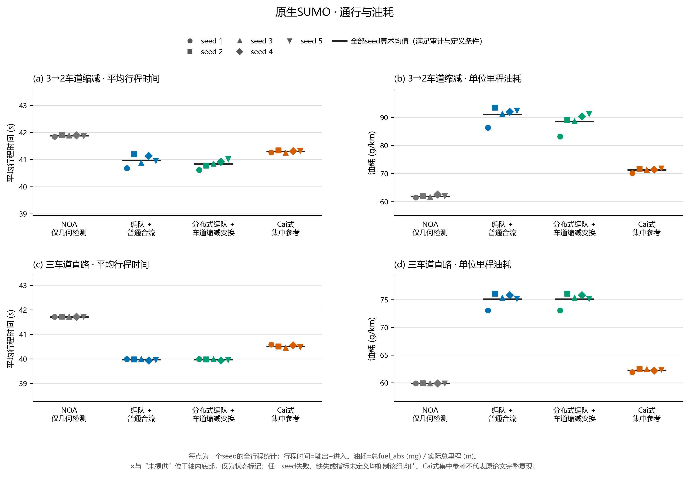
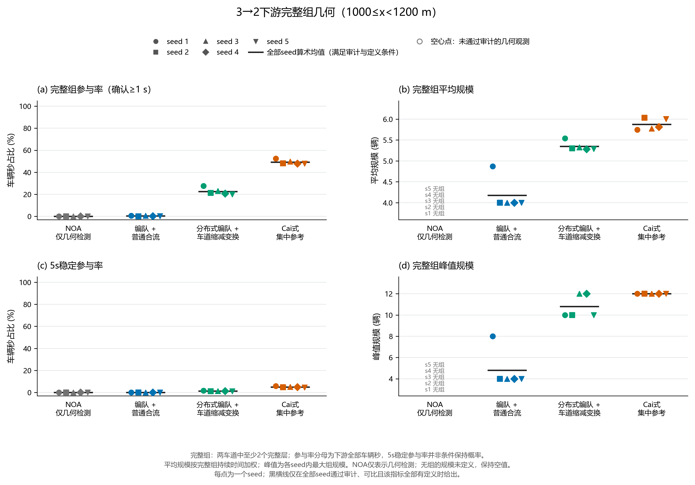
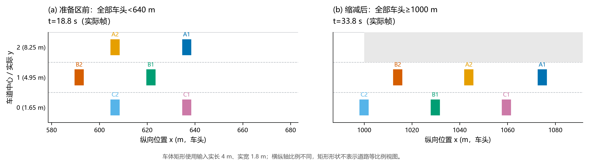

# 原生 SUMO 编队形成与 3→2 变换验证报告（A40方法对照）

日期：2026-10-29。数据版本：A40历史方法对照，位置反馈增益 κ=0.3 /秒。本稿保存已经完成、独立复算的 A 批次。后续 C 批次更新了常规速度平滑和物理空隙选择，本稿数字全部对应 A 的冻结源码。

A40 的 40 个条件全部安全排空，60 组同种子方法配对全部通过审计。在 3→2 场景中，分布式变换的平均行程时间为 40.839 秒，比普通 NOA 少 1.039 秒，即 2.48%；下游确认多层结构的参与率为 22.52%，高于普通形成加合流的 0.34%。同时，单位里程燃油从 NOA 的 61.917 增至 88.510 克/公里，增加 42.95%。A 的主要成果是实现了真实局部变换和较强的下游结构恢复，能耗表现仍需改进。

## 1. 实验设计与四种模式

实验为两种道路、四种方法、五个随机种子的完整组合，共 40 例。车道缩减道路在 0–1000 米有三条车道，在 1000–1200 米保留两条车道，640 米起准备变换；直路控制在全长 1200 米保持三道。每道按独立伯努利过程请求发车，期望流量 1250 辆/小时，持续 600 秒，之后最多留 300 秒排空。

| 模式 | 本次控制内容 |
| --- | --- |
| NOA | 相同 CAV 车型的巡航、安全跟驰、受阻超车和必要合流；没有交错队形目标 |
| 普通形成 `formation` | 真实同道前车后 30 米跟驰、各道头车位置相位对齐和自由补位；准备区继续基本形成，采用普通空隙搜索合流，基本相位随实际道路由三道变两道 |
| 分布式变换 `transform` | 在基本形成上增加中道让位、接收车开隙、保留道提前采用两道相位，以及局部真实空隙保持和入列 |
| Cai式集中参考 `global` | 读取全体当前实车状态，每 5 秒分组生成交错目标并联合最小成本分配，使用共同 SUMO 运动和安全执行 |

两种局部形成模式在准备区都不再向终止道自由补位；普通形成仍保留基本形成跟驰，消融掉的是主动变换机制。直路不触发准备区，两种局部形成模式应有完全相同的物理输出。

共同车型为 IDM CAV：车长 4 米、车宽 1.8 米、静止净距 1.5 米、响应时间 0.2 秒，加速/常规制动/紧急制动上限为 5/10/30 米/秒²，巡航 28.8、最高 33.3 米/秒，速度因子固定为 1。仿真步长 0.1 秒，横移请求时长 1 秒；四种模式统一使用停止位置速度上限、相邻换道检查及 8 米车头位置差走廊约束。环境为 SUMO 1.27.1、Python 3.12.9、SciPy 1.18.1。

同一种子的请求时刻、起始车道和初速在四种模式及两种道路中保持一致。车辆全部交由 SUMO 原生插入，没有 Python 入口放行门；插入受阻就形成实际发车等待。NOA 保留正常超车和必要合流，也遵守与自由补位相同的必要合流优先规则。它与编队方案使用同一种 CAV，不采用论文 0%CAV 的 HDV 条件来制造慢基线。

局部控制只读前 200、后 100 米全部车道观测和本车记忆。50 米用于划分形成连通组件，组件外可见车辆仍参与安全判断；跟踪号由各自私有视角维护。集中参考的全体状态和联合分配能力单独保留，属于有更多信息的工程参照。

种子 1–3 先用于 300 秒增益筛选，种子 4–5 是新增验证种子。正式表完整保留五种子，因此其中三个种子已参与参数选择。

## 2. 完成、安全与独立复算

五条请求序列分别有 572、633、611、627、615 辆，共 3058 辆。每条序列在八个“道路×模式”条件中重复，A40 共记录 24464 次车辆运行。所有请求均实际发车并离场，没有最终待发车或在网余车。

| 核对项目 | A40 结果 |
| --- | ---: |
| 预定/完成条件 | 40/40 |
| 安全且排空、可进入性能比较的条件 | 40/40 |
| 接触事件、瞬移事件 | 0、0 |
| 同种子、同场景方法配对 | 60/60 有效 |
| 输入、结果、行程和源码审计问题 | 0 |
| 实际仿真结束时刻 | 637.6–643.8 秒 |
| 最大相邻轨迹采样间隔 | 0.1 秒（浮点误差内） |

独立比较程序从保存的行程和物理轨迹重算指标，核对请求、共同车型与执行参数、SUMO 版本、源码快照字节及哈希，也检查轨迹是否覆盖本次运行。40 例使用同一冻结控制源码版本，没有把成功种子挑出来另算均值。下表的交通均值均为五个种子各自统计值的算术平均；配对差值先在同一种子内相减，再对五种子取平均。

严格的“瓶颈前合流完成”还要求车辆到达目标道中心且横向速度归零，不能只看 SUMO 在横移中点翻转的车道号。

| 模式 | 曾观察到终止道的车辆 | 1000米前完成严格横移 | 五种子完成率均值 |
| --- | ---: | ---: | ---: |
| NOA | 1022 | 1012 | 99.02% |
| 普通形成 | 1393 | 1381 | 99.15% |
| 分布式变换 | 1393 | 1392 | 99.93% |
| 集中参考 | 1559 | 1559 | 100.00% |

分母包括上游曾换入终止道的车，随控制模式变化。分布式变换有一车未在严格的 1000 米位置门槛前完成横移，但该车最终安全通过并离场；交通排空率与瓶颈前横移完成率是两个指标。

## 3. 通行、入口等待与燃油

### 3.1 车道缩减场景

| 模式 | 行程时间(s) | 入口等待(s) | 系统时间(s) | 燃油(g/km) | 600秒窗口出口流量(辆/h) |
| --- | ---: | ---: | ---: | ---: | ---: |
| NOA | 41.879 | 0.0256 | 41.904 | 61.917 | 3421.2 |
| 普通形成 | 40.971 | 0.0539 | 41.025 | 91.094 | 3429.6 |
| 分布式变换 | 40.839 | 0.0539 | 40.893 | 88.510 | 3427.2 |
| 集中参考 | 41.299 | 0.0267 | 41.325 | 71.275 | 3423.6 |

行程时间从实际入场算到离场；系统时间从请求时刻算到离场，包含入口等待。分布式变换比 NOA 多等 0.0283 秒入场，计入后仍少用 1.011 秒系统时间。NOA 的行程时间已接近 `1200/28.8≈41.67` 秒的巡航旅行时间，本组流量下没有出现长期排队。

出口流量只统计 `[0,600]` 秒离场车辆，再换算每小时。该窗口包含启动阶段，末段请求的车辆在 600 秒后排空；3427.2 辆/小时不是道路饱和容量。分布式变换相对 NOA 增加的 6 辆/小时，等于每例在这个有限窗口平均多离场 1 辆。

| 同种子配对：候选减基线 | 行程时间差(s) | 燃油差(g/km) | 下游参与率差(百分点) |
| --- | ---: | ---: | ---: |
| 分布式变换 − NOA | −1.039 | +26.593 | +22.52 |
| 分布式变换 − 普通形成 | −0.132 | −2.583 | +22.19 |
| 集中参考 − 分布式变换 | +0.459 | −17.235 | +26.76 |

分布式变换相对 NOA 的五个种子都缩短了行程，差值为 −1.224 至 −0.845 秒，且五个种子都增加燃油。相对普通形成，四个种子行程更短，种子 5 增加 0.070 秒；五种子平均只少 0.132 秒。主动变换带来的主要增量体现在结构恢复，不能把相对 NOA 的全部 1.039 秒都归给车道缩减机制。

### 3.2 三车道直路控制

| 模式 | 行程时间(s) | 入口等待(s) | 燃油(g/km) | 600秒窗口出口流量(辆/h) |
| --- | ---: | ---: | ---: | ---: |
| NOA | 41.717 | 0.0256 | 59.894 | 3422.4 |
| 普通形成 | 39.971 | 0.0539 | 75.113 | 3432.0 |
| 分布式变换 | 39.971 | 0.0539 | 75.113 | 3432.0 |
| 集中参考 | 40.514 | 0.0267 | 62.270 | 3429.6 |

普通形成和分布式变换在直路的全部五种子输出一致，二者交通、能耗和结构指标的配对差值均为零。直路中两种局部形成相对 NOA 已少用 1.746 秒、燃油增加 25.41%。这部分来自基本形成控制，与必要合流无关；车道缩减场景与直路控制分别配对，未把跨场景的均值差当成方法收益。

### 3.3 42.95%的燃油增加意味着什么

A 的单位里程燃油由 SUMO 排放设备 `fuel_abs` 与实际路线里程得到：总燃油毫克除以总里程米，数值单位为克/公里，未额外做燃油密度换算。最终 tripinfo 积分包含车辆离场步，所有车辆都完成，结果不是较快完成子集的油耗。

在相同排放模型下，分布式变换从 61.917 增至 88.510 克/公里，增加 26.593 克/公里，即 42.95%；普通形成增加 47.12%，集中参考增加 15.11%。这些结果表明 A 没有实现节油。虽然分布式变换比普通形成少用 2.583 克/公里，仍远高于 NOA。

A 的位置反馈直接把误差转成速度请求，头车允许围绕巡航上下修正 2 米/秒，跟随车可请求至 33.3 米/秒；常规加减速只受共同车型的 5/10 米/秒²边界限制，没有额外的平滑或能耗目标。因此更快旅行和反复位置修正伴随更高燃油，是本次数据所显示的代价。直路已出现 25.41%增耗，也说明不能把全部增耗归给合流。后续复审还发现普通合流搜索可能错过当前可用的物理间隙，具体反例见第8节。平滑控制与空隙修正需要同时检验交通、结构和能耗，不能只凭单个变换案例燃油下降就替换 A40 的完整比较。

图1：每个点为一种子，横线为五种子均值；上排为车道缩减，下排为直路。[SVG原图](figures/performance_by_seed.svg)。

## 4. 队形规模、参与和稳定性

结构检测只读真实 `x、y、速度`，不读取控制器目标或分组标签。完整层要求每道恰有一车，交错相位和同道 30 米层距误差不超过 2 米，距道中心不超过 0.3 米，组内速度极差不超过 0.5 米/秒；纵向包络里不能夹入额外车辆。主指标要求至少连续两层，物理关系保持 1 秒确认，保持 5 秒计稳定。

参与率为确认结构的车辆秒除以评价区全部车辆秒，稳定参与率使用 5 秒门槛。平均规模按多层组持续时间加权。下表“最大规模”取五个种子中的最大观测，其余列为五种子均值。“—”表示没有确认多层结构，规模未定义；NOA 的检测结果不能称作受控编队。

| 区域、模式 | 平均规模(辆) | 最大规模(辆) | 参与率 | 5秒稳定参与率 |
| --- | ---: | ---: | ---: | ---: |
| 上游0–640米：NOA | — | — | 0.00% | 0.00% |
| 上游：普通形成 | 6.36 | 9 | 1.60% | 0.50% |
| 上游：分布式变换 | 6.34 | 9 | 1.61% | 0.50% |
| 上游：集中参考 | 6.72 | 15 | 3.48% | 1.01% |
| 下游1000–1200米：NOA | — | — | 0.00% | 0.00% |
| 下游：普通形成 | 4.17 | 8 | 0.34% | 0.008% |
| 下游：分布式变换 | 5.35 | 12 | 22.52% | 1.25% |
| 下游：集中参考 | 5.88 | 12 | 49.29% | 4.99% |

分布式变换下游参与率的五种子范围为 20.07%–27.57%，各例峰值为 10、10、12、12、10 辆。相对普通形成，下游参与率增加 22.19 个百分点，5 秒稳定参与率增加 1.24 个百分点。稳定参与率仍只有全部下游车辆秒的 1.25%，因此“形成过多层结构”和“长时间稳定保持”还存在明显差距。

| 下游确认结构质量 | 几何RMS(m) | 速度RMS(m/s) | 内部断裂/100形成车辆秒 |
| --- | ---: | ---: | ---: |
| 普通形成 | 0.253 | 0.077 | 30.98 |
| 分布式变换 | 0.348 | 0.072 | 14.70 |
| 集中参考 | 0.262 | 0.054 | 3.65 |

几何 RMS 汇总跨道相位及相邻同道层距残差，速度 RMS 为组内速度相对该组均速的偏差。断裂统计已参加确认多层结构的层内或相邻层关系在评价区内部消失的次数；出区域与记录结束的消失分别删失。普通形成的几何 RMS 较小，是在很少的形成暴露内计算，不能据此判断它比参与更多的变换方案更稳定。

直路按全长评价，两种局部形成的平均规模均为 7.20 辆、最大 15 辆、参与率 11.44%、稳定参与率 8.26%；集中参考相应为 7.42 辆、30 辆、22.67%、16.94%。直路全长与缩减道路的上游、下游采用不同空间分母，分别用于控制和分区分析。

图2：缩减后1000–1200米的确认多层结构。[SVG原图](figures/downstream_geometry_by_seed.svg)。

## 5. 从调整开始到两道结构的恢复

恢复评估以每辆车第一次实测 `x≥640` 的时刻为起点，不插值推算穿越时刻；随后在 `[640,1200)` 中寻找它第一次参加保持 1 秒的两道多层结构。这个范围包含准备区，因而允许车辆在瓶颈前已完成两道组织。恢复检测与上一节仅评价下游的车辆秒参与率不同：这里问的是“一辆车在离场前是否至少参加过一次，以及何时参加”。

以下将五种子的逐车记录合并，给出描述性统计。延迟均值、中位数和 P95 只对实际观察到事件的车辆计算；没有观察到两道确认事件的车，在道路出口删失，延迟保持未定义。

| 模式 | 调整车辆 | 观察到两道结构 | 观察比例 | 出口删失 | 条件均值(s) | 条件中位数(s) | 条件P95(s) |
| --- | ---: | ---: | ---: | ---: | ---: | ---: | ---: |
| NOA | 3058 | 0 | 0.00% | 3058 | — | — | — |
| 普通形成 | 3058 | 170 | 5.56% | 2888 | 12.60 | 11.55 | 17.96 |
| 分布式变换 | 3058 | 1308 | 42.77% | 1750 | 13.02 | 13.60 | 16.66 |
| 集中参考 | 3058 | 2421 | 79.17% | 637 | 11.11 | 11.30 | 15.00 |

全部 3058 辆中有些在上游未形成过三道结构，其事件属于新形成。为观察真正的变换恢复，再限定为进入准备区前已参加过确认三道结构的车辆：

| 模式 | 上游已形成成员 | 恢复为两道成员 | 恢复比例 | 出口删失 | 条件均值(s) | 条件P95(s) |
| --- | ---: | ---: | ---: | ---: | ---: | ---: |
| 普通形成 | 243 | 47 | 19.34% | 196 | 11.45 | 12.30 |
| 分布式变换 | 243 | 210 | 86.42% | 33 | 13.89 | 14.70 |
| 集中参考 | 543 | 526 | 96.87% | 17 | 11.34 | 14.20 |

分布式变换与普通形成具有相同的 243 名上游成员，恢复数由 47 增至 210。其条件恢复均值更长，同时覆盖了更多原先未恢复的车辆；只比较两个条件均值，会忽略删失集合的差别。集中参考在上游形成的成员更多，543 名的集合与局部方案不同。

分布式变换总计 1750 个“恢复删失”全部发生在道路出口。这些车辆已经完成交通行程，只是在离场前没有进入满足两层和 1 秒确认的结构，不能把它们算成路网未完成，也不能把恢复延迟写成零。42.77%的逐车事件比例与22.52%的下游车辆秒参与率回答不同问题。

## 6. 六车功能案例

独立六车案例从两层三道交错结构开始：终止道 A1/A2 位于 100/70 米，中道 B1/B2 位于 85/55 米，0 号道 C1/C2 位于 100/70 米，初速均为 28.8 米/秒。初始请求同样经 SUMO 原生插入，没有强制摆位或外部轨迹替代。

六车全部安全完成，发生两次 2→1 必要合流、一次 1→0 让位。严格横移完成事件依次为：A1 在 20.0 秒、673.121 米；B1 在 20.5 秒、668.495 米；A2 在 21.2 秒、673.015 米。两辆终止道车均在瓶颈前完成横移。

下游确认结构最大为 6 辆，即三层两道；平均规模为 5.43 辆，参与率为 59.81%，5 秒稳定参与率为 3.83%。它验证了一个完整小单元的真实变换过程，连续流结论仍由 A40 的随机请求实验给出。

图3：18.8秒准备区前与33.8秒全部车头进入下游后的实际帧。完整路径见[真实横向轨迹](figures/six_vehicle_trajectories.png)，[快照SVG](figures/six_vehicle_snapshots.svg)。

## 7. Cai2024 原图与本机集中参考

Cai 等的论文 *Multi-lane Formation Control in Mixed Traffic Environment*（IEEE IV 2024，DOI `10.1109/IV55156.2024.10588701`）提出交错目标、联合分配及轨迹规划框架。原文 Fig.5 给出不同时空位置的速度热图：1250 辆/(车道·小时)、100%CAV 的采样点在 1000 米、200/400/550 秒附近约为 29±2 米/秒；这里的 ±2 是读图误差。论文没有公布可填入本次比较表的平均行程时间和燃油标量，0%CAV 图也对应全 HDV。

A40 的集中参考是本机重新运行的共同条件数据。它保留“当前全体实车→交错目标→联合最小成本分配”，每 5 秒重规划；目标构造、50 米分组和 SUMO 反馈执行采用本工程适配。它没有执行论文的 A*/CBS/Bezier 轨迹流程，也未运行 MATLAB 的 GPOPS/SNOPT；本机 SNOPT 只读探测曾返回 `Invalid SNOPT Mex File`。因此表中 41.299 秒、71.275 克/公里和49.29%的下游参与率属于适配集中参考，不是 Cai2024 论文结果或其性能上界。

原图定位、参数区别、图像读数和 MATLAB 运行条件详见 [Cai2024全局方案对照依据](../../Cai2024全局方案对照依据.md)。本次工程比较显示：集中信息与联合分配取得更高下游参与和恢复比例；分布式变换在 A40 中旅行略快、燃油更高。三者分别保留其来源，不能用论文热图替代本机指标。

## 8. 数据来源与后续替换边界

| 内容 | A40 证据 |
| --- | --- |
| 运行协议、参数与源码冻结 | [protocol.json](protocol.json) |
| 40例清单 | [manifest.json](manifest.json) |
| 独立复算的逐例、配对和均值 | [comparison_verified/summary.json](comparison_verified/summary.json)；同目录提供 runs、pairs、run_means、pair_means CSV |
| 恢复事件、删失与逐车时刻 | [恢复汇总](recovery/summary_compact.json)及[压缩逐车表](recovery/per_vehicle.csv.gz) |
| 六车行程、严格横移与分区结构 | [functional_six.json](functional_six.json) |
| 图形来源及绘图摘要 | [figures/figure_manifest.json](figures/figure_manifest.json) |
| 原始运行目录 | `variants/phase5g_pure_formation/results/native_validation_20261029T0452`，每例含源快照、输入、SUMO日志、0.1秒轨迹、事件、tripinfo及行程 |

本稿所用清单 SHA256 为 `dd5882ef62cf1971c33b38980f5c14cfc62036d278bffeb3e25c1f7e0f31171e`；A 控制规则快照 SHA256 为 `bdbd68bc5191bf9c50a61c27b863c21f973fd666e25f2abbc6a28831cfa2a0e8`。独立比较程序摘要为 `b797c2a7f3a900d1915bdc606ae4b5335ba1e53d7bf24bcd78925c1227a30b20`，恢复程序摘要为 `ccd260728657ca44c662ab044d24cb2c7bcaf569895d315030c393fae7844e80`。

方法复审给出了一个具体空隙反例：本车 E 在718米，目标道 F 在730米、R在706米，三车同速28.8米/秒。当前24米车头间隙满足8米走廊检查，中点恰为718米；A的普通合流分支却只列入至少30米的内部间隙，跳过这个可用位置，选中前车前方745米，给出33.3米/秒请求，随后又受实际安全距离约束。这会带来不必要的加减速，A中“普通合流”与局部变换空隙逻辑的差异也不全是主动协调的差异。

后续C将NOA、普通形成和分布式变换统一为当前位置的真实F/R空隙，并尝试共同±2米/秒²请求变化限制。其长时种子2出现50.110秒行程，对应NOA42.195秒，故执行限制被撤回。[C40完整对照](../2026-10-29-native-current-gap/README.md)保留整批结果。

现行D保留统一物理空隙，以位置误差与参考速度差计算渐进的速度请求，恢复MATLAB车型5/10/30米/秒²物理能力。D的完整结果见[主报告](../../2026-10-29-原生编队变换验证报告.md)，本稿A40继续保留为直接速度反馈的方法对照。
