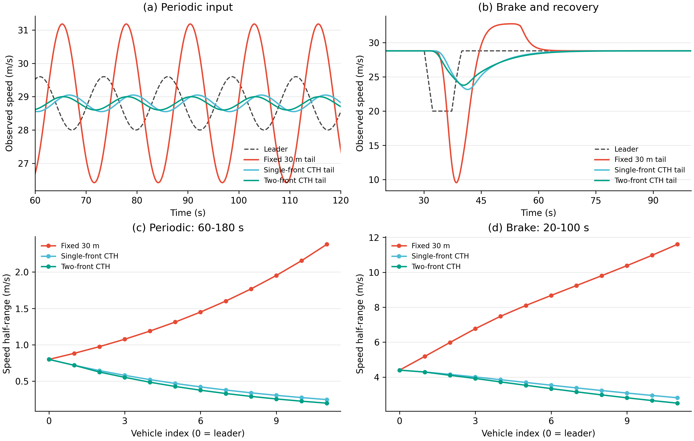

# 文献规则试验：结果与最终采用

日期：2026-10-30。工作目录：`D:/yanjiu1/keyan1`。

本轮默认采用两项更新：**单前车固定时距跟驰，以及考虑邻车制动代价的自由补位。** 固定时距是主要的平顺性改进；补位代价带来较小、可重复的节油和平均换道次数减少。合流参考平滑恢复、第二前车预瞄保留为已试验候选，没有加入默认程序。

核心规则从461行变为511行，私有记忆仍为三个字段。巡航28.8m/s、最高33.3m/s，真实发车、物理安全、3→2道路和本车0/1统计沿用原设置。当前规则SHA256为`65142b448412325357bab0bdcdc6fa6caaa75cddef2c6a498ab4d49454441317`。

## 1. 实际试了哪些内容

| 候选 | 单独试验结果 | 最终处理 |
| --- | --- | --- |
| T：单前车固定时距 | 12车串的周期速度扰动由沿队列放大改为衰减；五流量原编队燃油均值均降低，平均连续1时长均增加 | 采用，NOA与编队共用这一基础跟驰 |
| M：补位制动代价 | 在原版和T上分别试验；独立新种子中，T加M在五个流量的燃油均值均降低，平均横移更少 | 采用，定位为经济性和组织成本改进 |
| R/TR：横移完成后平滑恢复参考 | R在原版有局部改善；加到T后，四个筛查流量/道路组的平均行程时间都增加 | 保留源码与数据，不启用 |
| T2：第二实际前车预瞄 | 车串进一步减振，但持续流筛查增益较小、关系保持指标有升有降 | 保留源码与数据，不启用 |

先做80例筛查，再使用新种子11–15做250例独立验证。每道流量500、750、1000、1250、1500辆/h，分别跑三车道直路和3→2道路；持续发车600秒，绝对上限900秒。五种策略各50例：原NOA、原编队、新NOA、T编队、TM编队。每组流量/道路有五个同输入种子，全部安全排空，接触和瞬移均为0，共121,870次车辆运行。

纵向另有三种控制、两种领车输入的6个工况，并重复T的两次运行，共8次；重复轨迹逐字节一致。所有结果按实际执行源码冻结，版本、输入、参数和统计均可复核。协议见[初筛协议](protocol.md)和[独立验证协议](heldout_protocol.md)。

## 2. 两条采用规则怎样工作

### 规则一：期望距离随本车速度变化

仍跟踪当前走廊50米内的最近实际前车，期望车头距改为

\[
D^*=4+1.5+0.8506944444\,v_{ego}\quad\mathrm{m}.
\]

巡航28.8m/s时仍为30米；20m/s时约22.514米，10m/s时约14.007米。前车位置、前车速度及本车速度进入原有反馈。更远车辆继续参与安全判断；跨道头车对齐和30/15米巡航参考保留。

NOA与编队共用`_front_following`，因此新NOA也是本轮独立对照的一部分。NOA没有跨道配对行为，输出状态始终为0；编队状态沿用已经确认的局部关系定义。

### 规则二：有形成收益的补位，优先选择制动代价较小者

候选先满足原来的缺位、负荷改善及物理走廊条件。然后在同一物理帧，使用统一公开跟驰模型，比较换道前后本车、新道后车及原道后车的速度请求损失；总损失较小的候选优先。

目标道后车另设独立条件：预测速度请求不低于其当前速度减`10×0.1=1m/s`。这一条件对应原物理制动能力10m/s²，其他车辆的收益不能抵消它的过大制动。等速且有形成价值的补位仍可进行。必要合流继续使用原真实安全空隙和优先顺序，不受自由补位成本筛选阻塞。

预测只用可见位置、速度和统一参数，不读取邻车意图、私有记忆或0/1。它直接复用当前时距跟驰，避免同时保留另一套固定间距预测器。

## 3. 五流量独立验证

以下均为种子11–15的等权平均。每道流量单位为辆/h，时间为秒，燃油为g/km。这里“新编队”指当前TM。

### 相对原编队的变化：3→2

| 流量 | 原编队时间 | 新编队时间 | 原编队燃油 | 新编队燃油 |
| ---: | ---: | ---: | ---: | ---: |
| 500 | 41.7617 | 41.7662 | 64.4925 | 64.2134 |
| 750 | 41.8425 | 41.8370 | 67.4330 | 66.6551 |
| 1000 | 41.9072 | 41.8917 | 70.1064 | 68.5176 |
| 1250 | 42.0937 | 42.0118 | 73.4439 | 70.4453 |
| 1500 | 42.6930 | 42.1730 | 79.6179 | 72.5171 |

五流量等权平均，时间减少0.123723秒，燃油减少2.549059g/km。1500流量下时间减少约0.520秒，燃油减少约7.101g/km。500流量下时间增加约0.0045秒。

### 与相同跟驰的NOA比较：3→2

| 流量 | 新NOA时间 | 新编队时间 | 新NOA燃油 | 新编队燃油 |
| ---: | ---: | ---: | ---: | ---: |
| 500 | 41.7788 | 41.7662 | 61.1804 | 64.2134 |
| 750 | 41.8612 | 41.8370 | 62.5801 | 66.6551 |
| 1000 | 41.9706 | 41.8917 | 63.8791 | 68.5176 |
| 1250 | 42.1398 | 42.0118 | 65.3555 | 70.4453 |
| 1500 | 42.4710 | 42.1730 | 67.3108 | 72.5171 |

新编队平均比新NOA快0.108344秒，燃油多4.408513g/km。三道直路中，新编队平均多0.009309秒、燃油多3.737534g/km。缩减道路相对直路的附加时间差分减少约0.117653秒。

同一新跟驰下的NOA/编队对照比较的是整套策略，其中还包含既有协作合流和普通超车政策差别。T对原版用于观察跟驰更新，TM对T用于观察补位代价增量。三类差值在数据表中分别保存。

### 本车关系的参与和持续

| 流量 | 原编队参与率 / % | 新编队参与率 / % | 原平均连续1 / s | 新平均连续1 / s |
| ---: | ---: | ---: | ---: | ---: |
| 500 | 68.3562 | 68.1729 | 25.2715 | 25.4476 |
| 750 | 81.5443 | 81.4450 | 25.1939 | 25.3391 |
| 1000 | 87.4862 | 87.3080 | 24.9346 | 25.2025 |
| 1250 | 90.9052 | 90.8052 | 25.8527 | 26.3729 |
| 1500 | 93.4864 | 93.2361 | 26.3694 | 27.4023 |

平均连续1时长在五种流量下都比原编队长；参与率略低。五流量平均变化为连续1增加0.428459秒、参与率减少0.162202个百分点。人数数据指全路同时报告1的车辆数，完整人数、峰值和逐种子结果见[profiles.csv](results/profiles.csv)及[逐种子差值](results/seed_differences.csv)。

| 流量 | 新编队平均同时参与人数 | 各种子峰值人数的均值 |
| ---: | ---: | ---: |
| 500 | 10.696 | 23.0 |
| 750 | 19.707 | 36.6 |
| 1000 | 27.886 | 46.6 |
| 1250 | 36.261 | 59.4 |
| 1500 | 44.893 | 67.4 |

M单独加到T后的收益较小：缩减道路燃油平均再少0.182636g/km，每例平均少7.56次严格完成的横移（车道号跨线事件少8.36次），行程时间增加0.000669秒；连续1时长减少0.037557秒。19/25个流量—种子组合节油，五个流量均值、每个种子的五流量燃油均值都改善。保留M的依据是低成本补位及经济性，而非额外的通行时间或关系持续优势。

## 4. 改善来自哪里

12车串使用相同实测领车输入。周期输入的队尾速度半幅，原固定30米为2.380583m/s，T为0.247925m/s，T2为0.199091m/s；制动恢复输入分别为11.600182、2.819649、2.510745m/s。T已把这两组实测扰动变为沿队列衰减，构成采用时距跟驰的直接依据。

交通诊断沿用既有口径：800–1000米区域、100–600秒窗口、速度低于5m/s的车辆秒积聚，以及实际越线时间。新TM相对原编队的平均时间、燃油下降，并未同时表现为该区域密度和低速积聚下降：密度平均增加0.070707辆/(km·车道)，低速积聚增加0.760车辆秒/例。相对T，M减少平均横移和燃油，低速积聚增加0.416车辆秒/例。

与同跟驰的新NOA相比，TM在缩减道路的低速积聚平均少20.656车辆秒/例，640–1100米时间少0.117689秒，上游100–600米多0.017049秒。完整策略有局部拥挤缓解，但本次更新的主要价值是纵向减振和组织成本降低。固定窗口通过量没有给出稳定的容量提升结论。

## 5. 代码、验证和数据

- 当前入口仍为根目录`runrun.py`，首次计算与SUMO窗口同步推进。规则在`variants/phase5g_pure_formation/noa/native_rules.py`。
- 225项核心测试、37项子测试、当前原生GUI入口9项测试通过；实际根入口短测12辆安全排空。历史H/P等价断言继续检查其原封存版本，当前时距合同独立测试。
- [实现及车串原始证据](implementation/evidence.tar.gz)保存测试日志、实际根入口记录、八次车串的原始轨迹与驱动；[清单](implementation/manifest.json)逐文件给出SHA256。[出版核验](publication_verification.json)核对主报告70个数值单元及原件摘要。
- 80例筛查、250例独立验证的七份紧凑数据包约47.8MB，按原字节保留输入、结果、车辆记录及源码，保存全部0/1帧和越线样本。完整轨迹约1.88GB只保留原件与哈希，不在Git中重复展开。
- 两套独立复核核对原trip、源码、同请求和统计；250例的1,602,184个原状态帧与直接汇总一致。全部330例证据另有13,200项表格比较。

数据入口见[本轮README](README.md)、[完整五流量表](results/results_tables.md)、[证据及离线验证](evidence/README.md)、[瓶颈实测和复算](traffic_evidence/README.md)、[代码审查](review_TM.md)和[独立结果复核](review_results.md)。现行全部规则、执行顺序和代码结构见[系统说明](../../原生SUMO编队变换系统说明.md)。

本轮候选及采用版本通过用户GitHub仓库的研究分支和main管理。候选可从固定Git基线和公开补丁重建，不需要保存整份本地仓库副本。
