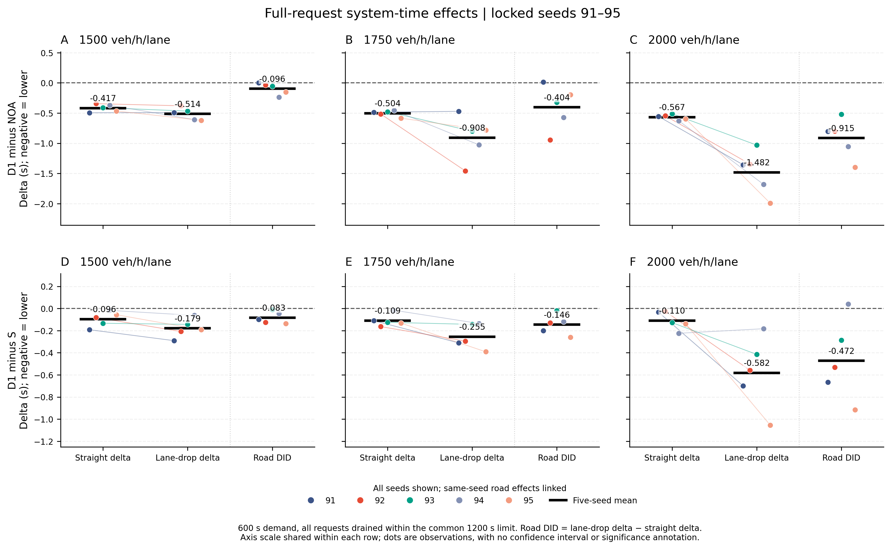

# 局部感知交错编队的形成与提前缩道变换

本轮研究按2026-11-03的新要求，只使用 **1500、1750、2000辆/h/车道**。工作目录为D:/yanjiu1/keyan1；采用的D1已经安装到实际运行入口。规则423行，SHA256为`2be889140b497b763818a35814b0f34815c7cccd309dd5007ebaddca8a91f35a`。完整规则、每个函数和执行顺序见[系统说明](../../原生SUMO编队变换系统说明.md)，论文组织见[论文主线与贡献](论文主线与贡献.md)。

研究得到的主要结果是：交错形状与局部提前腾位结合后，三档缩道系统时间均减少，流量越高，额外缩道收益越明显。真实车辆完成了24辆由无序到交错、45辆由三道交错到两道交错的过程。燃油相对NOA仍增加，急减速也未全面减少；这些结果与效率一起保留。

本轮共完成22个交通矩阵、282次不同run_dir的实际运行，全部安全排空；复用参考不重复计数，单元测试、离线诊断、GUI短测和两例固定初态几何实验另列。[运行清单](run_census/summary.json)保留逐批与逐例来源。

## 1. 方法围绕一个问题展开

三道变两道时，终止道的车必须进入中道。仅让车排列整齐，还不能保证中道存在可执行的接收空隙。原版S多数必要合流已在约674–679米完成，剩余代价集中在640–800米的接入重组；问题并不是所有车都等到1000米才变道。

D1让车辆从实际可见空隙出发，判断哪里还能接收一辆车，再比较未来两道的局部负荷。若中道连同将要并入的终止道车辆较多，而lane0较空，中道车可以提前转向lane0。终止道车仍使用原来的必要合流与安全规则；相邻道互选相位持续维持交错形状。这使横向分工和纵向交错围绕同一个缩道过程工作。

相对S只采用两项行为更新：

1. **实际gap补位与局部负荷均衡。** 取消原锚点/七层格点搜索，候选直接使用目的道实际前后车形成的gap。每辆可见车按实际横向运动所指向的资源最多计一次；候选迁移须使局部计数平方和下降，并通过原走廊与公开跟驰响应代价检查。评分gap与本车随后执行的gap一致。
2. **接收作用域内的未来资源映射。** 本车进入640米准备区，或在自身±90米看到已经进入准备区的终止道车，就将lane1与lane2计入未来同一个存续资源。接收车可在自己尚未到640米时提前腾位；终止道必要合流触发仍为640米。

全部控制只读本车前200米、后100米内各道实车的实测状态和自身三个记忆字段。邻车没有公开编队意图、私有目标或状态位。局部机会按几何排序，每个控制器只在获选对象是自己时动作；全局轨迹只用于评价。

共同纵向规则是`D(v)=5.5+0.8506944444v`的真实前车CTH，巡航28.8m/s、最高33.3m/s。相邻道互选采用巡航0/15/0米相位，合流后为0/15米；相位与真实前车要求反向调速时，优先真实前车。8米几何走廊、停止安全上限、原生SUMO发车和执行均与NOA一致。

## 2. 五个新种子的正式确认

21:01冻结D1，21:34在任何最终输入运行前登记[协议](final91_protocol.md)。91–95五个新种子，三档流量，两条道路，NOA/S/D1三种方法，共90例。每例持续请求600秒，统一1200秒物理排空上限；实际90/90安全排空，没有碰撞或传送，也没有替换种子。S是原461行编队版，NOA保留普通跟驰、受阻超车和必要合流。

系统时间为每个请求从计划发车到实际离场的时间，包含原生入口等待。每例先按车辆求均值，再按五个种子等权汇总；表中改善百分比为**逐种子改善百分比的均值**，与“先平均时间再作比值”分列。交通收益不是由人为限制NOA入口产生：正式三档缩道的平均入口等待差仅为−0.0038、−0.0076、−0.0117秒/车，主要差别来自路内行程。

| 每道流量 | NOA系统(s) | 原编队S系统(s) | D1系统(s) | D1相对NOA改善 | D1相对S再节省(s) |
| ---: | ---: | ---: | ---: | ---: | ---: |
| 1500 | 42.443881 | 42.109625 | 41.930337 | 1.209386% | 0.179288 |
| 1750 | 43.252977 | 42.599916 | 42.344911 | 2.094288% | 0.255005 |
| 2000 | 44.715362 | 43.815907 | 43.233811 | 3.304213% | 0.582096 |

D1相对NOA及S的15组缩道对比均更快，直路各15组也均更快。因此还需要道路差分分辨一般组织收益与缩道额外收益。

令`δ=本方案系统时间−参考系统时间`，每个流量/种子先计算`DID=δ缩道−δ直路`；负值表示扣除直路效应后仍额外节省。下表不相减百分比。

| 每道流量 | D1−NOA缩道δ(s) | D1−NOA直路δ(s) | 额外缩道DID(s) | DID<0种子 | D1−S额外缩道DID(s) | DID<0种子 |
| ---: | ---: | ---: | ---: | ---: | ---: | ---: |
| 1500 | −0.513544 | −0.417304 | −0.096240 | 4/5 | −0.083199 | 5/5 |
| 1750 | −0.908067 | −0.503787 | −0.404280 | 4/5 | −0.145514 | 5/5 |
| 2000 | −1.481551 | −0.566902 | −0.914650 | 5/5 | −0.472328 | 4/5 |

1500下NOA已接近顺畅行驶，额外缩道收益较小；2000下出现更大的可恢复瓶颈延误。道路差分识别的是两类道路中完整控制系统效应的差异，结合消融与真实轨迹解释其来源。

例如2000档，NOA的缩道与直路时间差为2.755523秒/车，D1对应差为1.840874秒/车，二者相差0.914650秒。1200米中大部分路段原本顺畅，因此全程百分比与瓶颈额外耗时分别报告更能说明实际意义。

独立审计从全部90例原始trips重算四项主指标，核对978696个门线样本双端点、90份区域账本及原始轨迹SHA；区域积分与原ledger最大差为0。30主配对、30次配对及各15个道路DID全部合格。可直接读取[逐案例](diagnosis/final91_independent_v1/per_case.csv)、[逐种子配对](diagnosis/final91_independent_v1/paired_seeds.csv)、[道路DID](diagnosis/final91_independent_v1/road_did_seeds.csv)和[独立核验](diagnosis/final91_independent_v1/README.md)。

## 3. 燃油与持续交通

| 每道流量 | 正式D1−NOA燃油(g/km) | 正式D1−S燃油(g/km) | 1800秒D1相对NOA系统改善 | 1800秒D1−S系统(s) |
| ---: | ---: | ---: | ---: | ---: |
| 1500 | +7.608524 | −0.161456 | 1.091054% | −0.199230 |
| 1750 | +7.793151 | −0.825592 | 2.047163% | −0.302476 |
| 2000 | +6.514407 | −2.802182 | 4.365248% | −0.638604 |

燃油由共同HBEFA3模型累计，按车辆行驶里程归一。正式均值相对S下降，个别种子仍有反向点，全部见[燃油配对图](diagnosis/final91_figures_v2/final91_fuel_effects.png)。D1相对NOA的燃油代价仍然存在。

持续流用81/82两个种子，NOA/S/D1各六例，共18例，1800秒持续来车后统一排空，全部安全完成。区域统计使用完整[100,1800)窗口；只跑缩道，不推算未运行的长直路DID。D1六例均比S更快且省油；1750的低速车辆秒仍比S多4.9，保留该反向指标。[持续流详情与原件](real_gap_balance_D1_long1800_81_6/README.md)。

## 4. 提前变换确实发生了什么

正式91–95的45个缩道案例均完成逐帧与全变道审计。以下腾位是在550–640米发起最新绑定请求，并在640米前严格完成的实际1→0动作；这一区间覆盖接收车可提前看到终止道准备负荷的位置范围。每档五种子等权。

| 每道流量 | 原S提前腾位次数 | D1提前腾位次数 | 必要合流实际开始S→D1(m) | 严格完成S→D1(m) |
| ---: | ---: | ---: | ---: | ---: |
| 1500 | 7.0 | 66.4 | 645.78→645.16 | 674.27→673.84 |
| 1750 | 9.2 | 85.0 | 650.50→645.40 | 675.53→673.49 |
| 2000 | 17.0 | 103.0 | 658.75→647.73 | 679.75→673.64 |

这些是物理完成事件；S在更上游已有形成调整，因此“提前”指在必要合流前释放接收资源，而非每次D1横移都比S位置更靠上游。future映射的增量作用另由DR消融识别。

同一正式窗口[100,600)、100≤x<1100米，全域正速度亏损S→D1由561.63→474.31、1001.47→817.26、2143.48→1599.92车辆秒。负加速度积分三档也下降，但极端急减速暴露分别为185.08→209.76、267.46→274.50、407.72→365.34车辆秒。2000相对S有所改善，低两档仍有代价。严格同并入车、同接收后车匹配的完整后窗中，后车急减速时间由.242→.312、.236→.298、.230→.340秒/事件，表明总体延误减少与特定接收车辆的扰动可以并存。[正式45例机制与全部后窗](diagnosis/final91_drop45_mechanism_consolidated_v1/README.md)保存39454个严格完成变道、14153个必要合流及来源SHA。

[速度时空图](diagnosis/final91_spacetime_v2/README.md)使用固定seed91的六例NOA/D1原始轨迹，25米×10秒分箱和统一色标，直接展示终止线等待与640米附近上游重组代价。该种子包含1500/1750的反向道路DID，展示身份与五种子主统计分开；另给实际lane2补图，保留全道聚合可能稀释的末道停车。

### 开发与持续流的机制复现

以下开发机制数据来自71/72或81/82，先于正式91–95批取得，和正式主效应分开。

600秒两种子均值中，D1在640米前**严格完成**的1→0腾位分别为131.5、166.5、196.5次。请求、实际开始和完成分别计数。准备区外的普通均衡也会产生早迁，不能把这些事件全部归于future映射。

| 每道流量 | 必要合流实际开始S→D1(m) | 实际完成S→D1(m) | 请求时与接收后车的车头间距中位S→D1(m) | 100–1100m正速度亏损S→D1(车辆秒) |
| ---: | ---: | ---: | ---: | ---: |
| 1500 | 645.58→645.12 | 674.40→673.60 | 16.36→17.61 | 621.37→483.64 |
| 1750 | 648.93→645.40 | 674.75→673.60 | 16.13→16.83 | 1015.86→842.47 |
| 2000 | 657.31→646.26 | 679.02→673.42 | 15.67→17.42 | 1867.89→1479.81 |

提前腾位、接收后车间距和延误分布共同支持未来资源重分担机制。表中距离是在最近绑定请求时以并入车x减目标道后车x计算的车头间距；该值仍小于巡航CTH的30米，切入压缩没有消失。600–800米急减速暴露(a≤−6m/s²)三档反而由128.10/178.80/258.25增至153.65/212.45/282.95车辆秒；严格双方匹配的完成后5秒窗口也没有支持全面更平顺。这里的改进体现为组织和延误。[完整机制审计](diagnosis/D1_mechanism_consolidated_v1/README.md)与[持续流机制](diagnosis/long1800_D1_mechanism_v1/README.md)保留所有分窗和不利值。

### 两个单项消融

DR只去掉future资源映射，保留实际gap、提前接收作用域和横向运动计数。DP只去掉纵向phase，保留主动横向组织与本车关联状态，因而DP不是纯NOA。两者均在冻结后独立运行，未按正式结果调参。

| 600秒71/72，正值表示比D1慢 | 1500 | 1750 | 2000 |
| --- | ---: | ---: | ---: |
| DR−D1缩道系统(s) | +0.037442 | +0.102026 | +0.010952 |
| DP−D1缩道系统(s) | +0.238490 | +0.329872 | +0.484096 |
| DP−D1直路系统(s) | +0.391307 | +0.443413 | +0.454407 |

DR直路与D1逐例相同；缩道更慢的种子数为2/2、2/2、1/2，future在2000并非每例增益。DP的实际跨道相位精度明显较弱，600秒各例系统时间更长，但它的直路损失也较大，1500/1750不能说phase收益专属于瓶颈。180秒短筛的DP在2000两例反而更快且更省油，持续时长和种子均不同，全部结果见[消融短筛](real_gap_balance_DR_DP_screen73_12/README.md)与[600秒消融](real_gap_balance_DR_DP_development71_24/README.md)。

## 5. 实际交错形成和两道恢复

[几何实验](../2026-11-03-staggered-bottleneck/formation_demo_D1/README.md)复用原24辆无序、45辆预成形的逐字节初态，只把出口从1200延至2400米，便于完整观察较长队形。瓶颈仍在1000米，准备仍在640米；这条展示网络不参与上表交通效率比较。

24辆在37.6秒全部完成必要变换，62.6秒仍24辆在路，同道CTH误差为+0.0222至+0.1442米。45辆在42.4秒全部完成，62.4秒严格早于首车离场，45/45仍在路：连续44个纵向间距14.8489–15.4115米、车道严格交替，同道前车间距29.9998–30.2604米。67.4秒的补充帧处于首车出口边界，另行标明。

本车`formation_state=1`只表示已建立实际跟驰/被跟驰/跨道互选关系，允许仍在调距。参与车辆秒、同时人数和连续1时长直接统计各车输出；几何恢复使用实测位置证明，不用状态1代替完整队形。

正式五种子缩道的直接本车状态统计如下，均为先逐例统计、再五种子等权平均。纯NOA的参与量、人数和关联段数全为0，无关联段时的持续时长保留N/A。

| 每道流量 | D1关联车辆秒比例 | 全场同时关联人数均值 | 每例峰值人数均值 | 连续1时长均值(s) |
| ---: | ---: | ---: | ---: | ---: |
| 1500 | 96.803% | 49.117 | 70.2 | 37.991 |
| 1750 | 98.074% | 58.761 | 80.8 | 39.439 |
| 2000 | 98.822% | 68.631 | 90.0 | 40.662 |

全场人数可含多支局部队列；连续关系时长也受车辆在路时间影响。它们描述参与规模与关系持续性，实际交错精度和扰动恢复由前面的物理几何与轨迹分别展示。完整三方法两道路18组统计及90份原result来源见[直接状态统计](final91_all90/analysis/formation_seed_equal_means.csv)。

## 6. 文献尝试与采用理由

| 独立方向 | 发现及处理 | 证据 |
| --- | --- | --- |
| V1/V2预合流前驱与提前观察 | 部分局部响应改变，但中流量持续收益不一致、燃油增加；未采用 | [V1](projected_predecessor_v1_screen73_12/README.md)、[V2](projected_predecessor_v2_screen73_6/README.md) |
| F2未来资源+原格点 | 正确识别未来负荷，但格点机会与实际半格gap不一致，1750变慢；未采用原实现 | [600秒F2/C5](F2_C5_development71_24/README.md) |
| C5局部五秒接近轨迹 | 合流期更柔和，但部分制动移至完成后，2000短筛变慢；未采用 | [C5](local_gap_trajectory_C5_screen73_6/README.md) |
| GP/GP2实际pair规划和持有 | 大量机会回到原执行，持续流效果小且混合；未采用 | [GP2长试验](bound_real_gap_GP2_long1800_81_6/README.md) |
| B/BC上游45/22.5米预稀疏 | 空隙增大，同时上游组织成本增加，短筛各例更慢；未采用 | [B](capacity_spacing_B_screen73_6/README.md)、[BC](capacity_spacing_BC_screen73_6/README.md) |
| D1实际gap+资源均衡 | 单一局部判据连接选择与执行，开发、持续流及新五种子均有增量收益；采用 | [D1开发](real_gap_balance_D1_development71_12/README.md)、[规则补丁](candidates/real_gap_balance_D1/README.md) |

没有将这些失败候选层层叠加到生产。D1替换原补位搜索，保留原跟驰、phase、合流闭环与安全。

Cai2024是IEEE IV论文 *Multi-lane Formation Control in Mixed Traffic Environment*，DOI 10.1109/IV55156.2024.10588701。D盘MATLAB的活跃控制链采用全组分配与分阶段轨迹；本研究借鉴交错几何和提前变换思想，控制信息改为有限局部观测。Cai2023 IET/预印本是另一篇工作。这里没有用未复现的集中式数值作排名。[文献核对](literature/README.md)和[理论条件](literature/theory_notes.md)给出实际读取范围与条件性分析。

## 7. 工程验收、复算与保存

D1独立代码审查无待修的重要问题。实际磁盘16个测试文件共239项测试和51项子测试通过，9项GUI入口测试、自检及根入口1750流量30/30辆真实SUMO短测通过。[安装记录](implementation/installed_D1_migrated_core.json)、[独立审查](implementation/review_D1/README.md)、[旧测试迁移](implementation/D1_test_migration.md)均绑定现行SHA。早先一次错误工作目录启动未运行测试，已明确保留；旧格点合同的9个失败与迁移理由也保留。

在根目录运行`python runrun.py`即可实时打开窗口，默认1750流量。入口不再先生成全部轨迹。`python runrun.py --check`检查本机依赖；研究CLI显式给出流量、模式、道路、种子和排空上限。

代码版本与小补丁推送到[GitHub研究分支](https://github.com/32780542/yanjiu1/tree/research/20261103-midflow-staggered)。各数据单元保存协议、全部结果、compact原件包、SHA与隔离离线复算。[最终D1/S冻结源包](final_frozen_sources/README.md)逐字取自实际正式运行，区分六个模拟源和额外启动文件。紧凑包可恢复逐车主指标及既有门线/区域评价，完整positions/events另按索引和代表性案例留存。

已关闭的详细诊断表以[压缩包](diagnosis/closed_diagnostic_tables.tar.gz)和[逐件索引](diagnosis/closed_diagnostic_tables_index.json)保存：106,268,135字节压为37,295,910字节；在diagnosis目录用`tar -xzf closed_diagnostic_tables.tar.gz`恢复原相对路径。摘要、脚本、图和来源表可直接阅读。最终审计和图使用独立目录，未混入该历史闭包。

最终45例新提取的详细诊断另存[正式诊断包](diagnosis/final91_diagnostic_tables.tar.gz)及[逐件索引](diagnosis/final91_diagnostic_tables_index.json)，使用相同方法逐件核对，和开发闭包分开。各单元README记录其封口时的生产版本与raw留存状态，最新安装版本以本报告和恢复检查点为准。

完成全部机制提取、独立核验和云端保存后，按[精确清理计划](storage_cleanup_plan/summary.json)删除126个成功非展示案例的252个大轨迹文件，释放1,550,020,724字节；120个案例的240个完整轨迹仍保留，共1,331,850,907字节，每个SHA复核通过。主/次反向结果的三方法双道路上下文、原定代表案例和24/45几何原件保留。[执行记录](cleanup_execution/README.md)列出实际文件和删除前后离线复核。

两份已发布诊断包逐成员校验后，还移除了1128个完全重复的本地展开文件，另释放151,578,995字节；归档内容与逐件SHA仍完整保留，按上述命令可逐字恢复。[诊断压缩记录](cleanup_execution/diagnostic_payload_cleanup/verification.json)与交通大raw清理分别记录。本轮合计释放 **1,701,599,719字节（约1.70GB）**，没有复制整份工作区存版本。

下一位研究者先读本报告、系统说明、论文主线和检查点即可继续。正式91–95结果不再用于调整这版控制器；后续方法变化应另立版本和独立输入。
