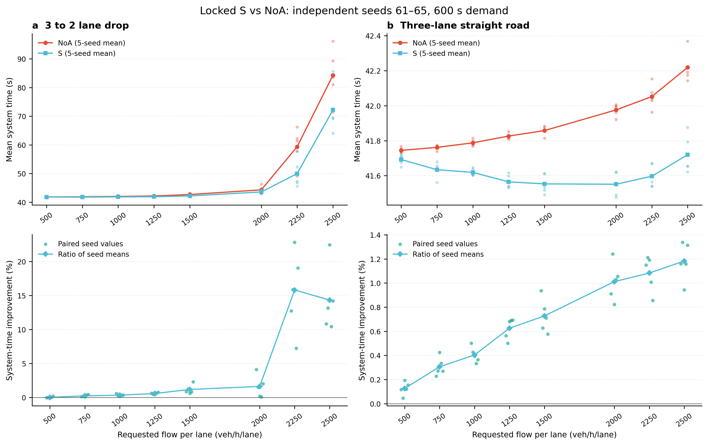
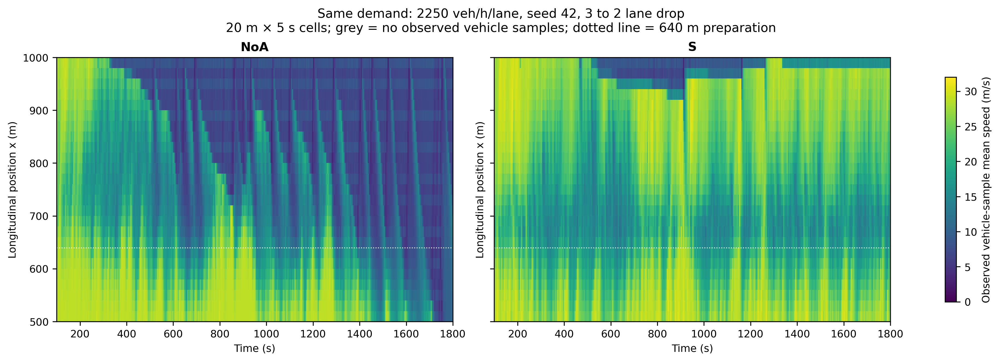

# 交错编队形成与3→2变换：研究结果与采用说明

2026-11-03。本轮采用S，已安装于 `D:/yanjiu1/keyan1`。461行纯规则保持原SUMO框架、实际发车与共同安全；相邻道实车参与局部形成和变换，真实前车跟驰与相位要求相反时优先CTH。源码SHA256：`8bdaa210e7aa7e72e8ae5e6b4a6642e38adc80b2a3416653624752fbf685d12f`。

**新种子600秒验证160例全部安全排空，形成与变换的24/45辆真实几何验证通过；1800秒NoA/S八例也全部安全排空。** 2250、2500每道的最终系统时间分别改善15.81%、14.34%；1800秒两种子确认分别改善20.08%、17.24%。燃油增加单独列出。

## 1. 原来为什么改善小

原500–1250辆/h/车道大多接近自由流。最终独立组1250的NOA系统时间42.16秒，原路巡航参考1200/28.8=41.67秒，平均时间改善空间很小。1500开始出现间歇积聚；2250、2500已经持续受瓶颈影响。

高两档的NOA实际瓶颈状态如下，区域为800–1000米、三道、[100,600)秒，五种子等权；它们确实有拥堵。

| 每道流量 | 密度NOA/S(辆/km/道) | 区域均速NOA/S(m/s) | 低速车辆秒NOA/S | 1000m实测流率NOA/S(辆/h) |
| ---: | ---: | ---: | ---: | ---: |
| 2250 | 56.68/31.57 | 11.53/21.62 | 7663.38/1413.40 | 6572.16/6776.64 |
| 2500 | 73.31/66.38 | 8.60/9.96 | 12273.80/10407.66 | 6660.00/6935.04 |

三道2250和2500分别相当于总需求6750、7500辆/h。两道30米巡航间距的平衡参考为6912辆/h；该值说明负荷水平，实际流率由同车越线记录计算。接近这一负荷时，减少合流扰动能够明显降低累计延误。

原TM还有提前等待链：一组实际轨迹中，接收车与终止道车辆只差5.453米，横移需要8米；接收车主动请求为0，终止车在1000米停住。等待未释放走廊，继续道也被拖慢。[逐步原始诊断](diagnosis_highflow/diagnosis.md)保存该事件。S已删除这套提前开隙及helper等待分支。

## 2. 实际采用的规则更新

1. **真实前车时距跟驰。** NOA与编队共享D(v)=5.5+0.8506944444v的基础CTH，当前实际front决定target/reference。最终停止位置安全上限独立执行。
2. **全体局部交错互选。** 物理相位三道0/15/0、存续两道0/15；以连续横向位置插值。每车与实际相邻道±50米候选反向互选，已有前车的body也能纠正跨道位置。几何和速度破平局，track仅作跟踪。
3. **直接观察另一条车道。** 正常50米内无front时，只有相邻道实车证明单个30米空格，才衔接60米内最近真实front。原59米断链因此修复；同道数量不替代邻道层的实际存在。
4. **CTH优先。** 有真实front时，若phase与CTH提出相反调速，phase本步置零；同向、CTH零修正和自由head继续原相位。例：CF请求28.44而相位想加.4时保持28.44，消除两目标持续相抵。实现只新增两行。
5. **真实空隙与必要合流优先。** 保留实际F/R中点、单侧目标、自身gap保持、横移执行和入列；自由补位比较局部负荷、真实交错空位和公开CF响应成本。
6. **复用同帧计算。** 缓存本次补位的重复CF预测，提前过滤安全函数的无关前车。既有30000条完整输出、10000条安全值及真实配对positions/trips精确等价验收保留；驾驶规则由S自身另外验证。

每车仍只有lane_target、gap、joining三个私有记忆字段，控制只读本车及后100/前200米各道实测车辆。完整解释与每个方法见[现行系统说明](../../原生SUMO编队变换系统说明.md)，实现及合同见[S方法](candidates/cth_priority_phase/method.md)。

## 3. 全新种子的正式结果

先锁定S，再揭盲61–65种子。八档流量、两道路、两方法各80例，600秒连续需求/1200秒统一物理上限。输入请求、物理参数及非规则源码逐对核验，80对全部有效；以下为五种子等权均值，系统时间包含真实入口等待。

| 每道流量(辆/h) | 3→2系统时间NOA/S(s) | 改善 | 改善种子 | 直路改善 | 3→2燃油S−NOA(g/km) |
| ---: | ---: | ---: | ---: | ---: | ---: |
| 500 | 41.82/41.81 | 0.02% | 2/5 | 0.13% | +2.88 |
| 750 | 41.88/41.77 | 0.26% | 5/5 | 0.31% | +4.41 |
| 1000 | 41.99/41.85 | 0.35% | 5/5 | 0.40% | +5.28 |
| 1250 | 42.16/41.91 | 0.59% | 5/5 | 0.63% | +6.31 |
| 1500 | 42.68/42.17 | 1.19% | 5/5 | 0.73% | +7.17 |
| 2000 | 44.30/43.58 | 1.64% | 5/5 | 1.01% | +9.38 |
| 2250 | 59.35/49.96 | 15.81% | 5/5 | 1.08% | +3.91 |
| 2500 | 84.26/72.18 | 14.34% | 5/5 | 1.18% | +4.81 |

500档仅2/5种子略快，三个反例分别慢.00756、.01245、.03074秒，完整保留。高两档均5/5改善。扣除同输入直路效应后，3→2额外节省8.93、11.58秒，均5/5，表明主要收益集中在车道减少场景。

600秒高两档入口等待分别只减少约.002、.456秒；瓶颈640–1100米段分别减少9.75、5.34秒。结合实际密度、低速车辆秒和越线流率，收益有道路内延误与瓶颈积聚减少的直接支持。

[完整配对表](final61_S160/tables.md)、[逐种子原表](final61_S160/paired_seeds.csv)、[独立复算](review_final61_S160.md)、[完整分区证据](evidence_final61/README.md)。独立核对160例及1,073,264个原件/账本标量，最大数值差8.29e−10；原表未改。

## 4. 形成与变换的真实画面

复用固定24辆未成形初态及45辆已成形初态，采用原生SUMO逐步运行。瓶颈仍在1000米，几何观察道路延长到2400米，使45辆两道队形约660米跨度能全体留在画面中；原1200米道路继续用于全部效率对比。

| 输入 | 最后车辆过1000米后25秒的在场车辆 | 同道CTH误差范围(m) | 实际跨道错位(m) |
| --- | ---: | ---: | ---: |
| 24辆未成形 | 24/24 | −.003431至+.000297 | 约±14.993至15.000 |
| 45辆预成形后3→2 | 45/45 | −.010751至−.000039 | 约±14.970至15.000 |

原0/5/10/15/20秒及下游固定帧、全部实际位置与速度、连续变化曲线和完整轨迹均保留。[S真实形成/变换](formation_demo_S_long/README.md)包含图、原始CSV与13.24MB完整证据包。这里没有添加形成期限或要求全路车辆合成一队。

## 5. 收益与编队的关系

31–35组另设匹配非形成对照G0：使用普通慢前车超车择空、基础CTH，保留相同gap并入与执行流程，本车状态0。S相对G0在2250/2500系统时间再改善4.49%/8.00%，均5/5。G0与原NOA分别列名，便于把完整策略收益与形成部分区分。

LP0保留自由补位几何，关闭纵向phase。独立AST与18000条完整Command/Memory的hex比较证明，它严格等价于S关闭所采用的CTH优先phase子系统。S相对LP0再改善2.20%/3.05%，均5/5；LP0真实24辆几乎并排，45辆出现65米孔，未完成交错任务。

因此本轮同时有实际交错几何、匹配非形成对照和phase关闭对照。收益支持所采用形成/变换机制的作用；各子部件的数值不机械相加。[170例匹配归因表](matched_nonformation31_and_S170/tables.md)、[LP0补充证明](matched_nonformation31_and_S170/LP0_addendum.md)。

另外把普通NOA的前车作用距离无条件扩至60米，以相同31–35输入另作检查。S相对这一基线在2250/2500仍分别改善8.27%/11.53%，均5/5；原行程、输入和物理源逐项复核，见[距离敏感性附表](S_NOA60_sensitivity/README.md)。

## 6. 1800秒持续高流量确认

种子41、42，每道2250、2500辆/h，1800秒持续需求/3000秒统一物理上限，NOA/S八例全部安全排空。区域及越线窗口延长为[100,1800)，从同一全程封存ledger重算；系统/行程/入口等待仍为完整请求值。

| 每道流量 | 系统时间NOA/S(s) | 系统改善 | 路内行程NOA/S(s) | 入口等待NOA/S(s) | 燃油S−NOA(g/km) |
| ---: | ---: | ---: | ---: | ---: | ---: |
| 2250 | 60.55/48.39 | 20.08% | 60.32/48.16 | 0.23/0.24 | +2.99 |
| 2500 | 139.23/115.23 | 17.24% | 109.68/100.49 | 29.56/14.74 | +2.37 |

2250档瓶颈均速由12.32升到22.13m/s，低速积聚由24124.95降到3813.05车辆秒。2500档仍处于过饱和，区域低速积聚仅小幅下降；系统改善同时来自路内行程缩短与原生入口等待减少。两方案的插入方式一致，分别报告这两项时间。

[延长窗口完整表与独立核验](long_window_NOA_S1800/README.md)。下图为2250、seed42同输入的实测速度时空图，20米×5秒单元，不作平滑或虚拟补点；逐文件来源见[图表来源](final_figures/provenance.json)。

## 7. 分别试过但未采用的方法

| 候选 | 实际发现与处理 |
| --- | --- |
| A最近可行gap点 | 高流量更慢，保留负结果 |
| C/helper、F压力疏解 | 未解除等待或带来组织成本，未采用 |
| H队首先后、ED相位连续 | 有限改善，未作为最终版本 |
| J2/J2fast | 全体相位和等价计算优化保留于S |
| K低速减弱phase | 八例筛查无明显改善 |
| M相对速度反馈、Q短预测 | 45辆持续约±4–5.5米残余，CTH与饱和phase相反作用 |
| N本车唯一阻挡释放 | 短批有益，600秒2500平均反而慢.30%，未采用 |
| MN叠加 | 短批未优于简单方案，未采用 |
| LT速度伸缩跨道相位 | 45辆尾部恢复较慢，+25仍有12.89米CTH残差，未采用 |
| LP0关闭phase | 交通较快但未形成交错，保留为严格消融 |

代码版本保留补丁、SHA及合同记录。计算墙钟timeout、执行崩溃与物理未排空分别记录；原TM、L、M、N、Q部分长运行的未封口状态保持物理未知，未从矩阵删除。实验间并发和计算优先级不同，墙钟运行时间不用于驾驶性能排名。

## 8. 燃油、代码验收与存储

**本轮没有得到节油结果。** 最终80对燃油均增加；600秒高两档多3.91/4.81g/km，1800秒多2.99/2.37g/km。[完整燃油图](final_figures/fuel_cost_paired.png)保留全部流量。

实际安装461行（原511行）；磁盘233项测试、43项子测试、9项GUI入口测试通过，根入口真实22/22辆安全排空。[安装验收](implementation/installed_S_verification.json)、[独立代码审查](implementation/selected_S_code_review.md)、[测试迁移推导](implementation/S_test_migration.md)。

源码、测试、人类说明和各版本补丁保存到用户GitHub；紧凑数据按整个计划及完整道路/流量分区，单包小于20MB。正式160例八包共83.21MB，全部原字节比对和隔离离线核验通过。[正式证据索引](evidence_final61/PUBLIC_MANIFEST.json)。选定几何保留完整轨迹，普通新运行在原件/字段复核后只清理两个大轨迹文件；失败partial raw继续原位置保留。

本轮后续存储复核又仅清理L/M/N/Q八个成功案例的可替代raw，释放477,616,342字节；连同选定长批清理，共释放 **1,052,196,963字节**。16个超时raw共813,903,124字节、指定双源完整轨迹和原索引绑定文件均保持原SHA。原索引记录封存当时的状态，最新状态见[最终清理与独立复核](storage_cleanup_final/README.md)。

## 9. 运行与下一窗口入口

在 `D:/yanjiu1/keyan1` 运行 `python runrun.py`，窗口与本次第一次计算逐步同步；默认1250每道。观察持续瓶颈时可把脚本顶部FLOW_VEH_H_LANE改为2250或2500。依赖自检为 `python runrun.py --check`。

下一窗口先读[根README](../../../README.md)、[现行全部规则与方法](../../原生SUMO编队变换系统说明.md)、本报告和[检查点末尾](../../phase5_checkpoint.md)。文献及MATLAB的实际阅读入口见[参考设计](methods/reference_design.md)与[全体相位依据](methods/J_JT_local_coupling.md)。历史Cai/自建global资料保持原版本含义，本轮排名来自上述实际同输入对照。
