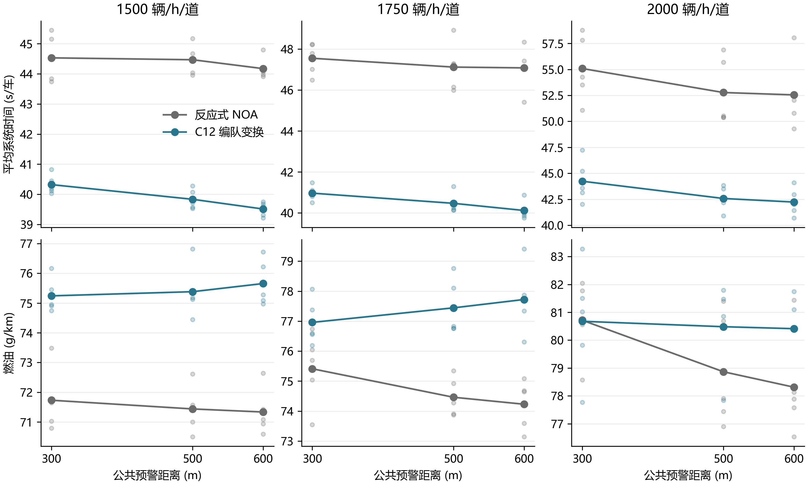

# 300、500、600 米公共预警试验

本轮比较同一路段在三种公共预警距离下的编队变换。缩道点在 1000 米。300、500、600 米预警分别从道路的 700、500、400 米位置开始。NOA 和编队在同一条件下收到同样的道路信息，均感知前 200 米、后 100 米的实车。车辆时距为 0.85 秒，交通输入、车辆物理和安全走廊按上一轮保留。

正式试验使用 211–215 五个种子和 600 秒来车。500、600 米各新增 30 例，300 米引用上轮同种子下 30 例 NOA 与编队变换。原 C12 的平均系统时间如下。每个单元格按种子等权，时间从请求发车计到驶出。

| 流量（辆/h/道） | 300 米 NOA → 编队（秒） | 500 米 NOA → 编队（秒） | 600 米 NOA → 编队（秒） |
|---:|---:|---:|---:|
| 1500 | 44.530 → 40.322 | 44.468 → 39.835 | 44.172 → 39.512 |
| 1750 | 47.551 → 40.966 | 47.120 → 40.468 | 47.081 → 40.120 |
| 2000 | 55.088 → 44.236 | 52.776 → 42.575 | 52.549 → 42.230 |

600 米的编队系统时间在三档五种子均值中最低。相对 500 米分别少 0.323、0.349、0.345 秒。开发组两个种子的 2000 流量恰好相反，600 米平均多 0.538 秒。600 米让两种驾驶方式都获得更多调整时间，所以要分别看编队自身用时与相对同预警 NOA 的收益。



图中实点为五种子均值，浅点为各个种子。上排为系统时间，下排为燃油。各面板纵轴按对应数据定标。图和逐种子表均使用真实已消费数据。 [逐种子配对](data/distance_confirmation/paired_seeds.csv) · [矢量图](preview_comparison.svg)

## 四个局部候选

1. **L1**。公共预警期间，普通车辆在未参与实际接收或换道时继续原来的交错调距。C12 在预警可见并且附近有终止道车辆时会进入接入跟驰，L1 将这一切换推迟到本车需要退道、已有虚拟前车或正在横移。
2. **L2**。在 L1 上，只提前跟随一个接入间距内的邻道实车。这缩短虚拟接收的作用范围。
3. **L3**。在 L1 上，让直接感知范围外的提前合流等待已有的动态空位检查通过。空位以目标道实际前车后一个接入间距为目标，继续使用原安全走廊。已有退道计划和实际前车横移引导可继续。距缩道点 200 米以内进入原必要合流。
4. **L4**。把 L3 的提前空位条件单独应用于 C12，沿用 C12 的纵向跟驰。四个候选均以冻结规则和同一运行器试验。 [候选源码](rules) · [开发逐种子配对](data/local_development/paired_seeds.csv)

开发阶段每个候选有 500、600 米两档，各三种流量、两个种子。四个候选共 48 个新增案例，全部安全排空。L1 的六组平均时间增加。L4 在 600 米、2000 流量下减少 1.224 秒系统时间与 1.233 g/km 燃油，因此进入五种子确认。 [开发均值](data/local_development/flow_means.csv)

高流量开发中，600 米的原 C12 有 505/665 辆在 500 米位置之前并入，500 米组为 353/665 辆。900 米之后并入的数量也由 96 增为 114，末道停车暴露由 210.15 增为 440.75 车辆秒。提前完成的数量和拖到末端的数量可以同时增加，这给出了检验提前空位条件的动机。

## 队形检查与头车进入开阔路段

45 车固定车群用来检查变换完成后能否恢复两列交错。三道到两道的位置仍是 1000 米。出口延长到 3600 米以观察全体车仍在场时的几何，随机车流的道路仍为 1200 米。表中时间指 45 辆车首次全部居中并按纵序交替。误差为 100 秒实测相邻车纵距对动态半间距的平均绝对误差。

| 规则 | 预警 | 首次完整交错（秒） | 100 秒误差（米） | 完成横移 |
|---|---:|---:|---:|---:|
| C12 | 500 | 59.4 | 0.000028 | 22 |
| C12 | 600 | 51.8 | 0.000016 | 22 |
| L4 | 500 | 未达到 | — | 23 |
| L4 | 600 | 未达到 | — | 23 |
| L5 | 500 | 未达到 | — | 23 |
| L5 | 600 | 83.4 | 3.630349 | 22 |
| L6 | 500 | 59.4 | 0.000028 | 22 |
| L6 | 600 | 47.4 | 0.000014 | 22 |

L4 的两组尾部都留下三辆连续同道车。两组最后一次 1→0 发起时，原道最近后车在 100 米实车视野之外。L5 让缩道点后的新补位服务于 50 米内实际后车，600 米组恢复了交替，但 500 米组仍失败。

回查车群的第一个动作，原 C12 在 500、600 米下分别于 2.8、1.2 秒完成首次 2→1。L4 的两组都等到了 13.2 秒，头车行至约 832 米才完成。原因是 L4 的提前空位检查要求存在目标道实际前车，头车面对的是前方可见开阔路段。

L6 保留 L4 的空位规则，并允许目标道前方 200 米内未见实际占道前车时，用原有安全走廊先行。目标道上有前车时，新建的提前换道计划用实际前车定位空位。已有计划继续接受安全检查，后续车辆可以观察实际横移接续。L6 对两档都恢复了完整交错，600 米组比 C12 提前 4.4 秒。两档分别从首次完整交错起连续保持 499、619 帧，至 109.3 秒首车离场。 [11 个固定车群读数](data/cohort_geometry.jsonl)

第二种初态把中道整列前移一个 30 米节距，三列仍交错，但队头改为中道。相同初态和 600 米预警下，C12 和 L6 均以 22 次横移完成交错，分别用 47.2 与 75.7 秒。L6 的 100 秒纵距误差为 0.0348 米。两种头部排列下的恢复时间排序相反。 [中道领头初态](data/middle_head45_initial.json) · [复测读数](data/middle_head_geometry.jsonl)

## 持续来车和扩大 NOA 跟驰范围

2000 辆/h/道、221 与 222 两种子、1800 秒来车时，原 C12 编队的 500、600 米系统时间分别为 43.211 与 42.529 秒。相对同预警 NOA 少 12.829 与 12.204 秒，燃油分别增加 0.399 与 1.232 g/km。L4 两档分别比 C12 少 0.741、0.629 秒，固定车群的恢复失败仍需计入规则取舍。 [持续来车逐种子配对](data/long_C12_L4/paired_seeds.csv)

扩大 NOA 跟驰范围的对照仍使用同一前 200 米实车视野，只让普通跟驰读取该范围内的真实前车。2000 流量、五种子下，原 C12 编队相对这组 NOA，500、600 米分别少 12.019、10.098 秒，少用 6.671、5.069 g/km 燃油。这个基线的 500 米平均系统时间比原反应式 NOA 多 1.819 秒，600 米少 0.221 秒。 [扩大跟驰范围逐种子配对](data/wide_noa/paired_seeds.csv)

L6 在第一批 1800 秒试验中，相对同预警 C12，500、600 米分别减少 0.815、0.694 秒和 0.888、0.654 g/km。末道全程停车分别由 989.80 降至 726.55、由 852.85 降至 599.55 车辆秒。 [221、222 逐种子对照](data/long_L6_initial/paired_seeds.csv)

## L6 五种子确认

45 个新增案例全部安全排空，180 个计划配对合格。下表为 L6 减同预警 C12 的系统时间，单位为秒。45 个直接规则配对中有 21 个缩短。600 米、2000 流量的均值减少 0.178 秒和 0.517 g/km，末道停车在五个种子中都减少，均值由 361.12 降至 181.44 车辆秒。600 秒试验的时间改善幅度较小，三档流量的方向也不同。 [L6 对照明细](L6_comparison.md) · [逐种子数据](data/L6_confirmation/paired_seeds.csv)

| 流量（辆/h/道） | 300 米 | 500 米 | 600 米 |
|---:|---:|---:|---:|
| 1500 | +0.012 | −0.072 | −0.020 |
| 1750 | +0.138 | +0.002 | +0.079 |
| 2000 | −0.078 | +0.130 | −0.178 |

600 米、2000 流量下，按逐车实际完成事件统计，五个种子各方案均有 1781 次 2→1。L6 将 500 米之前完成的并入从 1437 次减到 1218 次，900 米及以后由 222 次减到 189 次，500–900 米之间由 122 次增到 374 次。并入更多发生在中段，平均完成位置也相应后移。 [按种子的实际完成位置](data/merge_position_600_2000.csv)

## 四种子持续来车复验

增加 223、224 两个种子后，合并 221–224 的 1800 秒同预警配对。流量为 2000 辆/h/道。表中末道停车为 900–1000 米全程累计车辆秒。

| 预警 | L6 减 C12 系统时间（秒） | L6 减 C12 燃油（g/km） | 系统时间缩短 | 末道停车 C12 → L6 |
|---:|---:|---:|---:|---:|
| 500 米 | −0.329 | −0.394 | 2/4 | 731.03 → 668.80 |
| 600 米 | −0.367 | −0.206 | 3/4 | 806.00 → 519.53 |

新增种子中，500 米两对系统时间分别增加 0.016、0.301 秒。600 米分别增加 0.310 秒、减少 0.387 秒。四种子均值支持在高流量持续来车中继续使用 L6 做对照研究。600 秒结果的时间差较小，且中道领头初态恢复较慢，因此默认运行采用 C12，L6 以冻结候选交付。 [四种子逐项配对](data/long_four_seeds/paired_seeds.csv)

本轮新增 256 个随机来车案例和 13 个固定车群案例，全部安全排空，均无碰撞、无瞬移。随机来车的输入、冻结源码、逐车统计及配对证据已归档。原始轨迹在各运行目录。 [紧凑归档](data/evidence) · [过程计划](plan.md)

## 查看窗口

根目录的默认入口使用 200 米直接感知。对原 C12 试 500 或 600 米时，可在规则文件顶部设置 `ROAD_PREVIEW` 后运行根入口。 [C12 参数](../../../variants/phase5g_pure_formation/noa/native_rules.py)

在本机已有的冻结运行目录中可直接观察 L6 的 600 米条件。以下命令在仓库根目录执行，使用正常 SUMO 窗口入口，并为此次运行另建输出目录。

```powershell
python -X utf8 -B tmp/staggered_bottleneck/20261104_public_L6_formal45_r01/sources/L6_600/run_native_flow.py --mode transform --flow 2000 --seed 211 --duration 600 --max-time 1200 --gui --output-base results/preview_gui_L6_600
```

从 Git 仓库复现时，可把 `rules/L6_600.py` 交给原实验运行器的 `--candidate L6_600=路径`。运行器会将候选与同一版本的 SUMO 入口和引擎冻结在新结果目录。 [L6 源码](rules/L6_600.py) · [运行器](../2026-11-03-staggered-bottleneck/tools/runner.py)
