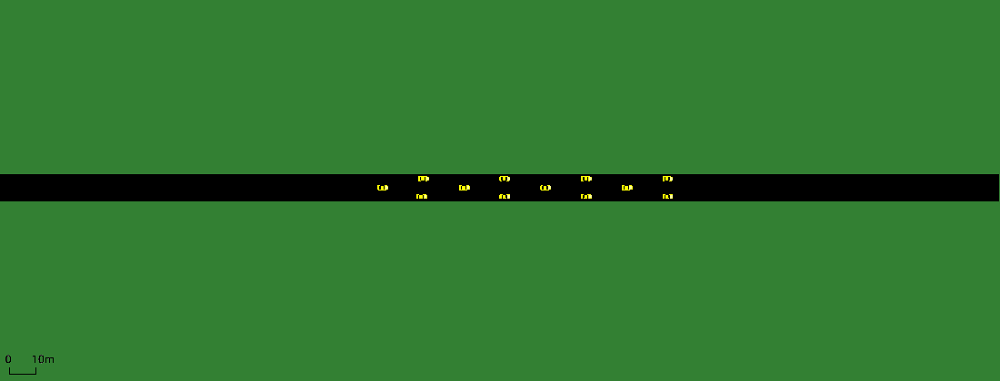

# 三车道交错编队的跨道补位

12 辆车从同一入口依次开进三车道直路。按车道 0、1、2 分别有 6、4、2 辆。用 2026.11.18 第一版运行，12 辆车保持这个分布，全程没有跨道。用补位版运行，车辆实际跨道 4 次，分布变为 **4、4、4**。从仿真第 **29.3 秒**起，全部 12 辆构成四层交错队形，连续保持 **15.1 秒**。两次使用相同的车辆、初速、发车顺序和路网。[GitHub 第一版存档](https://github.com/32780542/yanjiu1/tree/2026.11.18-v1)

## 在 SUMO 窗口里看

在项目目录直接运行下面的命令。窗口随第一次计算实时推进，可手动平移、缩放。约第 33 秒，将视野移到入口下游 **770–875 米**，可以看到四层完整队形。若习惯在 VS Code 点运行，在根目录的 `runrun.py` 中将 `FORMATION_DEMO` 设为 `True`。设为 `False` 即可观察原有的连续车流经过 3→2 缩道，三车道上游也使用新规则。

```powershell
cd D:\yanjiu1\keyan1
python runrun.py --formation-demo
```



第 33 秒的车头位置如下，单位为米，按从前到后排列。两个外侧车道的前两辆分别都在 874.4、844.5 米，中道对应两辆在 859.4、829.5 米。屏幕上的错位和下面的位置取自同一次真实 GUI 仿真。

| 车道 | 第一层 | 第二层 | 第三层 | 第四层 |
|---|---:|---:|---:|---:|
| 2 道 | 874.4 | 844.5 | 814.5 | 784.6 |
| 1 道 | 859.4 | 829.5 | 799.6 | 769.6 |
| 0 道 | 874.4 | 844.5 | 814.5 | 783.8 |

## 如何从旧的分层补位走到现行规则

9 月 23 日规格的第 6 节要求前方缺位优先，已满的层保持，车辆按物理位置决定谁可以补位。这个顺序能够避免后车同时抢一个空位。原来的单车、双车分支还按上道、中道、下道排列优先级。当车道间距随速度变化、车辆从入口随机到达时，优先向指定一侧移动可能让车辆绕过更近且空着的位置。现行实现保留从前向后补位的顺序，将方向选择改为观察三条车道的实际占用。[旧版规格第 6 节](../../../variants/phase5g_pure_formation/docs/superpowers/specs/2026-09-23-phase5g-layered-local-formation-design.md) · [现行单车规则](../../../variants/phase5g_pure_formation/noa/native_rules.py)

1. **先认出自己附近的车群。** 本车观察所有车道前 200 米、后 100 米内的车辆，按纵向位置排序。相邻车辆若相隔超过 50 米，就从这里断开。每辆车只使用与自己相连、且确实在自己视野里的那一段车群。
2. **确定是否需要横移。** 至少有三辆车时，本车直接清点这段车群在三条车道上的实际车辆。最多和最少的车道只差一辆以内，便保持车道。可见车群内已有车辆横移或尚未回到车道中心时，等待这次动作结束。队尾允许有尚未补满的一层。
3. **从前往后找第一个能补的位置。** 本车从车群前端往回看，逐车计入它真实所在的车道，同时记下每条车道已看到的最后一辆。对当前候选车，优先看前方车辆较少的车道，数量相同时优先少跨道。目标道前方已有车，就检查那辆车后方一个目标车距的位置。前方尚无该道车辆，就从可见前排车的位置换算这一道应有的错位。再直接看目标道，若半个目标车距内已有实车，就放弃这个位置。即使两次看到的各道车数相同，实际占位不同也会得到不同结果。
4. **安全跨一道，随后重看。** 目标隔一道时，本车先判断相邻中道能否通行。每次只跨相邻一道，检查车身是否占道、纵向位置是否会交叉，以及当前和一秒后的 8 米安全间隔。如果前面的候选车能补，后车等待。本车只有判定自己是候选车时才发出换道请求。下一步读到的是各车真实执行后的状态。没有车道总数配额、全局层号、队长命令或车间消息。
5. **换完后共同调距。** 同道目标车头间距为 `D = 5.5 + 0.85 × 本车速度` 米，1 道比 0、2 道后错半个 D。在每一条实际观测到的车道上，从前往后给可见车辆排出局部次序。把每辆车的位置按其所在车道和次序换算到本车这一层，再取平均作为本车的纵向目标。这样，后车会靠近，过于靠前的车也会略微回落。车辆只计算自己的目标；不同视野中的车可以有不同的参照。实际同道间距过短时，跟驰与制动安全约束优先。低于三辆时沿用原有局部跟驰与邻道配对。
6. **形成与缩道衔接。** 正在执行的换道、已经观察到的前车向内合流以及自己看到的缩道，优先进入既有的合流逻辑。车辆进入两车道路段后按两道接续。在可见三道上，真实横移既可能是补位，也可能是向瓶颈合流的前兆，后车根据可见运动作出判断。当前方法保留了这种局部信息条件。

## 用实际车身位置核对队形

每 0.1 秒读一次 SUMO 轨迹。三条车道各有一辆才构成一层。以巡航时约 30 米的同道间距、15 米的邻道错位核对，层间与错位容差 2 米，车身距车道中心不超过 0.3 米，同一组车速度极差不超过 0.5 m/s。表中还要求整组车三道数量极差至多一辆。五车情形检查完整前层，并允许尾层空一个位置。[几何检测器](../../../variants/phase5g_pure_formation/experiments/complete_layers.py) · [按车群复核脚本](check_cohort.py)

| 三车道直路的初始条件 | 形成后的三道车数 | 首次满足几何条件 | 最长连续保持 |
|---|---|---:|---:|
| 5 辆，3/1/1 | 2/2/1 | 13.6 s | 24.3 s |
| 6 辆，4/1/1 | 2/2/2 | 16.9 s | 21.4 s |
| 6 辆，全部在中道 | 2/2/2 | 21.5 s | 17.0 s |
| 9 辆，5/3/1 | 3/3/3 | 19.5 s | 17.7 s |
| 12 辆，6/4/2，分散摆放 | 4/4/4 | 21.0 s | 14.8 s |
| 12 辆，6/4/2，从入口逐辆发车 | 4/4/4 | 29.3 s | 15.1 s |

另一次仿真将两批六辆车相隔 8 秒发出，第二批的初态与第一批左右镜像。直路上两批都独立排成 2/2/2，分别连续保持 21.4 和 20.9 秒，有 13.0 秒两队同时成形。这里只在离线评价时按发车批次辨认成员。将路网改成三变二后，只统计每批头车到达 800 米之前的三道阶段：入口逐辆发出的 12 辆保持完整四层 1.2 秒，分散摆放的 12 辆保持 0.9 秒；分批测试中的第二个六车组在这一段未形成完整两层。供形成的距离和接下来发生的合流会影响能观察到多久的完整队形。[所有车群数据](cohorts.csv) · [七种初始条件](initials.json)

要检查一次自己的演示，运行 `python check_cohort.py <运行目录>`，脚本路径在本报告同目录；运行目录由 `runrun.py` 结束时打印。它读取真实位置并检查完整车群，不使用车辆自己报告的 0/1 状态。

## 随机连续车流中的队形与效率

采用同一条 1200 米三变二道路，限速 33.3 m/s。每档来车 600 秒，种子 311–315。重新运行补位版 15 例，与第一版和纯 NOA 的同批实验对照。逐例核对两个编队版本的道路、发车清单和实际驶出车辆，补位版共完成 13,169 辆，碰撞、瞬移均为零。

下表的“完整队形占比”按车·秒统计，观察范围为上游 0–640 米。车辆须属于至少两个相连的完整三车层，并且相同车辆间的相应几何关系维持至少 1 秒才开始累计。平均行程按全路每辆车实际驶出时间减实际入场时间计算。两项指标分别衡量队形和通行速度。

| 每道需求（辆/h） | 第一版完整队形占比 | 补位版完整队形占比 | 第一版平均行程 | 补位版平均行程 | 纯 NOA 平均行程 | 补位版较纯 NOA 省时 |
|---:|---:|---:|---:|---:|---:|---:|
| 1500 | 0.09% | 2.25% | 40.27 s | 42.98 s | 43.46 s | 1.09% |
| 1750 | 0.43% | 2.21% | 41.03 s | 43.63 s | 46.00 s | 5.14% |
| 2000 | 0.50% | 1.76% | 43.10 s | 46.39 s | 51.80 s | 10.45% |

在 2000 档，五次运行中实测最大的完整编队从 15 辆变为 18 辆。三档流量下完整交错队形的时间占比均增加，补位后的全路行程比第一版增加约 2.60–3.29 秒/车。持续随机来车时，满足严格完整几何的车辆时间仍然只占约 2%；现场能观察到局部完整车队，周围的车辆同时在入队、调距与变换。各车的 0/1 参与信号记录已建立的编队关系，严格队形占比则来自车身位置。这两个数字应分别解读。[各种子车数、总行程与完整队形车秒](traffic.csv) · [第一版与纯 NOA 的配对数据](../2026-11-18-local-bottleneck/stage/headway085/cases.csv)
