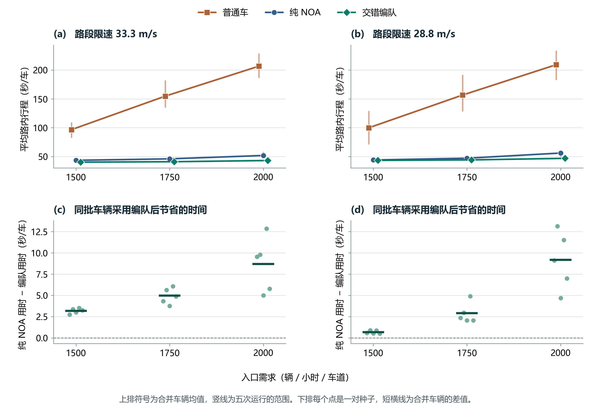
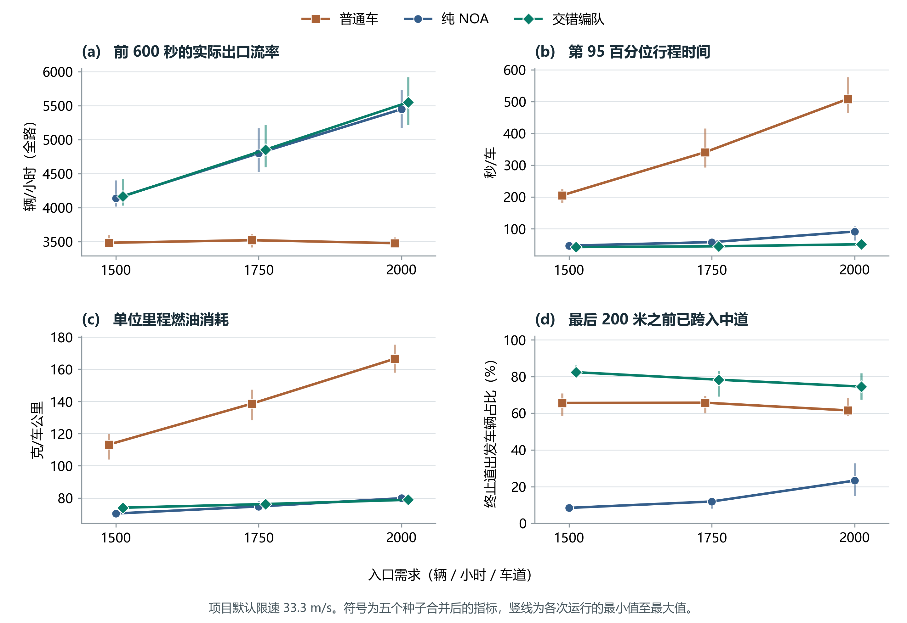

# 三车道缩为两车道时，普通车、纯 NOA 和交错编队如何通行？

本页记录 GitHub 标签 `2026.11.18-v1` 的结果。加入主动跨道补位后的实测和使用方法见[补位版报告](../2026-11-18-formation-fill/README.md)。

在普通车 IDM 时距为 **0.85 秒**的实验中，需求越高，交错编队相对纯 NOA 节省的时间越多。项目限速为 33.3 m/s 时，每车道每小时来车 1500、1750、2000 辆，编队分别将平均路内行程缩短 **7.34%、10.80%、16.80%**。在最高需求下，差别尤其体现在慢车上：纯 NOA 有 95% 的车在 91.5 秒内走完，编队把这个时间缩短到了 51.5 秒。

## 一、道路、来车和计时

从入口到出口共 1200 米。前 1000 米有三条车道，末端的 200 米有两条。下文把持续通到出口的两道记为 0 道和 1 道，把在 1000 米处结束的车道记为 2 道。车头到达 800 米时，局部方法第一次能直接看到缩道。

三道独立随机来车 600 秒。每道每 0.1 秒按“该道小时需求 × 0.1 / 3600”的概率生成一个请求，随后继续仿真直至所有车辆驶出。每档用五个种子 311–315。同一种子下，三种方法逐车使用相同的请求时刻、车道、起点和初速。三档每种方法在每个限速下分别有 3750、4384、5035 辆完成行程。**每辆车实际进入路网才开始计时，实际驶出停止计时。** 五个种子的行程合并后，每车权重相同。前 600 秒出口流率另用固定时间窗计算。

普通车取自本机 Cai MATLAB 工程中的普通驾驶分支，在项目 SUMO 1.27.1 的同一路网上运行。普通车只改 IDM 时距；本轮按两个限速重跑普通车 30 例，纯 NOA 和编队复用对应的 60 例原始行程。90 例全部排空，SUMO 碰撞和瞬移记录均为零，共复核 79,014 个实际行程。普通车额外复跑一次用于记录并道位置，两次的 26,338 条普通车记录逐车核对，进出时刻、停车时间和燃油消耗相同。[本地 MATLAB 分支核查](matlab_audit.md) · [逐种子结果](stage/headway085/cases.csv)

## 二、三种方法用了多长时间

单位为秒/车。第二列是每条入口车道的需求。普通车两列仅改变了 IDM 时距。最后一列以纯 NOA 路内时间为分母。

| 路段限速（m/s） | 每道需求（辆/h） | 普通车 0.65 s（上轮） | 普通车 0.85 s（本轮） | 纯 NOA | 交错编队 | 编队较 NOA 省时 |
|---:|---:|---:|---:|---:|---:|---:|
| 33.3 | 1500 | 48.52 | 96.66 | 43.46 | 40.27 | 7.34% |
| 33.3 | 1750 | 76.86 | 154.76 | 46.00 | 41.03 | 10.80% |
| 33.3 | 2000 | 125.78 | 206.75 | 51.80 | 43.10 | 16.80% |
| 28.8 | 1500 | 53.17 | 99.87 | 44.02 | 43.33 | 1.57% |
| 28.8 | 1750 | 95.62 | 156.63 | 47.10 | 44.18 | 6.19% |
| 28.8 | 2000 | 140.83 | 209.32 | 56.04 | 46.88 | 16.36% |

普通车对时距很敏感。项目限速下，2000 档把时距从 0.65 增至 0.85 秒，普通车的行程增加 **80.97 秒/车**。在 28.8 m/s 时，匀速跟驰的期望净距中，仅时距这一项就增加 5.76 米。宏观上，三档需求下普通车前 600 秒的出口流率都在约 3500 辆/h；加大来车量后，每辆车要花更长时间走完同一段路。最高需求下，在 600 秒内实际入场的普通车有 4533 辆，纯 NOA 和编队各有 5034 辆，三组最后都完成 5035 辆。206.75 秒完全发生在路内。普通车平均只累计停车 2.51 秒，长行程的大部分时间花在仍有速度的行驶过程中。[0.65 秒历史数据](stage/headway_065.csv) · [本轮汇总](stage/headway085/summary.csv)

两种局部方法共享观测、执行器和巡航策略，最适合用来说明编队方法的收益。两种限速、三档流量下，30 对同种子结果均为编队更快。限速降低后，1500 档只节省 0.69 秒/车，2000 档仍省 9.17 秒/车，可见低需求下的收益对速度条件更敏感。



图 1。上排给出三组的平均行程与五次运行的最小、最大值。下排将两种局部方法单独比较，每个点是同一种子下纯 NOA 减去交错编队的平均行程，短横线是按所有车辆合并后的差值。同一需求下的符号在横向略微错开，便于识别。[矢量原图](stage/headway085/travel_time.svg)

## 三、交通效率、能耗和编队表现

**行程与可靠性。** 平均行程回答“一辆车通常花多久”，P95 回答“给多长时间，能让 95% 的车完成行程”。P95 用合并逐车时间排序后第 `ceil(0.95 × 车辆数)` 项。FHWA 用第 95 百分位行程时间描述可靠性。在本实验中，样本来自相同道路上不同车辆和五次来车过程。[FHWA 行程时间可靠性指标](https://ops.fhwa.dot.gov/publications/tt_reliability/TTR_Report.htm)

**流率、停车与能耗。** 出口流率为前 600 秒实际驶出车辆数折算的全路小时流率，包含启动期。停车时间取 SUMO 的逐车 waitingTime，速度降至约 0.1 m/s 及以下时累计。油耗是同一汽油车模型 HBEFA3/PC_G_EU4 的燃油质量除以总行驶里程，以克/车公里表示。Cai 等在多车道编队工作中也同时考察了行程时间和燃油。本文所有数据来自本项目实验。[SUMO 行程与燃油字段](https://sumo.dlr.de/docs/Simulation/Output/TripInfo.html) · [Cai 等多车道编队研究，图 13](https://ietresearch.onlinelibrary.wiley.com/doi/full/10.1049/itr2.12249)

**提前并入。** 分母是从 2 道实际出发的全部车辆，分子是首次从 2 道跨入 1 道时车头纵向位置小于 800 米的车辆。三个方法都取车辆横移经过两道分界、所属车道切换的时刻。一次换道从发起到车身在目标道回正需要时间，图表使用的是这一过程中的跨线时刻。[统计代码](tools/report_headway085.py) · [SUMO 换道输出](https://sumo.dlr.de/docs/Simulation/Output/Lanechange.html)

### 项目道路限速 33.3 m/s

| 每道需求 | 方法 | P95 行程（s） | 出口流率（辆/h） | 路内停车（s/车） | 油耗（g/车公里） | 提前并入 |
|---:|---|---:|---:|---:|---:|---:|
| 1500 | 普通车 | 205.5 | 3484.8 | 2.02 | 113.24 | 65.60% |
| 1500 | 纯 NOA | 47.1 | 4138.8 | 0.53 | 70.32 | 8.42% |
| 1500 | 交错编队 | 42.6 | 4166.4 | 0.01 | 73.94 | 82.36% |
| 1750 | 普通车 | 340.8 | 3523.2 | 2.47 | 138.60 | 65.75% |
| 1750 | 纯 NOA | 58.2 | 4801.2 | 1.33 | 74.71 | 11.90% |
| 1750 | 交错编队 | 45.2 | 4854.0 | 0.08 | 76.21 | 78.27% |
| 2000 | 普通车 | 508.2 | 3478.8 | 2.51 | 166.46 | 61.55% |
| 2000 | 纯 NOA | 91.5 | 5449.2 | 1.93 | 79.85 | 23.28% |
| 2000 | 交错编队 | 51.5 | 5551.2 | 0.25 | 78.85 | 74.51% |

2000 档共有 1675 辆车从终止道出发。纯 NOA 有 **390** 辆在最后 200 米之前跨入中道，编队有 **1248** 辆，增加了 858 辆。同期出口流率提高 **102 辆/h（1.87%）**，P95 缩短 **40.0 秒**。也就是说，这组实验中编队对耗时较长车辆的改善，比固定窗口出口计数的变化更显著。普通车同样有 61.55% 的车辆提前并入，它的行程却最长，说明换道位置本身不足以解释整条路的表现。

1500、1750 档，编队每车公里分别比纯 NOA 多用 3.62、1.50 克燃油；2000 档则少用 0.99 克。三个流量档都省时，燃油收益随需求和限速变化。



图 2。项目限速下的五次配对运行。竖线为逐种子指标的最小值至最大值。[矢量原图](stage/headway085/traffic_metrics.svg)

### 共同限速降至 28.8 m/s

| 每道需求 | 方法 | P95 行程（s） | 出口流率（辆/h） | 路内停车（s/车） | 油耗（g/车公里） | 提前并入 |
|---:|---|---:|---:|---:|---:|---:|
| 1500 | 普通车 | 210.1 | 3490.8 | 1.55 | 99.39 | 61.83% |
| 1500 | 纯 NOA | 47.9 | 4132.8 | 0.52 | 67.66 | 8.02% |
| 1500 | 交错编队 | 46.2 | 4138.8 | 0.06 | 66.54 | 72.49% |
| 1750 | 普通车 | 347.8 | 3514.8 | 2.52 | 125.24 | 59.15% |
| 1750 | 纯 NOA | 59.3 | 4765.2 | 1.54 | 72.16 | 12.79% |
| 1750 | 交错编队 | 48.5 | 4818.0 | 0.18 | 69.02 | 70.77% |
| 2000 | 普通车 | 490.7 | 3428.4 | 1.95 | 158.82 | 55.04% |
| 2000 | 纯 NOA | 106.0 | 5379.6 | 2.73 | 77.71 | 24.24% |
| 2000 | 交错编队 | 59.7 | 5500.8 | 0.61 | 73.07 | 64.84% |

### 有多少车辆参与，能持续多久

每辆编队车每步报告一个 0 或 1。参与率是值为 1 的车辆时间除以全部受观测的车辆时间。持续时间是同一辆车从进入状态 1 到回到 0 或离场的连续时长，按片段取平均，途中跟驰对象可以变化。峰值是这五次运行中，同一时刻全路最多有多少辆车报告 1；这些车可以分属多个局部队列。单靠 0/1 不能还原每支独立车队的长度，也不能据此判定速度扰动是否沿车队放大。

| 路段限速 | 每道需求 | 编队参与率 | 连续参与平均时长 | 全路同时参与峰值 |
|---:|---:|---:|---:|---:|
| 33.3 | 1500 | 97.63% | 38.81 s | 72 辆 |
| 33.3 | 1750 | 98.63% | 40.10 s | 84 辆 |
| 33.3 | 2000 | 99.32% | 42.64 s | 97 辆 |
| 28.8 | 1500 | 97.75% | 42.06 s | 77 辆 |
| 28.8 | 1750 | 98.75% | 43.45 s | 91 辆 |
| 28.8 | 2000 | 99.42% | 46.46 s | 113 辆 |

普通车没有编队控制，参与率按方法定义为 0。纯 NOA 的实际状态输出始终为 0。两者的同时参与峰值均为 0，均无参与片段可求持续时间。以上统计均在车辆决策之后完成。[状态统计实现](../../../variants/phase5g_pure_formation/experiments/native_sumo.py)

## 四、同一辆车交给三种方法，各自怎样开

三组车长 4 米、宽 1.8 米、静止净距 1.5 米，车型最高速度 33.3 m/s，初速 28.8 m/s，最大加速度 5 m/s²，常规减速度 10 m/s²，紧急减速度 30 m/s²。三组共用发车清单、同一网络、相同排放模型和 0.1 秒仿真步长，连续换道时长设为 1 秒。下面逐项列出会改变驾驶行为的差异。

| 驾驶问题 | 普通车（本机 Cai 的 HDV 控制） | 纯 NOA | 分布式交错编队 |
|---|---|---|---|
| 谁给出速度和车道 | SUMO 的 IDM 计算加速度，LC2013 选择车道。速度模式 31、换道模式 1621。 | 本车每步给出速度和车道请求，SUMO 做物理执行和安全检查。速度模式 31、换道模式 512。 | 与纯 NOA 共用同一观测和执行器，替换单车决策规则。 |
| 能看到哪些车与道路信息 | 原生换道器从入口就可读完整路线的接续关系和后续车道占用。可因终止道不能直达出口而提前换道。 | 本车观察三道，前 200 米、后 100 米。距缩道点 200 米内才直接看到道路末端。邻车以本车追踪编号区分。 | 和纯 NOA 相同。前车已经开始横移时，后车可以在自己看见缩道前作出反应。 |
| 跟驰时距放在哪里 | **0.85 秒直接写入 IDM**。期望净距随本车速度、接近速度变化，IDM 用净距计算加速度。 | **0.85 秒在上层**，用来指定同道车头间距；底层 SUMO 的 IDM 时距为 **0.20 秒**。 | 同纯 NOA，另用同一间距的一半安排邻道错位。三者时距数字相同的部分，作用层级不同。 |
| 空路上怎么走 | 向路段与车型允许的速度行驶，主试验可接近 33.3 m/s。 | 通常请求巡航 28.8 m/s，跟驰修正的速度请求可达 33.3 m/s。 | 以 28.8 m/s 为巡航基准，可为跟驰和错位调速，实际速度同受路段限速与车辆动力学约束。 |
| 跟谁走 | 原生 IDM 跟随相关前车，前车速度、实际车间净距和接近速度均进入跟驰计算。 | 正常跟随前方 50 米内车身占用本车道的最近一辆；空路巡航。 | 同道跟驰叠加邻道错位；已建立前车关系后，同道近处暂空时跟驰可延续至可见的 200 米。变换时还会考虑正在或能够汇入本车道的前车。 |
| 平路何时主动换道 | 为路线接续、获取速度收益、给邻车让行或靠右行驶而换道。速度收益权重 0.3，协作权重及其调速子权重为 0.5。 | 本车和本车道前车都慢于 26.8 m/s，安全相邻道向前多出超过 15 米空间，才为超车换道。可选时取前向空间最大者。 | 正常形成队形时，各车在现有车道前后错位。该控制分支没有自由超车或按各道车数均分车辆的动作。 |
| 终止道何时并入 | 原生路线策略根据后续接续、车道占用、邻车和可用间隙决定时机。 | 自己看见缩道且中道安全就并入。若并不进去，可降低速度对准中道实际前车后方。上游也可能因普通超车先行离开终止道。 | 自己看见缩道，或看到本车道实际前车已朝中道横移，就准备从 2 道进 1 道。暂时进不去时先跟本车道实际前车，可开始横移时才接续目标道前车。 |
| 接收道怎样响应 | LC2013 可在模型内部向阻挡合流的邻车传递角色或建议速度，由邻车按协作权重响应。 | 继续本车的跟驰或超车，各车执行共同避碰规则。 | 1 道车可为 2 道车留出跟驰空间；本车受约束且 0 道有合适空位时，可从 1 道向 0 道接续。0 道车也可把具备并入条件的 1 道前车纳入跟驰。 |
| 换道安全与连续性 | 采用 SUMO 原生安全间隙、速度调整和横向执行。 | 在当前时刻与 1 秒预测时刻检查目标道净空，再经共同执行器、安全速度和 SUMO 检查。优先执行本车尚未完成的换道。 | 和纯 NOA 用相同的最终检查；主动腾位多检查目标位置能否容下接入间距。本车可记住同一个空位的前车，持续对准。 |
| 怎样协作、是否记作编队 | 保留原生隐式让行。无编队控制、集中式规划与奖励模块。 | 靠本车局部感知，状态始终为 0。 | 靠本车观察到的运动和自身记忆，无 V2V、全局配车、统一换道时刻或队长广播。状态 1 表示已有可用的跟驰或配对关系。 |

普通车与项目两组的差值同时包含 IDM 时距所在层级、纵向控制律、巡航、择道和信息范围带来的差别。向老师说明编队贡献时，以纯 NOA 为主对照，以普通车说明原生驾驶在相同路网上的表现。先前把三组底层 IDM 都设为 0.20 秒时，普通车在项目限速 2000 档曾达到约 37.58 秒/车，说明普通车与 NOA 的排序会随基线设定变化。[共享底层参数实验](matched_planners.md) · [普通车参数与原生路线信息的逐项实测](hdv_information.md) · [SUMO 换道模式](https://sumo.dlr.de/docs/TraCI/Change_Vehicle_State.html#lane_change_mode_0xb6)

## 五、交错编队如何形成

1. **先找同道实际前车。** 本车看三个车道上的车辆。正常跟驰选 50 米内、车身实际占用自己车道的最近前车；正跨线的前车也可以占用本车道。对已建立的跟驰关系，当 50 米内暂时没有前车时，可接续到 200 米内当前最近的同道前车。始终没有参考车，则以巡航速度行驶。
2. **同道间距随着车速变化。** 车头到车头的目标距离是 `D(v) = 4 + 1.5 + 0.85v` 米，其中 4 米是前车长度，1.5 米是静止净距，速度单位是 m/s。以 28.8 m/s 行驶时，目标车头间距为 29.98 米，相邻两辆车之间的净距为 25.98 米。0.85 是本次采用的目标时距，不代表实测中每两辆车都恰好相隔 0.85 秒。
3. **把距离误差换成速度修正。** 同道前车在位置 `x前` 时，本车瞄准 `x目标 = x前 − D(v本)`。以参考车速度为基准，每米位置误差对应 0.3 m/s 的期望速度修正。每个 0.1 秒步长只走当前速度到该期望速度之差的 20%，随后应用安全上限。车离得远会逐步追上，离得近会逐步放缓。
4. **用看得见的邻道车辆建立交错关系。** 0 道与 2 道使用相同的纵向基准，1 道比它们向后错半个车头间距。两辆车配对时用两车平均速度计算这个间距。每边只在 50 米范围内选错位误差最小的邻车；误差相同再按实际纵向距离、位置和运动量比较。然后本车用同一张局部快照，从候选车的位置反算一次。只有双方按这张快照会选中彼此，才使用这个配对。车辆始终直接观察邻道，不需要数本车道前方车辆来推断邻道有几层。
5. **用纵向调速形成队形。** 每个配对取一半错位误差，中道车可合并左右两边的误差。位置增益仍取 0.3，错位对应的速度修正限制在 ±2 m/s，再乘以上述 20% 响应。若这项调整与同道跟驰要求方向相反，以同道跟驰为先。正横移的车辆按照实际横向位置，在两个车道的目标错位之间连续过渡。
6. **形成阶段的换道原则。** 平直三道上的交错是靠前后调速形成的。车辆从各自进入的车道寻找邻车，没有凑足固定车数、给每条车道配同样数量或强制补齐编队层数的规定。当前三组对照用的是“形成＋变换”控制，横向重排发生在下节的合流与接续条件下。
7. **车辆何时报告自己已参加。** 形成时，有同道跟驰前车、50 米内有同道后车、或与相邻车道双向配对，都可产生状态 1。变换时，实际使用的队列前车或接续参考车也可产生状态 1。孤立且无关系的车为 0。该状态允许车辆仍在调整间距，统计器只汇总报告。

例如当车速均为 28.8 m/s，假设 0 道车头位置是 400 和 370 米，2 道处在同样的纵向层次，那么这一层 1 道车的理想位置约为 385 米。继续行驶时三辆车都在前进，半个间距也跟着车速改变。这里的 400、385、370 米是用于讲解的瞬间位置，控制器只保存眼前邻车的局部关系。[实际决策代码](../../../variants/phase5g_pure_formation/noa/native_rules.py)

## 六、三道缩为两道时，车队怎样变换

1. **终止道产生第一个横移动作。** 2 道车辆看到前方 200 米内有缩道，或看到本车道最近的实际前车已向 1 道移动（向内横向速度大于 0.1 m/s），就开始寻找并入机会。后续车辆可以直接看到这个动作，所以不必都等到自己的车头到达 800 米。每辆车都独立检查自己的空隙。
2. **中道判断自己下一刻要跟谁。** 1 道车辆把实际同道前车与可能并入的 2 道前车放到一起比较。当自己看到了缩道，或看到这辆 2 道车已向内横移，同时该车在本车观测中具备横移空间时，这辆车可成为参考。候选里选纵向最近的前车。中道车据此调速，就能把空间留在即将进入的车辆后方。
3. **另一条存续道也能接续。** 0 道车看到前方的 1 道车已经向内横移，且横移安全时，可以跟它。若 0 道车已见到缩道，且看到该 1 道车前方一个目标间距内确有一辆可并入的 2 道车，它也可以提前考虑这辆有条件向 0 道接续的 1 道车。每个候选都来自这辆 0 道车实际看到的车辆。
4. **中道只有确有空位时才向 0 道移动。** 本车见到缩道、观察到邻车向内横移、或已有未完成计划时，才考虑这个动作。前车已进入接入距离内，或跟着它要慢于巡航速度时，本车寻找 0 道最近的真实前车。待接入的位置在这辆前车之后 `d = max(D(v), 16 m)`，其中 16 米让半间距至少容得下 8 米的横移检查距离。有本车道前车时，新的位置应至少与当前位置同样接近“该前车后方半个接入距离处”；若本车道前面空着，目标点需能改善现有纵向目标，接续 2 道前车时允许同等位置。
5. **算出来的位置必须真的容得下车。** 检查 0 道前后各车，相对目标点当前和 1 秒后的纵向距离均要达到接入距离，期间不能交叉。本车侧旁 8 米内有人占着横移通道也不能发起。已找到合适空位时，车辆用自己的短时记忆跟住该空位的前车；条件变化就重新选择。这里的 8 米是按车辆纵向参考点测得的车头位置差。
6. **执行有先后，车辆各自决定时刻。** 已经在进行的换道优先，其次是 2→1 的必要合流，再其次是 1→0 的可选腾位。2 道车暂时并不进去时先跟自己车道的前车，只在能开始并入或已横移时接续目标道前车。有方案时，本车速度仍受实际同道前车和制动距离约束。每次只横跨一条车道，当前及按相对速度预测的 1 秒后都要有至少 8 米纵向空间；执行器再检查车身占用、道路限速和 SUMO 的安全条件。距终止道末端只剩 200 米时还会计算停得住的速度上限。
7. **两道上重新排好。** 换道时长设为 1 秒。执行器以车身到达目标道中心 0.05 米内、横向速度低于 0.05 m/s 识别完成。随后车辆继续在 0、1 两道上根据同一套跟驰和错位原则选择参考车。仿真每 0.1 秒统一更新物理世界，各车可能在相邻几步看到相似的横移信号；各车的开始时刻由自身观测和间隙决定。[单车变换规则](../../../variants/phase5g_pure_formation/noa/native_rules.py) · [局部观测、换道执行和运行记录](../../../variants/phase5g_pure_formation/experiments/native_sumo.py)

**把机制和结果连起来。** 2000 档由纯 NOA 切换成编队后，同一批终止道车辆有更多在上游并入，路内停车和出行时间尾部都下降。此前还做过一次更有针对性的对照，固定变换规则，只把邻道目标从并排改成交错。2000 档平均每车又省 4.51 秒，缩道前最后 200 米的累计低速车辆时间从 1785.64 降到 334.70 车·秒。那次行程按发车请求到驶出、五个种子等权，其作用是单独检验队形几何；本报告的主表始终按实际入场到驶出。这两组实验共同支持的解释是：交错先把邻道车辆沿路排开，局部变换再利用这些前后空间，让更多车辆在缩道口上游完成合流。[交错与并排、开启与关闭变换的四组对照](factorial_hdv.md)

## 七、数据、图片与复算

[18 行汇总数据](stage/headway085/summary.csv) · [90 行逐种子数据](stage/headway085/cases.csv) · [图 1 PNG](stage/headway085/travel_time.png) · [图 1 SVG](stage/headway085/travel_time.svg) · [图 2 PNG](stage/headway085/traffic_metrics.png) · [图 2 SVG](stage/headway085/traffic_metrics.svg)

在项目根目录运行下列 PowerShell 命令。两次仿真分别生成两种限速的全套三组数据。每次使用新的输出目录，汇总脚本核对网络、车型、逐辆来车、实际行程、碰撞与瞬移，然后按原始 SUMO 记录出表。仅重画图时，把最后一行的目录换成已归档的 `stage/headway085` 的完整相对路径即可。

```powershell
$t = 'docs/experiments/2026-11-18-local-bottleneck/tools'
python -B scripts/run_logged.py --label headway085-333 --timeout 28800 -- python -B "$t/run_onroad.py" tmp/verify085_333 --road-limit 33.3 --hdv-tau 0.85
python -B scripts/run_logged.py --label headway085-288 --timeout 28800 -- python -B "$t/run_onroad.py" tmp/verify085_288 --road-limit 28.8 --hdv-tau 0.85
python -B "$t/report_headway085.py" tmp/verify085_333 tmp/verify085_288 tmp/verify085_tables
python -B "$t/plot_headway085.py" tmp/verify085_tables
```
