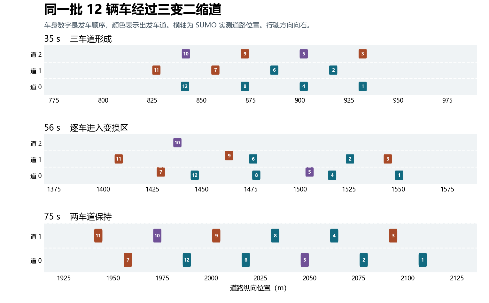

# 从三道四层到两道六层

12 辆车依次从入口驶入，三个车道分别来了 6、4、2 辆。先让车在直路上自己补位，形成每道 4 辆的四层交错队形。等各车自己看到缩道，再把同一批车排成每道 6 辆的六层交错队形。这正是本次实验要验证的两个动作。[改动前的 2026.11.19 第一版](https://github.com/32780542/yanjiu1/tree/2026.11.19-v1)

## 在窗口里看一次

在项目根目录运行 `python runrun.py --transform-demo`。图和窗口使用相同的来车。35 秒时看道路 825–940 米处，三道各有四辆，两条外侧道大致并排，中道退后半个间距。56 秒时看 1400–1560 米处，每辆车随自己看到的道路逐步变换。75 秒时看 1935–2110 米处，最前方的 1 号车在道 0，下一辆 3 号车在道 1，再下一辆 2 号车回到道 0。沿车队看过去，两道依次交替。窗口可以手动缩放、平移。



这条演示路在 1600 米处缩道，下游留出 1000 米观察保持过程。直接运行 `python runrun.py` 则使用原 1200 米道路，1000 米处缩道，下游 200 米。两种场景的道路感知距离都是 200 米。12 辆车巡航时排成两道约占 165 米，在原路下游能同时看见全队的距离只剩约 35 米。

## 每辆车如何决定

**1. 找到身边的车。** 每辆车可以观察所有车道前方 200 米、后方 100 米内的车辆，观测量是车身位置、速度和横向运动。在视野中沿道路前后排列，相邻纵向间隔不超过 50 米的车连为一段。本车的临时跟踪号只用于识别连续观测或输出自身参考关系。车之间没有消息、共享队号、发来的目标或公共发令时刻。

**2. 三车道先补人，再排齐。** 当可见车群至少有三辆，且本车能在前端或后端多看出一个连接间距时，它从前往后逐层检查实际占道。如果各道车数最多只差一辆，保持车道。如果相差两辆或更多，按前方已占位置寻找缺位，直接检查目标道有没有车占着它，优先考虑靠前且有安全横移空间的候选。每辆车只执行算到自己身上的动作，一次跨相邻一道。可见群内正在横移时先让该动作完成。车辆按各道前后次序调距。较短或两端都截断的可见片段，用同道前车跟驰与邻道配对调距。

**3. 用车速定义交错几何。** 同道目标车头间距为 $D(v)=4+1.5+0.85v$ 米。4 米是车长，1.5 米是静止净间距，0.85 秒是目标时距。巡航 28.8 m/s 时同道间距 29.98 米，对应邻道错位 14.99 米。三道时每层有三个位置，两道时每层有两个位置。0.85 秒沿用本项目的比较设置。

**4. 看见道路变窄，重新确定自己在两道上的位置。** 本车距终止点不超过 200 米时开始使用两道几何。在两车道路段持续使用同一目标。把可见车群从前到后编号为 $j=0,1,\ldots$。第一辆可见车所在的存续道记为 $b$，若它还在将要终止的道 2，则就近取 $b=1$。第 $j$ 辆的目标道为 $(b+j)\bmod 2$。因此道 0 和道 1 都能接车，哪一道在前由当时实车决定。按纵向次序交替也允许两种镜像队形。每次最多申请横跨一道，较远的目标分两次完成。队形变换不需要读取前车的转向意图。

**5. 一起调距。** 设本车在可见段内排第 $i$，第 $j$ 辆的实测纵向位置为 $x_j$，以群内平均速度求半间距 $h=D(\bar v)/2$。假设队首几何位置是 $a$，那么第 $j$ 辆应在 $a-jh$。把所有可见车辆的纵向位置都纳入最小二乘拟合，得到

$$
a^*=\arg\min_a\sum_{j=0}^{n-1}(x_j-a+jh)^2
=\frac1n\sum_{j=0}^{n-1}(x_j+jh),\qquad x_i^*=a^*-ih .
$$

这个解保留了可见车群的纵向中心。三道排齐用相同的平移拟合原理，偏移量改为“同道名次乘以 $D$ 加上本车道的相位”。两道纵向控制使用位置误差和速度误差，给出加速度请求 $u_i=\omega^2(x_i^*-x_i)+2\omega(v_c-v_i)$。取 $\omega=2\ \mathrm{s}^{-1}$，加速度请求限于 ±5 m/s²，每 0.1 秒更新，再施加安全速度上限。对以恒速平移的固定目标，这组比例和速度反馈系数对应临界阻尼。实际车群会进出视野、交换前后次序并触发安全约束，因此全队的恢复时间用轨迹测量。

**6. 让落单车接上队尾。** 两道变换中，如果 50 米内本车已独自成段，就查看前方最近的车是否在 100 米内。100 米取自后车可被前车观察的距离。符合时用这两辆车拟合同一个交错目标，后车自然缩短距离，并落在队尾另一道。超出这个范围就独立巡航。分两批相隔较远驶入的车辆可以各自形成一队。

**7. 按实际车身执行。** 车辆检查目标道实车的横向占用、当前纵向距离和一秒后的预测距离。若间距不足或预测位置将交叉，就继续调距。已开始的横移由本车持续完成。同道及跨线占道的前车、终止道剩余制动距离、速度上限共同约束实际速度。退出的旧规则包括看到前车往旁边走便跟着走，以及为把中道车辆推向外道而单独给空隙排序。纯 NOA 对照继续使用普通跟驰、受阻超车与必要并入。

这套方法可以称为**基于局部感知与几何投影的分布式交错编队控制**。它有离散的车道选择和连续的纵向跟踪。若一段车采用一致的次序与相位，且各车到达目标，偶数辆必然两道等分，奇数辆最多相差一辆。有限视野下每辆车只对自己的可见段计算，仿真负责检验这些局部结果能否拼成连续队形。Cai 等将相对目标分配与车辆运动执行分层处理，本项目借鉴了这一建模思路，并用每车的局部几何拟合求取个人目标。[Cai 等的多车道相对运动规划论文](https://doi.org/10.1049/itr2.12249)

## 怎样衡量队形

从 SUMO 每 0.1 秒的车身轨迹独立复算，车辆的编队状态位继续单独记录。下游按实际纵向位置排序，两种镜像都计入。交错链中的车必须停在车道中心 ±0.3 米内，相邻车辆交替占道，前后邻车的纵向错位和同道两车的间距各自误差都在 ±2 米内，组内最大速度差不超过 0.5 m/s。间距目标按被比较两车的平均速度计算。检查连续车辆，夹在中间的车辆不能跳过。

- **全队保持时间**为同一批车辆全部进入相应区域、同时满足队形要求的最长一段时间，按首末合格帧的时间差计算。上游区域在本车能看见缩道之前，下游区域从缩道断面起算。
- **下游稳定交错占比**为处在交错链中的车辆时间占全部下游车辆时间的比例。至少四辆连续车辆须以相同的前后次序保持一秒，满一秒后开始计入。同一辆车同时属于几个四车片段只计一次。
- **下游车道数差**为每帧两道车数之差的绝对值按时间累加，再除以同期两道总车辆时间。0% 表示每一帧两道都同样多。断面通过量另外列出，用于区分累计车数均衡和同一时刻队形均衡。
- **上游完整层占比**每整秒取一帧，统计上游处于至少两层完整三道交错中的车辆数，除以这些帧的上游总车辆数。采用巡航间距 29.98 米，容差沿用项目原有三道几何评价。路内行程只从实际进入道路算至驶出。

[逐车群结果](cohorts.csv) · [连续车流逐种子结果](flows.csv) · [轨迹复核程序](assess.py)

## 实测结果

**同一批车能保持多久。** 原 1200 米路网上，逐辆进场的 12 辆在新旧两版通过缩道时都是 6/6。旧版下游同时排成连续交错的最多 4 辆，新版达到 12 辆。新版上游全队同时呈三道交错 1.1 秒，下游同时呈两道交错 1.1 秒。加长演示路后，同一批车上游连续保持 21.9 秒，下游从 63.2 秒起连续保持 28.8 秒。[可直接复算的演示轨迹](demo/positions.jsonl.gz)

| 固定来车 | 加长路下游断面两道通过量 | 同时交错的最大规模 | 同一批车全员在下游连续交错的最长时间 |
|---|---:|---:|---:|
| 12 辆从入口逐辆发车，初始 6/4/2 | 6 / 6 | 12 | 28.8 秒 |
| 12 辆从分散位置出发 | 6 / 6 | 12 | 4.4 秒 |
| 6 辆，初态偏向外侧道 | 3 / 3 | 6 | 32.0 秒 |
| 6 辆，初态偏向中道 | 3 / 3 | 6 | 32.0 秒 |
| 5 辆 | 3 / 2 | 5 | 32.5 秒 |
| 9 辆 | 5 / 4 | 9 | 30.5 秒 |
| 两批各 6 辆，间隔 8 秒 | 6 / 6 | 6 | 两批分别行驶，全 12 辆为 0 秒 |

**连续随机来车。** 原路网上持续发车 600 秒，再运行至最后一辆驶出。表内第一列数值是 11 月 19 日第一版，第二列数值是当前方法。每档的三个种子为 6、311、312，按种子等权取平均值。种子 313 单独复核。12 对实验的新旧两版各有 10,611 辆驶出，均记录到零碰撞、零瞬移。[逐对输入和结果](flows.csv) · [独立种子 313](holdout.csv)

| 辆/h/道 | 下游稳定交错占比，% | 下游两道车数差，% | 上游完整三道层占比，% | 平均路内行程，秒/车 |
|---:|---:|---:|---:|---:|
| 1500 | 2.13 → 45.95 | 9.81 → 7.39 | 4.12 → 20.54 | 42.78 → 42.44 |
| 1750 | 1.59 → 34.12 | 9.41 → 6.72 | 4.45 → 18.98 | 43.12 → 42.97 |
| 2000 | 3.59 → 21.52 | 9.03 → 6.83 | 2.78 → 13.38 | 46.46 → 43.24 |

独立种子 313 在三档流量下，下游稳定交错占比分别从 0.95%、0.67%、3.47% 提升到 **49.19%、39.45%、21.36%**。2000 辆/h/道时，独立种子的平均行程由 43.51 变为 43.21 秒，短于前三种子的平均改善幅度。更一致的效果是下游交错和车数均衡。高流量时队形仍常被打断，21.52% 表示全部下游车辆时间里，约五分之一处于连续保持的四车及以上交错片段。

**试过哪些做法。** 在原路逐辆进场的 12 车试验中，只用队首位置作参照的候选在下游保持全队交错 0.2 秒，只跟前一辆作参照的候选最多同时排齐 6 辆。最终采用共同拟合，全 12 辆同时交错 1.1 秒。分散初态中，若只认 50 米内车群，最后一辆会落后约 81 米，下游只能排齐 11 辆。把所有车的连接距离扩到 80 米虽能接回这辆车，150 秒、种子 6 的三档流量预试中，稳定队形对车流的覆盖会随流量和连接距离明显变化。保留 50 米主体范围，只允许落单车在彼此可见时与最近队尾建立双车目标，分散初态也恢复到 12 辆。另试过将两道控制的阻尼和响应速度直接用于三道。逐辆发车的 12 辆在上游始终未达到完整四层。2000 辆/h/道的 150 秒预试中，上游完整层占比由 13.96% 降为 0%，所以三道形成沿用较缓的调距。[候选方法实测](selection.csv) · [控制器中的两个模块](../../../variants/phase5g_pure_formation/noa/native_rules.py)

## 复现

```powershell
python runrun.py --transform-demo
python runrun.py --transform-demo --headless --output-base tmp/demo
python variants/phase5g_pure_formation/run_native_flow.py --mode transform --flow 2000 --duration 600 --seed 6 --max-time 850 --output-base tmp/traffic
python docs/experiments/2026-11-19-staggered-reconfiguration/assess.py docs/experiments/2026-11-19-staggered-reconfiguration/demo --cohort
```

评价新运行时，把最后一行的目录换成本次的结果子目录。连续来车去掉 `--cohort`。固定车群的七个输入沿用[11 月 18 日的初态](../2026-11-18-formation-fill/initials.json)。逐辆入场的 `stream` 使用根入口的十二次发车。两版输入到达序列的 SHA-256 列于数据表，便于配对复核。
