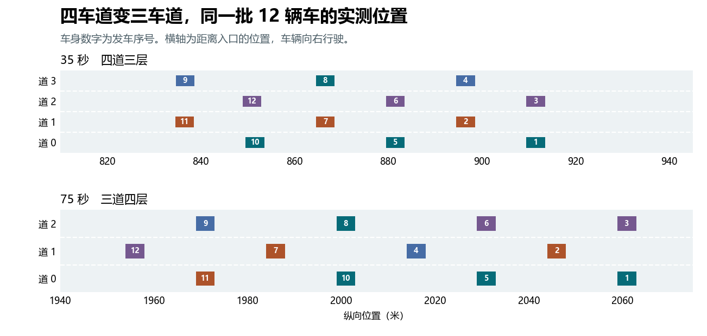

# 终止道少跨一道，三车道末层先填两侧，四变三实测

[2026.11.20 第一版](https://github.com/32780542/yanjiu1/tree/2026.11.20-v1) 保存了改动前的代码与用户的窗口设置。控制器继续使用前 200 米、后 100 米内各车道的实车观测。本车距终止点 200 米时才开始变换。

## 三变二怎样减少连续换道

道 2 的车要离开终止道。如果再把它分配给道 0，它就得先去道 1，再去道 0。新方法保留了两道交替的纵向位置，只在局部重新分配谁来占这些位置。

每车在自己的视野里从前向后看，每六个相邻位置分为一段。选六个有一个几何原因：三道的两层和两道的三层正好都容纳六辆车。每段先按纵向交替算出道 0 和道 1 各有几个位置，再尽量把道 0 的位置给本车未在终止道见过的车。候选较多时，优先保留原有交替次序，其次考虑谁已在道 0。同一目标道保留各车的纵向次序，位置仍按时距拟合。这样，原来在中道的车可以移向道 0，留在道 1 的位置就能接收终止道来车。

“在终止道见过”由每辆车自己的传感器记录，使用本车的临时跟踪号。车辆离开本车的可见车群后，该记录就会释放。车道安全检查和正在执行的横移仍优先。分段内可选车辆与每车可见范围都有限，因此连续两次换道仍可能发生。

**连续车流对照。** 两版各跑 1500、1750、2000 辆/h/道，种子 6、20，每次连续来车 600 秒再排空。普通实验路长 1200 米，1000 米处缩道。连续换道按 SUMO 记录的车身到达目标车道中心、横移结束的事件判定。从距缩道 200 米起，如果同车相邻两次完成事件依次为 2→1、1→0，便计一辆，观察到驶出为止。表中分母为同期完成 2→1 的车辆数，两种计数均按车辆去重。

| 流量（辆/h/道） | 第一版连续换道 / 完成并入 | 新版连续换道 / 完成并入 | 下游稳定交错车辆时间，第一版 → 新版 | 平均路内行程，第一版 → 新版 |
|---:|---:|---:|---:|---:|
| 1500 | 251 / 528 | 14 / 549 | 44.25% → 44.48% | 42.48 → 42.36 秒 |
| 1750 | 381 / 600 | 9 / 626 | 29.08% → 37.60% | 42.91 → 42.61 秒 |
| 2000 | 520 / 683 | 23 / 709 | 18.52% → 22.25% | 43.36 → 43.39 秒 |

稳定交错沿用 11 月 19 日的口径。同样四辆或更多相邻车满足交替、间距、速度和车道中心要求满 1 秒后开始累计车辆时间。百分比与行程按两个种子等权平均，各车只计进入道路至驶出的时间。六次配对的主要变化是少做一次横移，2000 档平均行程基本持平。[逐种子记录和来车校验值](flows.csv)

## 三车道最后一层怎样补位

完整三道交错层在道 0 和道 2 各有一辆，中道的一辆退后半个同道间距。车数还明显不均时继续在可见车群内从前向后安全补位。各道车数已至多相差一辆，又发现中道比某条外道多时，中道队尾车辆优先查看那条外道，安全时补过去。两侧都缺车时选择有安全空间的一侧。

三组来车都专门把一辆车放在中道多余的位置。下表从同一批车辆的实际位置读取，第 35 秒车辆都还在三道上。持续时间则使用全部上游帧，要求整队同时满足间距、错位和速度条件。

| 总车数 | 初始道 0 / 1 / 2 | 新版第 35 秒 | 上游正确末层最长连续时间，第一版 → 新版 |
|---:|---:|---:|---:|
| 2 | 1 / 1 / 0 | 1 / 0 / 1 | 0 → 35.1 秒 |
| 4 | 1 / 2 / 1 | 2 / 1 / 1 | 0 → 34.4 秒 |
| 5 | 2 / 2 / 1 | 2 / 1 / 2 | 0 → 34.2 秒 |

12 辆逐车进场的三变二演示仍能先排成 4/4/4，再排成 6/6。下游全队连续交错 28.9 秒，4 辆从终止道并入的车都只跨了一道。[全部固定车群结果](cohorts.csv)

## 四变三的效果

上游使用四条真实 SUMO 车道，四条道独立生成车辆。车辆看到缩道后，每三个相邻位置构成新三道队形的一层。同层按横向位置分配道 0、1、2，再用速度相关的同道间距调距，两侧在前、中道落后半个间距。末层只剩两辆时各占一侧。在试验中也比较过将 6 或 12 个位置一起分配，按三辆一层重排让逐车入场的 12 辆车在下游连续保持得最久。



演示路在 1600 米处缩为三道，之后还有 1000 米可观察整队。普通逐车入场的 12 辆从 4/3/3/2 出发，上游达到 3/3/3/3 并连续保持 19.8 秒，通过缩道时是 4/4/4，下游整队连续保持 28.6 秒。从已排齐的四道三层出发，下游保持 27.6 秒。从终止道偏多的 1/2/3/6 出发，下游保持 27.5 秒。固定车群验收使用所有车的车身位置，要求数量平衡、中心偏差至多 0.3 米、组内速度差至多 0.5 m/s，折算到同一队首位置后的最大纵向差至多 2 米。

连续来车仍使用 1200 米道路和 200 米长的下游，各档用相同的四道来车与纯 NOA 配对。下表“三道交错几何占比”每整秒取一帧，计算下游处于至少两层完整三道交错（至少六辆）的车辆占比，采用巡航目标间距 30 米、纵向容差 2 米。NOA 的这一列仅统计实车偶然满足几何排列的频率。本地编队状态位在 NOA 下始终为 0。该指标与上表两道四车持续一秒的指标各有自己的定义。

| 流量（辆/h/道） | 每方案完成车辆 | 下游三道累计通过量（编队） | 三道交错几何占比，NOA → 编队 | 平均路内行程，NOA → 编队 |
|---:|---:|---:|---:|---:|
| 1500 | 2043 | 718 / 634 / 691 | 0.00% → 13.23% | 42.83 → 42.90 秒 |
| 1750 | 2368 | 848 / 752 / 768 | 0.35% → 8.82% | 44.61 → 42.99 秒 |
| 2000 | 2697 | 958 / 862 / 877 | 0.00% → 3.62% | 46.31 → 43.45 秒 |

两套路网共 24 次连续车流运行，25,102 辆次全部驶出，零碰撞、零瞬移。四变三在固定车群上能稳定成形。在最密的随机车流里，三道都有车通行，但同时出现两层完整交错的车辆占比只有 3.62%。四变三的连续横移也是后续可改善之处，例如 2000 档中有 272 辆从道 3 完成并入道 2 后又连续换到道 1。[逐种子数据](flows.csv)

## 打开窗口与复算

在项目根目录运行。演示在第 35 秒观察约 840–915 米处，在第 75 秒观察约 1960–2065 米处，均可手动移动视野。直接点击运行沿用本地设置的每道 1750 辆/h、种子 20、GUI 每步延时 1000 毫秒。下面命令将演示延时暂时调为 40 毫秒。

```powershell
python runrun.py --four-to-three-demo --gui-delay-ms 40
python runrun.py --transform-demo --gui-delay-ms 40
python variants/phase5g_pure_formation/run_native_flow.py --mode transform --scenario four_to_three --flow 1750 --seed 20 --duration 600 --max-time 1000 --output-base tmp/four
```

用 `--mode noa` 复算四变三对照。将结果子目录传给 [measure.py](measure.py) 可复算车道通过量、连续换道与轨迹几何，固定车群加 `--cohort`。演示输入也保存在[固定初态](fixed-inputs.json)中，各个场景的数组可用于实验入口的 `--initial`。
