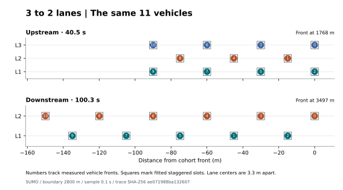

# 交错编队的形成、变换与最优性

**12:00 审阅入口。** 从[当前方法与实测结果](noon_review.md)开始，可直接运行四种道路的示例。新增的[一步变换容量定理](one_hop_capacity.md)说明哪些车必须再次跨线，[前槽接收轨迹](receiving_gap.md)说明同一批车怎样实际完成合流。下文保留 08:00 时点的研究记录。

本轮从 GitHub 的 [11.24版](https://github.com/32780542/yanjiu1/tree/11.24%E7%89%88) 出发。上游“编队形成”把分散进入的车辆排成均匀的交错层；道路改变后，“编队变换”把同一批车重排到开放车道。每辆车只使用前 200 m、后 100 m 内的物理观测与自身记忆。轨迹评价可以看全队。

**08:00 审阅入口。** 11.24 原有两种缩道，在 32 个相同初态中原版 8 例两段排齐，审阅版 32 例排齐。另测两种扩道 32 例，全部排齐。现版这 64 例在变换阶段合计实跨 576 次，等于理论下界；其中 5 例四变三仍有个别车同向连跨两道。[按道路看结果、逐次换道与最短观测距离](review.md) · [固定视窗的稳定性](overlap_stability.md)

上午继续研究的逐车原因、方法对照与新增时间线见[中午审阅记录](noon.md)。

## 打开仿真看成果

在仓库根目录运行下面这条命令。11 辆车从各自车位起步，先在三道上补成 4/3/4，再变成两道的 5/6。看车辆编号可以辨认出同一批车。上游从 11.5 s 到 69.4 s 保持完整，下游从 89.7 s 到 110.8 s 保持完整。共 5 辆车各换一道，达到这个起点所能达到的最少数。窗口与计算同步，镜头可自由移动。若要看同一问题在另外三种道路上的过程，使用后文的四路演示命令。

```powershell
python runrun.py --layout 3to2 --initial-demo docs/experiments/2026-11-25-formation-transport/figures/11car_3to2_9901.json
```



**可重复到什么程度。** 在另一批 128 对未用于选择镜像规则的奇数车队中，两阶段全队形成从 110 例提高到 126 例，已有的 110 例全部保留。新增队形都由真实坐标、横向居中和速度差判定。126 个成功样本在上下游分别至少连续保持 6.8 s，123 例两段均达 10 s。120 例的实际变换同时达到所选终态的全队总跨界和单车最大跨界下界；如果允许在所有合法尾层间选择目标，112 例也达到该更低的标准。未全齐的两例分别是四变三 7 辆长列、二变三 13 辆长列。[四条道路的分母、逐案数据与相位证明](phase_moment.md)

### 审阅版四种道路的实测结果

每格给出同一批车在上游形成、下游重新形成后各自连续保持最久的秒数。12 辆的初态是陆续发车，24 辆长列从 506 m 的跨度出发，24 辆稀疏列在起步时分成多个小队。三个入口均实际打开 SUMO-GUI，按 0.1 s 计算，逐车读取坐标。12 场都能看到原班车辆形成和变换。

| 道路 | 12 辆，上 / 下游（s） | 24 辆长列，上 / 下游（s） | 24 辆稀疏列，上 / 下游（s） | 12 辆变换前后占道 |
|---|---:|---:|---:|---|
| 3→2 | 33.3 / 28.9 | 41.4 / 20.5 | 18.3 / 20.3 | 4/4/4 → 6/6 |
| 4→3 | 35.3 / 31.0 | 37.4 / 26.8 | 15.5 / 26.8 | 3/3/3/3 → 4/4/4 |
| 2→3 | 34.6 / 28.1 | 44.0 / 17.6 | 29.9 / 17.6 | 6/6 → 4/4/4 |
| 3→4 | 33.3 / 29.8 | 41.4 / 24.6 | 16.2 / 24.6 | 4/4/4 → 3/3/3/3 |

变换阶段，12 辆实跨 6 次、24 辆实跨 12 次；每辆最多跨一道。两项都是按照这些初态和终态算出的理论下界。碰撞和传送各零次。每次运行的时间区间、车数、轨迹指纹都在[实测表](review_gui.csv)。11 辆奇数案例另有[可独立检算的原始轨迹](figures/odd11_gui_evidence.zip)。

**连续来车呈现另一层现象。** 在 1500、1750、2000 辆/(小时·道)、每档两种随机来车的 900 s 对照中，相比 11.24，三变二和四变三的平均路内行程均缩短约 3.1–3.4 s。三变二的下游三秒持续交错占比相对旧版分别变化 −4.03、−0.13、+0.70 个百分点。选择前群队尾合并稀疏小队，在高流量上游也会打断已排好的局部交错，下一处值得研究的是一个车队在何时稳定保持已有成员。完整表含同条件纯 NOA、原始分母与实际入场核验。[900 s 四方案实测](public_review_900_results.md)

**变换要留出多长的路？** 在 1750 辆/(小时·道) 的持续流里，追踪四个在上游已排齐的 12 车队。把真实下游从 200 m 延到 1000 m，三变四的两组在原路段里都未全齐，延长后分别保持 22.5、27.1 s。四变三的两组从 2.0、1.4 s 延至 29.8、29.2 s。四组最终都是同样的 12 个成员，各跨 6 次、单车最多一次。它们分别来自两条路的两个有整队机会的种子。[道路长度对照与逐组轨迹](boundary_length_flow.md)

## 本轮找到的两个答案

**最少要动几次？** 以 12 辆均匀占道的三变二为例，终止道的 4 辆要并到中道，中道还要向另一存续道补 2 辆，因此最少 6 次。把这 6 步分给 6 辆车，每辆最多跨一道，即可把 4/4/4 变成 6/6。一般车道数的精确公式见下文。车道尚未开放时，沿道路横向逐道倒推可先动的人数，保留了一个能分阶段执行的计划。[完整证明与 48 组配对](transition_stages.md)

**凭什么让这辆车去占这个位置？** 在本车的可见范围里，把它改派到别的位置，允许其他车辆重新找最优搭配，比较两次最优代价。真实样本中，让 2039.030 m 处的车改变下一步，需要 2022.313 m 处的车与它换槽，总代价增加 502.481 m²；其余 18 辆不必改变分配。这个交换环给出了能逐车核对的答案。[替换环与证明](exchange_cycles.md) · [扰动多大才会改变本车动作](action_radius.md)

**怎样读结果。** [整齐满层车队](transition_stages.md)检验了相同起点能否完整变换；[7、11、13、17 辆的新种子](irregular_results.md)检验末层不满时的适用范围；[连续高流量一小时](hour_continuous_results.md)另算实际入场到驶出的时间。这三种试验各有自己的分母和观察区间。研究时间线在本文末尾。

## 先看车在路上做什么

**编队形成。** 一辆车先按实际前后间距，找出视野内与自己连续的一段车群。它按自己的速度和邻车速度算出一个同道间距。一层中每条车道可以占一个位置，相邻车道前后相错半个间距。在三车道的最后一层，先安排两侧再安排中间。本车算出这段车群可以怎样排，首先减少单车最远横移，再减少总横移；剩下的方案中选择纵向调距最小的一个。本车只追踪属于自己的位置。形成时，如果刚进入视野的车辆使建议方向很快反转，就继续调距；同一提议持续一个实际横移时长且有安全间隙，才向相邻道迈一步。

**编队变换。** 车辆实际看到道路变化后，在同一个指派问题里更换可用的目标车道。缩道时，终止道没有目标槽；如果单车至多一次跨道就能完成变换，中间车道的车也会向空的一侧补位，终止道车辆便有地方接入。扩道时可以先调速准备，到新车道真正出现后才允许横移。强制换道、对同道前车的制动、未完成的本车横移与实际空隙检查始终由单车执行。队首、队尾看到的成员可能不同，局部指派随本车观测更新。

**观察方法。** 在仓库根目录执行 `python runrun.py --layout 3to2 --transform-demo` 可看同一批 12 辆车在实时窗口里先组成三道，再变成两道。把最后一个参数换成 `--long-platoon-demo`，可看初始首尾跨度为 506 m 的 24 辆车。`--layout` 也可取 `4to3`、`2to3`、`3to4`。相机可自由平移、缩放。去掉演示参数可看连续来车。入口的车型、道路和车流设置见 [runrun.py](../../../runrun.py)；已保存的实测图片见[真实轨迹与槽位](figures/README.md)。

**看两个原本分开的小队如何相遇。** `python runrun.py --layout 3to2 --sparse-platoon-demo` 使用种子 8721 的 24 辆真实初态。后一小队能看见前群队尾时，在独立拟合的队首和“前群队尾减一个同道间距”之间取中点，全组目标作同样的纵向平移，横向指派和它的间隙随之保留。实际前车跟驰、已经执行的横移继续优先。该三变二例初始最大空档 91.68 m，在 38.0 s 首次全列连通；上游从 54.8 至 73.1 s 排齐，下游从 92.8 至 113.1 s 排齐。四种布局的真实 GUI 运行均已与对应的冻结仿真逐帧比对。[修正版配对验证](splice/retained_front.md)

### 初版固定演示中的同车队形

下表记录全体同一批车辆同时满足几何条件的最长连续时间。每道车数相差至多一辆，车均在车道中心 0.3 m 内；把各车按层号和半间距错位还原到同一队首，算出的队首位置极差须在 2 m 内，车速极差须在 0.5 m/s 内。上游只算所有车仍在预视区之前，下游只算所有车都已过边界。所有表中演示车辆均驶出，碰撞和瞬移均为零。

| 路网 | 12 车上、下游逐道车数 | 上游形成：实际 / 最少跨道 | 变换：实际 / 最少跨道 | 12 车上 / 下游保持 (s) | 24 车长演示上 / 下游保持 (s) |
|---|---|---:|---:|---:|---:|
| 3→2 | 4/4/4 → 6/6 | 4 / 4 | 6 / 6 | 33.3 / 28.9 | 41.4 / 20.2 |
| 4→3 | 3/3/3/3 → 4/4/4 | 3 / 3 | 6 / 6 | 35.3 / 31.0 | 37.4 / 26.8 |
| 2→3 | 6/6 → 4/4/4 | 0 / 0 | 6 / 6 | 34.6 / 28.1 | 44.0 / 14.1 |
| 3→4 | 4/4/4 → 3/3/3/3 | 4 / 4 | 6 / 6 | 33.3 / 31.0 | 41.4 / 26.9 |

12 车演示的上游为 1600 m，24 车长演示的上游为 2800 m，两者下游均为 1000 m。12 车四例变换时，每辆车最多实际跨一道。原 11.24 三变二上游从初始 6/4/2 形成 4/4/4 时跨了 8 次。原四变三变换的总数已经是 6 次，但有一辆实际跨了两道。统计区间采用首次及末次真实整队帧，并用车辆 ID 串起每条边界事件；驶出时的另一次补位另列。[12 车及难例明细](selected_demo.csv) · [24 车窗口运行](long_gui_cases.csv) · [11.24 基线](baseline_1124_demo.csv) · [形成距离对照](length_report.md)

**随机初态的独立确认。** 在主种子 6411–6416 的 48 对初态中，每对在 SUMO 第一帧的全部车位、车道和速度相同。11.24 有 18 对实现同一批车上下游全部排齐，新版有 24 对。新增的 6 对都是四变三、24 辆、紧凑车列。较分散的 24 个长列案例里，两版的上下游全齐数都是 0。两版都完成的 18 例里，变换总下界合计 144，实测由 170 次降到 144 次。新版另有 3 个四变三案例，虽达到总数下界，仍有一辆跨两道。[独立随机确认与各初态](random_holdout_report.md)

**实际测量扰动。** 90 次真实 SUMO 运行对比了粗界、精算强界和仅取名义最优解三种方案。20 组有噪声配对中，强界相对粗界的下游整队保持时间有 12 组增加、8 组持平；相对名义最优有 1 组增加、18 组持平、1 组减少。固定同一槽模板，用真实车位复算，强界获准的 5,476 个跨道提案有 0 个改变动作，名义最优获准的 5,585 个有 10 个改变。允许根据真实位置重新建模板时，强界也出现了 1 个分歧。由此可以说明本车动作在给定模板下更可信。[三种门控的原生轨迹比较](noise_closed_loop.md)

## 研究问题和验收口径

1. 给定同一批车辆、起始占道与实际目标车道数，最少需要跨过多少条车道边界？是否存在每辆车最多跨一道的分配？静态理论值、真实跨道事件和每车最多跨道数分别记录。
2. 给定本车的一个目标位置，强制把本车分到别处要付出多大纵向代价？哪些观测扰动不会改变这个位置的归属？邻车看到不同成员时，单个数值证书不能代替闭环轨迹验证。
3. 每次对照记录上游与下游全队连续保持时间、逐道车数和安全事件。平衡通过量只能说明道间流量，队形评价需要同一批车在同一时刻满足车道中心、前后错位和相对速度条件。

读理论可从[关闭哪条车道怎样改变跨界数](lane_position.md)、[两道镜像的精确代价差](phase_moment.md)、[末层留空时的最优选道](tail_profile_dp.md)和[本车动作的严格扰动半径](action_radius.md)开始。读实际轨迹可从[为何拉长道路仍会形成多个小队](visibility_holdout.md)、[利用可见队尾连接小队](splice/README.md)、[长时间来车的独立对照](continuous_results.md)和[同一辆车是否承担了第二次跨道](history_holdout_report.md)开始。固定车队的实测换道数以上、下游首次或末次排齐的帧为端点；持续流的占比统计使用全路实际进入的车辆。

## 理论

把车道按实际横向顺序排列。令 $n_k,q_k$ 为第 $k$ 道的初始和目标车数。新出现的道初始数为零，即将消失的道目标数为零。外侧边界流为零，内部边界净流量为 $f_k=\sum_{j\le k}(n_j-q_j)$，向编号较大的一侧取正。

**最少跨道次数。** 每条边界必须承载净流量，双向跨越只会增加次数，因此总数至少是 $\sum_k|f_k|$。把车辆和目标分别按车道排序后顺序配对，每个边界只有一个迁移方向，故达到下界。

**每车至多一次。** 当且仅当每道都有 $[f_k]_++[-f_{k-1}]_+\le n_k$。左式是满足两侧净流量而必须从这条道派出的最少车辆数。若多于原车数就必有外来车辆接力跨越。反之，分别派出两批互不重叠的原道车辆，留下其余车，守恒保证目标车数逐道成立。以六辆车三变二为例，2/2/2 到 3/3/0 只需三次；0/0/6 到 3/3/0 则需九次，其中三辆必须跨两道。此处只计起终位置，时间、避碰和可见边界由执行层负责。

**最小化单车负担。** 将车辆车道与目标车道各自排序，逐对距离的最大值是单车跨道数的最小可能上限。证明可交换任一横向次序相反的两条匹配边：排序配对后两段距离都不超过原两段中较长者；重复交换消去逆序即可。顺序配对同时达到最大值和总数的下界。因此保留能同时满足两级最优目标的边之后，仍至少存在一个完美匹配。只允许横向距离不超过该上限、且只顺着经过边界的净流方向走的边，就精确描述了这两个条件。

**把车分给交错位置。** 完整层每道一个位置，偏移量 $d_j=r_jD+\phi_j$；$D=5.5+0.85v$ 米，邻道相位相差半个间距。给定目标形状、固定槽集合，用所有实车拟合队首位置 $a=(\sum_i x_i+\sum_j d_j)/N$。在任意一对一分配下偏移量总和相同，故 $a$ 无须随排列重算。在保留的二分图中，令 $c_{ij}=(x_i-a+d_j)^2$，求最小费用完美匹配。每辆车只执行自己的目标。

**本车最优性间隙。** 设 $J^*$ 为匹配总费用，禁止本车原分配边后在相同横向最优条件下得到 $J^{-i}$，定义 $\gamma_i=J^{-i}-J^*$，单位为平方米。无替代取正无穷，等价替代取零。两观察者具有相同成员、同一目标集合、同一可用边，且每条边费用误差最多为 $\varepsilon$，则 $\gamma_i>2N\varepsilon$ 保证本车目标不变：原解及最优替代各自最多移动 $N\varepsilon$。有限视野截断、目标相位改变或新车进入属于匹配问题改变。不能用该命题证明这类情况下全队收敛。

**车道数改变时可以给出一个闭式答案。** 如果单侧扩缩、另侧车道对齐，变换前后的每道都均分了同一批 $N$ 辆车，$N$ 同时被 $K,L$ 整除，那么 $K$ 道变 $L$ 道的最小总跨道次数为 $N|K-L|/2$，单车最小最大跨道数为 $|K-L|$。证明如下。把车辆与槽分别按横向坐标排序，用分位数 $u$ 分别表示源车道 $\lfloor Ku\rfloor$ 和目标车道 $\lfloor Lu\rfloor$，取 $u=(i+1/2)/N$。全部位移同向，两组均值之差就是 $|K-L|/2$。最外侧的源车道或目标车道至少有一辆车须跨 $|K-L|$ 道，排序分配没有车辆会跨得更多。因而相邻车道数变化、12 辆整层车，在本研究四种道路上都有同一个预测：全队 6 次，每车最多一次。若只是半数车换道，另半数就能留在原道。

**末层未齐时，目标占道也需要选。** 如 9 辆车从 3/3/3 变成 5/4/0，下界为 5；变成 4/5/0，下界为 4。两种结果都均匀。评价时分别问两件事：对于实际达到的末层，动作有没有往返；如果允许选另一侧作为末层，能否进一步减少横移。三车道的两侧优先作为明确的形状约束单列。

**纵向位置有误差时如何判断可信程度。** 把两组指派的平方误差相减，所有 $x_i^2$ 和槽坐标的平方和都抵消，只剩 $-2\sum_i x_i(y_{\pi(i)}-y_{\sigma(i)})$。每车测得的 $x_i$ 最多偏 $e$ 米，所有槽的纵向跨度是 $S$，则任意两个指派的费用差最多变 $2NeS$。若本车的间隙超过这个数，改变本车目标的任何指派仍更差。所有槽一起平移不影响费用差，所以拟合出的队首随坐标原点移动不妨碍这个结论。代码用 $e=0.05$ m 做可复现的测量扰动情景；它是仿真设定。

**只提交本车能确定的动作。** 本车的物理槽、目标车道、下一步相邻车道是三个逐渐放宽的问题。重新求最优解时，依次禁止原槽、原目标车道上的所有槽、所有要求同一横移方向的槽。三个间隙满足 $\gamma_{槽}\le\gamma_{道}\le\gamma_{步}$。例如同道两空位相当，哪一个属于本车尚未确定，向左跨第一道仍可能是所有最优解的共同动作。在线纵向跟踪一个解，实际发起横移时读最后一个间隙。独立穷举 922 个场景的 2,766 个本车，其中 276 个在槽位并列时仍能确认目标道，另有 28 个在最终车道并列时仍能确认下一步。程序和连续位置区间的复算见[指派穷举](check_theory.py)和[截断视野实验](window_certificate.py)。

本研究继承了路径上最优传输的边界流公式、一对一位置指派和指派扰动分析。这里具体研究的是局部视野交错模板中的双横向下界、本车不同动作的置信程度，以及这些结论在真实分步横移中的表现。文献中的全队指派性能没有作为本车实测值。[树上的最优传输](https://proceedings.neurips.cc/paper/2019/hash/2d36b5821f8affc6868b59dfc9af6c9f-Abstract.html) · [Cai 等的目标指派与冲突搜索](https://doi.org/10.1016/j.trc.2021.103513) · [Cai 等 2024 年的混合交通多车道编队](https://doi.org/10.1109/IV55156.2024.10588701) · [Michael 等的指派敏感性分析](https://arxiv.org/abs/2005.11792) · [Dong 等 2025 年的时空多车道编队](https://doi.org/10.1016/j.commtr.2025.100219)

### 为什么全队范围的误差上界会挡住本车正确的换道

前面的 $2NeS$ 允许一次替代把每辆车都从队首调到队尾。真实最便宜的竞争方案往往只互换附近两辆车。令 $\pi$ 为当前求得的指派，$\mathcal A_i$ 为保持两个横向最优值、但改变本车下一步动作的全部指派。对固定的测量误差盒 $|\delta x_j|\le e$，计算

$$
B_i=\min_{\sigma\in\mathcal A_i}\left[J(\sigma)-J(\pi)-2e\sum_j |y_{\sigma(j)}-y_{\pi(j)}|\right].
$$

对任一替代，费用差对每辆车的位置误差都是一次函数；在误差盒两端取最不利符号，就得到括号内的值。再对全部替代取最小即可。因此 $B_i>0$ 时，在整个误差盒里，要改变本车的下一步动作都比继续使用当前解更差。其他车换成代价相同的槽不会影响这个结论。因为代价仍是一项项“车—槽”费用之和，只需额外一次带禁边的最小费用指派。程序先用便宜的上界，只有本车真的打算换道、上界又不能判断时才精算。

实际轨迹中的一例来自 24 辆车三变二的第 65 s。本车看到 20 辆车（含自身），槽纵向跨度 285.55 m。最便宜的换动作替代要多付 502.48 m²，粗略扰动代价却有 571.10 m²，原控制器因而保持原道。逐个替代算过后，最不利情况下仍然多付 **499.47 m²**，新控制器在完全相同的观测下发出从 1 道到 0 道的相邻横移请求。这里比较的是同一帧动作；整段道路上的表现另由闭环试验衡量。[原始局部几何](ego_gap_example.json)

将所有保持本车动作的替代排法也允许重新优化，可以进一步求出一个以米计量的严格临界值：让另一种动作也成为最优方案，各车的纵向测量至少需要偏离多少。上面第 65 s 的真实车窗得到 **7.60424 m**。在 240 个小场景中，用全枚举与连续误差线性规划逐一核对，42 个场景的本车动作能承受比固定整张指派更大的误差。[必要充分的半径、求解方法和独立检验](action_radius.md)

### 队形形成之后，间距为何可以恢复

当一段车群的成员和各自目标槽固定、各车能拟合同一个队形、前群锚点没有继续牵引、纵向控制没有触发限速或限加速度、实际前车跟驰也没有接管时，形成与变换可以共用一个纵向反馈。令 $c_i$ 为本车槽位按同道间距计量的层号（落后半层加 0.5），$D=5.5+0.85\bar v$，$x_i^*=\bar x+(\bar c-c_i)D$。控制器给出的加速度为

$$a_i=\omega^2(x_i^*-x_i)+2\omega(v_c-v_i),\qquad \omega=2\;\mathrm{s}^{-1}.$$

所有车的位置误差加起来为零，故队伍的平均速度满足 $\dot{\bar v}=2\omega(v_c-\bar v)$。取 $D_c=5.5+0.85v_c$，再写 $z_i=x_i-\bar x+(c_i-\bar c)D_c$，得到

$$\ddot z_i+2\omega\dot z_i+\omega^2z_i=\omega^2(\bar c-c_i)\,0.85(\bar v-v_c).$$

右边随平均速度误差衰减，左边是稳定的临界阻尼系统。因此位置的相对误差和相对速度均趋于零。离散实现先更新速度再更新位置；令 $s=\omega h$，无输入相对系统的迹和行列式分别为 $2-2s-s^2$、$1-2s$。二阶离散稳定判据给出 $0<s<2(\sqrt2-1)$，本项目 $h=0.1$ s 时 $s=0.2$。两个特征值约为 0.872 和 0.688。测试在六车位置和速度同时受到小扰动后执行实际控制函数，10 s 时队形原点差和巡航速度误差均小于 0.001。换道时成员集合会改变，实际能维持多久见轨迹表。

## 研究时间线（北京时间）

- **11 月 25 日 01:10**　将用户本地 40 ms 窗口设置单独存入 Git stash，从标签创建研究分支，基线文件树核验为 `d6cffde`。代码原件仍可通过标签独立取回。
- **11-25 01:24**　固定 12 车基线重新运行。三变二上游形成实际 8 次（下界 4），变换实际 6 次（下界 6）；四变三变换总数 6 次已达下界，但有车跨两道，而单车最优上限是 1。两个实验分别保持下游完整队形 28.9 s 和 28.6 s。这个差别说明仅优化总换道数无法识别全部浪费。
- **11-25 01:41**　精确指派器完成独立穷举。按横向最远距离、全队横向总距离、纵向平方误差依次优化。对同一局部车辆集合及模板，可见车位置各扰动至多 ε 时，本车换槽损失大于 2nεS 即足以保持目标，S 为槽位首尾纵向跨度。5,778 组计数与 472,375 个排列用于横向下界核对。
- **11-25 01:41**　加入真实扩道，四种断面均可在 SUMO 运行。第一轮固定12车均完整形成上下游交错队形。四变三变换跨6次且单车最多1次，恰达下界；上游形成却跨13次，理论最低仅3次。下一步沿真实轨迹查找多次往返的来源。
- **11-25 01:41**　可见成员改变会改变最优解。四辆可见车不动，仅在本车后方115 m补一辆车，本车唯一目标便换到另一道；两边的槽位最优性间隙均为正。实测96个三变二、84个四变三窗口在明确限定至多一辆隐藏尾车时可认证。这个人数上限仅用于离线分析。
- **11-25 01:44**　四道形成的首个反例发生在队尾尚未填满时。原先两车已占相邻两道，算法却强求第二车移至同相侧道，后车进入后又移回。允许四道末层在所有均匀分布中选横移最少的一种，固定12车形成由13次降至3次、每车最多一次，仍保持三车道末层外侧优先。
- **11-25 01:49**　三道的末层仍优先两侧。为区分临时缺位与稳定缺位，形成时本车先观察同一个跨道方向持续一段实际换道时间（SUMO 横移用1秒），期间继续纵向调距。四种12车演示中，上游实际跨道数变为4/3/0/4；变换均为6次，每车最多1次且达到理论下界。同步开展非整层和随机持续流检验。
- **11-25 01:56**　发现一个无需仿真即能重现的缺陷：长车列已完全交错，本车在视野里只看到半层，部分车辆却要求加速或横移。现在先判断队首是否可能在视野外；若被截断，就沿可见第一排的实际相位拟合，同时允许半层来自视窗的任一端。在2/3/4道共198个不同本车位置上，完美队形均能保持原车道与巡航速度。开始把修正放入动态长车流。
- **11-25 02:00**　持续流预先指定独立验证集：三变二和四变三，各用 1500/1750/2000 辆/小时/道，种子 2701–2704，每次发车 900 秒。先运行固定的 11.24 对照。在选定新版前，不用这四个种子的新版结果作调参依据；未排空、碰撞、瞬移均记录。
- **11-25 02:03**　把稳定性检查扩展到真实队尾未排满的长队。四道原本合法的18/19/18/18，被视窗截成8/10/8/9。若要求视窗里各道差至多1，就会凭空出现一次调整。新模板可从一层的后半部分开始，在形状里裁去视野外的前半层，只给实际看到的车辆分配。另已恢复刚开始仍排成单列时的物理前车跟驰，5–31 m/s 的固定时距平衡测试通过。
- **11-25 02:19**　加入同一原点区间的几何检验。所有可见车辆要在位置误差范围内对齐同一个交错格；完整层中缺失的槽，只有在这个共同原点下可能落到真实传感器边缘外才可忽略。该检验用于保住已经形成的局部队形。另在三变二24车的第65秒定位到具体漏动作：本车有约502 m²的正间隙，通用扰动上界把它挡住，正在计算针对本次替代分配的更紧界。
- **11-25 02:22**　定位的第65秒本车窗已封存。粗略干扰额度571.10 m²大于名义间隙502.48 m²；对所有会改变本车动作的替代精算后，最坏情况下仍多付499.47 m²。同一帧的控制函数从等待变为提交可安全执行的横移。形成和变换共用临界阻尼跟踪，在普通12车三变二演示中，上游整队连续时间从21.9 s增至33.3 s。
- **11-25 02:32**　实际闭环复证：保持相同24车初态，三变二下游完整编队由原粗界的最多16辆，改善至24辆且连续20.7 s。四变三下游24车连续26.8 s，二变三14.0 s，三变四26.9 s。长队的上游3/4道仍分别最多22/23辆；正在分辨可用距离与纵向执行能力的作用。
- **11-25 02:36**　选择均值拟合的临界阻尼控制、裁切格点共同原点检验和按需精算动作证书作为独立验证候选。保留仍可见的已有物理前车，避免一辆近处侧车抹掉跟驰记忆。提前声明的 2701–2704 验证集从此时开始运行；此后的其他控制思路均单独标为探索。
- **11-25 02:41**　多车经过不同视窗的验证已扩展至2–8道。262,328个理想观测窗能重现原位，2–8道只是模板计算；真实道路演示验证的是四种2/3/4道布局。默认视距加入±5cm后，420个窗口中154个改变了可见人数，零次误换道，最大纵向调整5.70cm。35种真正缺少内部槽位的负对照均被识别。
- **11-25 02:54**　控制器与实时入口已推送至原 GitHub 仓库独立研究分支，提交 e186b8a。用 --long-platoon-demo 可直接看上游2800m的24车形成和变换；4种道路均全组通过。核心控制、跟驰、安全、统计及恢复测试203项通过，350项子测试通过；四路入口与真实GUI亦已核查。
- **11-25 02:57**　另立一个闭环问题：如果车辆已经在本次变换中跨过一道，下一轮分配应把它承担过的动作算进去。设 h 为本车能亲眼观察到的既往跨界次数，先保剩余总跨道最少，再比较 max(h+剩余距离)。固定成员与目标下，只要实际跨步来自同一最优分配，剩余总数逐次减少一，重新指派的最大累计负担不升。250组小问题、43,600个排列、485次重排复核。开发集两例多跨得到修正；已预登记用新种子7601–7612核查随机初态，用3801/3802做1800秒交通对照。
- **11-25 03:02**　研究主记录和可复算的理论/实测数据已随提交 0e021ad 上传。再设两次单小时压力工况：各在3→2、4→3，以2000辆/小时/道连续来车3600秒，主种子4801。使用同一来车与11.24、纯NOA比较，重点看车流中交错队形能持续多久及是否越运行越不稳定。单种子长跑单列，不并入四种子验证结果。
- **11-25 03:07**　新种子7601–7612的96对随机车列已配对复核。两种算法均有48组上下游全齐，48组全齐车列的变换总动作均为432次。观察既往横移以后，单车也达到下界的组数由43增至48；但一组稀疏三变二车列的跨区同ID峰值由17降至4。暂时保留两套结果，等待持续流实验。进一步研究本车动作的精确误差半径，区分当前指派能否继续作证与本车动作究竟是否改变。
- **11-25 03:16**　找到一个真实的无通信正例：三变二24辆的六个紧凑随机输入，在下游排齐的1,222帧里，每帧全队跨度均超过343m，没有一辆车能看全前后共300m的全队。单种子连续保持20.1–20.4s。另一方面，稀疏长列在6,655个共同上游帧里都有超过50m的内部空档；8个相同初始条件延长到4000m仍没有全队形成。已开始检验可见前群能否用真实队尾作纵向参考。
- **11-25 03:16**　针对本车的扰动问题得到一个必要充分的度量：在成员和槽集合固定时，最小多大的逐车位置误差会让另一种横移动作与本车动作同时最优。用240个小问题对照遍历每个可能的指派和连续扰动线性规划，计算相符；42例中本车动作比单一名义指派还能承受更大误差。第65s的真实20车窗口，最接近的异动作并列需要7.60424 m的最大逐车位置误差。这个距离是离线诊断；在线仍用一次匹配可算的安全下界。
- **11-25 03:21**　持续流首次独立确认完成。每种控制运行36,705辆。相对11.24，两个缩道、三档流量和四个种子共24对，上游物理交错占比全部提高8.24–17.36个百分点。三变二下游同组交错持续至少3秒的占比在三档流量平均降低6.41/3.65/1.57个百分点；四变三分别提高2.18/0.90/0.18个百分点。当前研究显示上游形成和下游保持是不同问题。
- **11-25 03:24**　给不完整末层增加了精确的多项式算法：第一趟由逐道前缀求最小的单车最大横移，第二趟在这个上限内求最少总跨界并还原末层位置。51,536个小问题三方核对，另有1,200个随机问题均与枚举一致。20道半满末层在本机从3.14s降至0.46ms；当前2–4道因枚举更快，仿真保留枚举。前群锚定试验在独立验证前记录对照设定：选4个此前未用于锚定调参的种子9301–9304，比较同源600s开发之外的1200s两种缩道、三档流量。
- **11-25 03:49**　两道稀疏样本的失败定位到了队尾：在一个24车末帧中，前23辆每14.99m左右交替一次，最后一辆却与前车同道并相隔29.98m。用相邻半间距必须连续的两道槽列代替允许末排跳半格的形状后，原来缺一车的四个开发场景均在真实仿真中排齐，2→3三种子两种人数达6/6，常规和长列的四种道路也都维持完整。预先固定9801–9806的新种子、两道路、两人数及两密度，做48对独立检验，并用9301–9304持续流区分稳定性变化。
- **11-25 03:53**　本车严格误差半径已在真实轨迹分层抽取的96个有竞争动作车窗上全部求解。43帧中，即使现在整张分配表发生改变，本车动作仍能严格保持更久；6帧的实际临界误差不超过5cm，不能用单帧7.60m推广到全路。又证明共同间距D随车速变化时，只要槽的层号不变，最优动作集合及以米为单位的半径都不变，位置仍会按速度伸缩；900个匹配调用与整数穷举相符。
- **11-25 03:54**　保留真实前车优先后的代码与候选在81个配对工况中逐帧一致。4条道路的稀疏24车窗口入口已实跑；初始位置、速度及全程0.1s轨迹与冻结样本逐项或按哈希相同，4例变换均跨12次、每车最多1次。入口25项和30项子测试通过；最新受影响控制与统计回归194项和335项子测试通过。对该阶段已做独立版本存档。
- **11-25 04:22**　连续两道格在新种子9801–9806的48对里把双阶段全齐由41/48提至48/48，但单用连续格时，3→2的12个24车案例全有一车连续2→1→0；2→3另有两个0→1→2。比较三个复跑方案：累计跨道得到46/48全齐；仅在所有可见车辆都进入目标道集合后才收为连续格，48/48全齐、46/48变换双达界；再仅准许可用车道上的最大可执行子流，48/48全齐且48/48变换双达界。三项均用原相同物理起点，后两步属于针对已发现反例的开发，开始另测7/11/13/17辆、9901–9904新种子与持续流。
- **11-25 04:22**　开放子流定理经5,007个工况、43,006个实体子集与18,346个连续线性规划核对。共同的一步最优指派只沿每条边界的净流方向走。对尚未开的外侧新道，将该边可执行数设零，向上游逐边回推仍可释放的人数；达到的是逐边最大的批次，并且任何车道无需临时多占。局部观察不同时、不同时跨界或安全检查拒绝个别动作时，证明适用于计算的批次，实体结果仍需仿真。
- **11-25 04:41**　连续来车中，同一套追赶规则有两种后果。1750档的早期开发对照中，逐车观察到的平衡六车窗满足同道30±2m的比例由40.17%降至1.83%，改为随速度变化的目标间距仍有同样问题。只让全体同幅加速，三档中先完成的两档能保住大部分上游交错，但24个稀疏初态仅11个上下游同时整队。后续用同一批确定输入检验能否兼顾两项。
- **11-25 04:55**　独立128组不满层初态（7/11/13/17辆，四道形变化，每组两次同车配对）已完成，两种方法各1536辆全部驶出。上下游同一批全齐从93/128升至108/128；与所达终态相比两项静态下界都达到的工况从89升至103。三变二11辆的一个反例在301帧内始终有两辆纵向相邻车同道，尽管已达到最终人数所需的5次跨界。本车间隙还获得了直接的交换环见证：第65秒车窗最便宜的异动作只须交换2039.030m与2022.313m两车的槽，代价增加502.481m²。已独立穷举2240个替代槽核对。
- **11-25 05:04**　从11车反例推导了可直接计算的领相位选择：两道可见人数相等时，比较两道车辆纵向位置总和就能准确比较两种镜像的最小调距代价。用同一半数开发种子的32个奇数车队，原方案双阶段全齐22个；按各道位置总和选相位增至29个，按队首选增至32个，但队首法三变二的16个样本里没有一例达到所有合法尾层中两项下界。现在用9951–9954四个新种子做128对独立复核，同时复测原来48个满层起点。
- **11-25 05:37**　换成此前未用的9951–9954，镜像矩方法把上下游双阶段全齐从110/128增至126/128，16例新增、原有110例全保留。126例两段各自至少持续6.8s，其中123例两段均≥10s。达到所选终态两项最少跨界从104增至120，允许自由选合法末层时从96增至112。原48个满层输入全部保持双阶段全齐且变换同时达两下界。11车真窗口11.5–69.4s为4/3/4，89.7–110.8s为5/6，实测五辆各跨一道；原生0.1s轨迹和冻结版相同。另证两个完全相同的8车本车观测能对应相反的整队最优动作，构造对9组车数/间距重算成立。
- **11-25 06:11**　确定晨间审阅源码，保留按局部镜像矩选择相位的形成与分阶段变换。另预先固定10151–10154、四条道路、12/24辆及两种疏密，启动64对11.24与正式产品的直接对照。连续流则固定10121/10122两种子、两缩道、三档流量另行配对。真实3→4的两个已成12车队在200m下游均未重齐；只延长到1000m，原两组分别保持22.5/27.1s。四变三两组从2.0/1.4s增至29.8/29.2s。两个路网各只有两组真实机会，原始样本和上游反馈见独立路长附录。
- **11-25 06:22**　11.24 原生路网只定义了三变二、四变三。新种子对照按原版真实支持范围整理为 32 个缩道配对；两种扩道另跑 32 个现版初态，并明确标为单方案。四条道路真实窗口的 12/24 车各自保持时间都已补到首页。另在固定纵向控制分支上，104 个局部感知模板的离散稳定性已由带严格舍入界的矩阵幂验证；完整动力学切换在附录单列。
- **11-25 06:24**　整理完同初态对照。原版在两缩道有 8/32 完成两段，新版 32/32；两扩道另有 32/32。63/64 两段各至少 10 s。
- **11-25 06:26**　对原始越线事件逐车抵消正反步。审阅版 64 组在变换时 576/576，形成时 235/169。形成阶段多出的 66 步中，同车折返 20 步，不同车辆反向调位 46 步。五组四变三的双跨都是同向。
- **11-25 06:28**　从四个持续流车队的真实轨迹求出了看见整队 3 s 所需的下游长度。两组三变四分别为 447、309 m；两组四变三分别为 227、244 m。时间和真实路长的区别见审阅入口。
