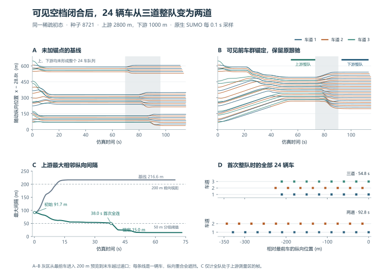

# 十二车实测轨迹与槽位

两图选自冻结批次 `selected_demo`。每次从入口发出 12 辆车，计划间隔 0.7 s，发车速度 28.8 m/s。路面在入口后 1600 m 处改变车道数，车道宽 3.3 m。每幅图从头至尾追踪该次运行的同一批车，按 0.1 s 采样。[三变二轨迹图](3to2.svg) · [二变三轨迹图](2to3.svg)

图 A 用 SUMO 车头纵坐标减去以 28.8 m/s 匀速移动的参考位置。水平线表示车辆正在以该参考速度行驶，异道车辆可以有相同的纵坐标。线条从各车发车时开始，至该车驶出时结束。颜色随车头横向位置所在的车道变化，空心圆标出首次观测到车辆越过相邻车道中线之间分界的位置。图 B 给出同一批车的实际横向坐标。同道且居中的车辆在这一投影上重叠。灰区始于首辆车进入边界前 200 m 的本车预视范围，止于最后一辆车驶过边界。

图 C、D 分别取上游和下游整队几何持续时间最长区间的中间采样帧。上游要求全部车头均在 1400 m 前，下游要求均已越过 1600 m。两面板的横坐标都以当帧队首车头为零，使用同一米制比例。上游、下游各绘制 12 个空心方格，按该帧实测速率计算同道纵向中心距 `5.5 + 0.85 × 平均速度` 米，相邻道前后错开半个中心距。参考槽只拟合队形的整体纵向平移量，两车道路段同时检查镜像相位。彩色圆点是车头实测位置，编号来自发车请求的 `initial_0…initial_11`。此处编号仅用于事后追踪。[几何判据](../measure.py)

| 路网 | 上游与下游快照 | 冻结运行 | 原始压缩轨迹 SHA-256 |
|---|---|---|---|
| 3→2 | 35.8 s / 78.7 s | `20261124T183617973338Z_formation_demo_transform_s20_dba0fe` | `ec5ceef2ed8d4b2b39fe79da243497d501bd7e3153706f3697d8dca7e3eaed58` |
| 2→3 | 32.7 s / 80.0 s | `20261124T183634872973Z_two_to_three_demo_transform_s20_f0f8d2` | `e29f2264256a63d20a8ee999db6e486b6a09cff5c1246489f5cc72a086b924a0` |

子目录保留每张图的原始 `positions.jsonl.gz`、SUMO 路网与发车输入，可独立复绘。在本研究目录运行下列命令，需要 Python、NumPy 和 Matplotlib。

```powershell
python plot_trajectories.py figures/3to2 figures/3to2.svg
python plot_trajectories.py figures/2to3 figures/2to3.svg
```

## 打开可拖动、缩放的 24 车演示

在项目根目录运行下列命令。可将 `3to2` 改为 `4to3`、`3to4` 或 `2to3`。默认每步窗口延时 40 ms。24 辆在 0 s 同时从 20 m 至 526 m 的初始位置发车，2800 m 处改变车道数，下游长 1000 m。

```powershell
python runrun.py --layout 3to2 --long-platoon-demo
```

按同一选定控制器运行，四种路网的 24 辆车均安全驶出，且上下游都测到了全部原始 ID 的完整队形。下表为最长连续保持时间。三变二的快照直接取自真实 GUI 运行的 56.7 s 和 107.3 s，便于对照窗口中的车辆位置。[长车列缩略图](long24_3to2.svg) · [逐例核验](../long_gui_cases.csv)

| 布局 | 上游完整 24 车 | 下游完整 24 车 |
|---|---:|---:|
| 3→2 | 41.4 s | 20.2 s |
| 4→3 | 37.4 s | 26.8 s |
| 3→4 | 41.4 s | 26.9 s |
| 2→3 | 44.0 s | 14.1 s |

两帧各 24 辆车的测量值和完整源轨迹哈希已存入 [快照数据](long24_3to2.json)。在本研究目录执行 `python plot_long_snapshot.py figures/long24_3to2.json figures/long24_3to2.svg` 即可复绘。

## 稀疏 24 车的可见空档与整队



三变二的同一批车初始占据 70–650 m，存在 51.7 m 和 91.7 m 两个超过 50 m 分组阈值的空档。图 A 的未锚定基线使最大空档扩大到 216.6 m，上下游可配对的最大几何队列均为 10 辆。图 B 的保留跟驰版只使用本车可见的前车群。38.0 s 时所有相邻参考点之间的距离首次均不超过 50 m；54.8 s 时在上游形成三道各 8 辆，92.8 s 时在下游形成两道各 12 辆。图 D 每个方点为一辆车在这两个采样时刻的实测位置。

运行 `python runrun.py --layout 3to2 --sparse-platoon-demo` 可观看，布局还可取 `4to3`、`2to3`、`3to4`。下表按各道路各自的种子 8721 初态，核对真实 GUI 中同一批 24 个 ID 的连续整队区间。括号为各车道从右至左的车辆数。形成阶段从首个物理位置计至首次上游完整构型，变换阶段从末次完整上游帧计至首次完整下游帧。跨道按车道分界实测，理论下界采用对应端点车道分布。

| 布局 | 首次全连 (s) | 上游完整区间 (s) 与逐道数量 | 下游完整区间 (s) 与逐道数量 | 形成总跨道实际/下界 | 形成单车最大实际/下界 |
|---|---:|---|---|---:|---:|
| 3→2 | 38.0 | 54.8–73.1 (8/8/8) | 92.8–113.1 (12/12) | 4/2 | 2/1 |
| 4→3 | 42.0 | 58.5–74.0 (6/6/6/6) | 88.1–114.9 (8/8/8) | 4/2 | 2/1 |
| 2→3 | 14.6 | 39.1–71.5 (12/12) | 103.8–116.7 (8/8/8) | 0/0 | 0/0 |
| 3→4 | 41.1 | 56.7–72.9 (8/8/8) | 89.7–116.6 (6/6/6/6) | 8/4 | 2/1 |

四次变换都跨道 12 次，达到总数下界；单车最大均为 1 次，同样取下界。每场全部 24 辆驶毕，零碰撞、零传送。GUI 记录使用 SUMO 1.27.1、0.1 s 步长、模拟器种子 20；输入文件 `configs/sparse_demo_8721.json` 的 SHA-256 为 `03e46c5d729b30a21e0197211f33e52d0e8f81fe4a3db237eae8d9da57acc296`。每场首帧的位置、车道和速度均逐车匹配该输入，且整份解压后的物理轨迹与对应的冻结 `retained_front` 运行逐字节相同。真实窗口的自动镜头关闭。另一次实时三变二运行将视图中心从 1900 m 调至 1210 m 和 1360 m，缩放由 100% 调至 460% 和 690%，继续运行 3 s、2 s 后分别读回原设定，镜头可自由平移缩放。

图 A 取自提交 `e186b8a` 原始源码。图 B、D 取自真实 GUI 的源码快照，`noa/native_rules.py` SHA-256 为 `a61217183c190fb7aec4cd13ba239325cf59e0d8fde95502cb904e3d2dfe1105`，`noa/staggered.py` 为 `4c784d465f068ff10bca8a0a27c385a92946d1be503fc27b09277e2b58d6b087`。三变二两份解压轨迹的 SHA-256 分别为 `d6f4b29cbd67868d7cdeedb12504c5d6d4ca4cb8512bfd1d3421a99b6d04c7b6` 和 `203784c40d5c5f848147b7f3b3c65d3098626da64a013c07cb1f23ff63c52623`。[冻结版本与独立配对试验](../splice/retained_front.md)
