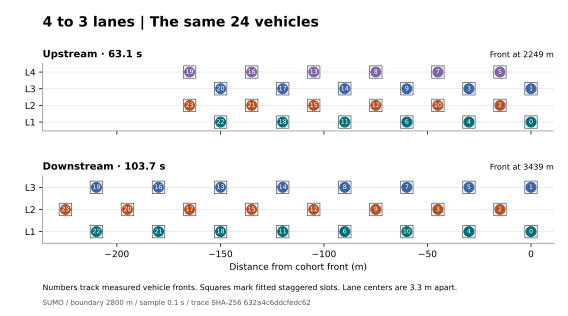

# 11 月 25 日中午审阅：交错队形如何补齐，又如何通过车道增减处

现在可以从一个窗口连续看两件事。先看原本散开的车辆在几条车道上排出半个车距的错位，再看同一批车在道路增减车道时重新分配位置。24 辆车四变三的实例在上游排成 6/6/6/6，下游排成 8/8/8。图形入口按 0.1 秒计算并推进，视野可以自由平移和缩放。

在项目根目录运行以下任一行。第一行便于观察整队，第二行便于观察接收车怎样给邻道车辆留空。将第三行的布局换成 `2to3`、`3to4` 或 `4to3`，可看另外三种道路。

```powershell
python runrun.py --layout 4to3 --initial-demo docs/experiments/2026-11-25-formation-transport/figures/24car_4to3_10153.json
python runrun.py --layout 4to3 --initial-demo docs/experiments/2026-11-25-formation-transport/figures/7car_4to3_11254.json
python runrun.py --layout 3to2 --transform-demo
```

## 每辆车怎样做

1. **形成时先补本车看得见的空位。** 本车观察所有车道前 200 m、后 100 m 的车辆。在相邻纵向间隔不超过 50 m 的本地车群内，用同道间距 $D=5.5+0.85\bar v$、邻道错位 $D/2$ 拟合交错槽位。三道队形的最后一层优先填两边。视窗里若还有暂时分开的车群，本车在发起横移前多问一次：眼前这一步能否同时属于两个车群合并后的某个最少跨道方案？能就保留，不能就继续调距，下一帧重新观察。
2. **看到道路变化后，先决定要做多少次横移，再决定由谁做。** 每车只使用自己看到的道路边界、可见邻车和此前在自己视野里观察到的跨线。固定本帧目标占道后，车道排序给出每车最远要跨几道，各边界的车数差给出全队至少要跨几次。如果每车一步就够，还能精确求出已跨过线的车至少有几辆必须再动。在满足这些条件的全部指派中，选择纵向调距平方和最小的一个。本车比较改选另一动作要多付出的最小代价，对 5 cm 的纵向测量误差复核后，才向已开放的相邻车道提交一步。[公式、证明与本车动作间隙](one_hop_capacity.md)
3. **接收车从本车所算的前槽，判断是否需要让出间隙。** 自己已在目标道时，查看同一列中紧挨自己前面的那个槽。如果它分给了邻道一辆物理上已在前方的车，而且本车确实挡住它现在的并入，就把本车纵向参考暂时限制在它后面一个时距间距。只要它仍是同一个邻道前槽，就持续留空。它入道、掉到本车后方、改配其他槽或超出视野，接收关系随之结束。七车实例中，只按当帧净空让行的两车最终只拉开约 8 m，待并入车始终留在原道。持续接收让它实际跨过标线，七车下游交错保持了 31.1 s。[合流轨迹与局部稳定性推导](receiving_gap.md)

三项决策均由本车独立计算。不同车辆对同一时刻可以得到不同指派。本地轨迹编号只用于在相邻帧认出一辆车。全队身份、全路网轨迹和其他车辆的计算结果只出现在离线评价中。

## 能形成多大程度的整齐队形

每批 192 个初态覆盖四种道路、7/11/12/13/17/24 辆、紧凑与长列、四个随机种子。两批合计 384 个初态，每个方法各有 5,376 辆车正常完成，碰撞与瞬移均为零。两个版本逐案核对了实际首帧车辆位置、速度和车道。整队成功要求同一批车在上、下游都出现几何完整的交错队形，以有连续正时长为准。这里也将两段都保持至少 10 s 的案例作为描述性统计。

| 384 个相同初态 | 晨间版 | 中午版 |
|---|---:|---:|
| 上下游均排齐 | 371 | 372 |
| 两段均至少保持 10 s | 366 | 366 |
| 形成时达到实际目标占道的两项跨道下界 | 259 | 274 |
| 变换时达到实际目标占道的两项跨道下界 | 349 | 367 |
| 形成时达到所有合法余数层中最优的两项下界 | 246 | 263 |
| 变换时达到所有合法余数层中最优的两项下界 | 335 | 353 |

“两项”同时计算全队总跨界数和单车最大跨界数。最后两行还允许重新选择最后一层放在哪些合法车道上，是更严格的比较。未排齐而无法定义这段起止队形的样本留在 384 的分母内。相对晨间版，三组新排齐，两组失去上游整队。两组都是十一车、二变三、长列。到达道路可见区前，它们均已占成 5/6，车速差已低于 0.05 m/s，但队列中间仍有两辆连续位于同道，两个交错相位错开了约 14.8 m。缺陷发生在上游形成；到了下游，两组都保持了 27.6 s 的三道交错。[逐初态变化](noon_changed_cases.csv) · [两组失配的原始几何读数](noon_two_lane_exceptions.csv) · [全部分母与消融比较](noon_comparison.csv)

**冻结代码后又测试了两个新种子。** 两法各 96 组、1,344 辆车，均安全排空；恰好是同样的 95 组在两区排齐，剩下一组是十二车、三变四的长列。形成达到实际占道两项下界由 63 增至 67，变换由 88 增至 94。如果允许重新选合法尾层，形成由 61 增至 64，变换由 84 增至 90。这组结果独立于前面用于定位问题和比较方法的 384 组。[未参与选版的逐案结果](noon_prospective_cases.csv) · [按道路汇总](noon_prospective_summary.csv)

开发用的 64 个起点另计，四种道路各 16 个。晨间版和最终代码都在 64 组完成了形成与变换。形成阶段实跨合计少了 18 次；变换阶段总工作量相同，此前有 5 组让同一辆车多跨一道，现在全部达到对应单车下界。[正式代码的开发组对照](noon_exact_dev64.csv)

## 坐在仿真窗口前可以看到什么

| 道路 | 同一批车 | 上游各车道 | 下游各车道 | 上游 / 下游最长完整保持 |
|---|---:|---|---|---|
| 三变二 | 12 | 4/4/4 | 6/6 | 33.3 / 28.9 s |
| 四变三 | 12 | 3/3/3/3 | 4/4/4 | 35.3 / 31.0 s |
| 二变三 | 12 | 6/6 | 4/4/4 | 34.6 / 28.1 s |
| 三变四 | 12 | 4/4/4 | 3/3/3/3 | 33.3 / 29.8 s |
| 四变三长列 | 24 | 6/6/6/6 | 8/8/8 | 24.2 / 25.0 s |

以上来自普通入口实际启动的 SUMO-GUI，几何数据由每帧横纵坐标重算。另两次窗口验证分别复现了三变二十一车和四变三七车。[七次窗口运行记录](noon_live_runs.csv) · [七车可复查的原始轨迹](figures/receiving7_gui.zip)



二十四车的实际跨线时刻也可以对着窗口看。第 20 号在 81.4 s 从道 2 到道 1，第 21 号在 83.2 s 从道 1 到道 0。七车例里的第 1 号在 74.7 s 从道 2 到道 1。计数阶段取上游最后的整队帧到下游首次整队帧；之后若有车辆驶离，剩余车辆仍会围绕眼前车组重新补位。[最终窗口逐车跨线记录](noon_gui_crossings.csv)

这个例子也能用来向别人解释“本车最优性间隙”。在旧轨迹的 82.1 s 同一帧，两辆车都看到 7/9/8/0，距离 8/8/8/0 只差把一辆从道 1 移到道 0。只按纵向位置选，20 号跨道比换人划算 101.61 m²。将各自观察到的跨线加入同一份分配后，20 号的所有合格方案都要求它留在道 1，因此它改选跨道的间隙为正无穷；21 号的最佳动作变为跨向道 0，改为留下至少要多付 292.53 m²。这里先在同一实际输入上比较决策，再另外运行车辆验证两车确实这样执行。[逐观察者的相同输入对照](noon_reassignment.csv)

**已经排成的队形是否会散开？** 在 384 组中的 372 个成功案例，以及另 96 组中的 95 个成功案例中，中午版均从下游第一次排齐连续保持到了原班车辆全在场的最后一帧。首车离开以后，384 组成功样本里剩余车辆又发生了合计 269 次跨线，晨间版对应的 371 个成功样本里为 219 次。分开统计这两个时段，可以区分整队能否保持，以及原队列离场后短车组怎样重新补位。[连续保持和离场后的跨线统计](noon_hold_to_exit.csv)

### 一辆车看不完整支长队时，整队需要多少路程

用同一随机种子 11811 生成 48 辆车，初始队首到队尾相距 485 m，超过单车前后合计 300 m 的视窗。四种道路上，48 辆都在上游形成了完整交错队形。随后固定初始车辆、控制参数和道路变化点，只把出口往后移，比较原班 48 辆在下游完整排齐并连续保持的时间。

| 道路 | 上游完整保持 | 1,000 m 下游 | 2,400 m 下游 |
|---|---:|---:|---:|
| 三变二 | 41.4 s | 0 s | 32.3 s |
| 四变三 | 36.4 s | 11.0 s | 59.6 s |
| 二变三 | 31.6 s | 0 s | 29.7 s |
| 三变四 | 46.0 s | 4.8 s | 53.4 s |

为什么两格是零？在短路上，三变二的首车在 108.5 s 离场，二变三的首车在 112.2 s 离场；在长路上，两组分别到 124.8 s 和 131.1 s 才排齐。逐帧核对到短路首车离场之前，两路中的车辆身份和车道始终相同，纵向坐标最大差小于 $1.4\times10^{-12}$ m。长路上首次排齐时，队首已经驶过变化点 1,466.8 m 和 1,542.9 m。用这两个读数预先判断，再建四段道路实测，三变二分别留 1,400 / 1,500 m，完整保持 0 / 1.1 s；二变三分别留 1,500 / 1,600 m，完整保持 0 / 1.9 s。四次预测均命中，每次 48 辆均正常驶出，碰撞与瞬移均为零。这两个距离描述的是这个初态和车速下，原班 48 辆首次排齐时队首走到了哪里。不同车数、速度和初始队形需要分别测量。[1,000 m 原始结果](noon_long48.csv) · [仅移动出口的配对结果](noon_long48_extension.csv) · [四次距离预测与实测](noon_long48_threshold.csv)

同一组距离试验可在新的项目检出目录按以下顺序复跑。第一行实验生成初始状态和短路轨迹，后两行读取相同输入。每个输出目录对应一次独立运行。

```powershell
$study = 'docs/experiments/2026-11-25-formation-transport'
python -B "$study/long48.py" tmp/nov25-noon-long48
python -B "$study/long48_extension.py" tmp/nov25-noon-long48-extension
python -B "$study/threshold48.py" tmp/nov25-noon-long48-threshold
```

## 数学结论有没有在车流中真正用到

**从 $K$ 条车道变到 $L$ 条，最少需要多少次换道？** 当道路只从一侧增减车道，另侧物理车道对齐，同一批 $N$ 辆车在变换前、后都能均分到每条车道时，全队至少要跨 $N|K-L|/2$ 次车道边界。还能同时做到每辆车最多跨 $|K-L|$ 次。以 24 辆四变三为例，下游每道要由六辆增至八辆；三条边界分别要通过 6、4、2 辆，全队最少跨 12 次，且这 12 次可以分给不同的车。若尾层没坐满或入口本来就不均匀，按当前各车道的实际人数重新计算边界两侧缺额。该定理给出目标分配的最低工作量；车辆实际付出了多少，还要从 SUMO 轨迹逐车核实。[任意车道数的推导与余数情形](README.md) · [从目标分配到本车动作的证明](one_hop_capacity.md)

在 1750 辆/(小时·道)、连续供车 600 s 的四变三中，早一版共计算 65,601 次一步变换的本车指派。其中 1,623 次不可避免要安排已观察到跨线的车辆再动，133 次选用了超过理论最少数量的车辆。正式算法在同一到达序列上计算 65,664 次，其中 1,738 次不可避免需要重复用车，超过理论最少数量的为 **0 次**。这些数按本车、按控制帧记录；同一个实际动作可以在多个观察者和多个时刻的计算中出现。三变二同条件下，两种算法原本都达到了这个局部下界。[决策次数、分母及实际完成车辆数](noon_reuse_decisions.csv)

直接枚举也得到相同结果。302 个小型一步运输问题中 176 个必须重复用车，314,746 个排列核对了闭式下界、最优分配和本车替代间隙。进一步可证明，固定模板内所有槽随时距等比例伸缩时，以平方米计的本车间隙同倍变化，最优动作集合保持一致；离散槽位重选或物理间隙改变时，车辆重新求解。[证明与复算](one_hop_capacity.md)

两批 192 组的固定车队中，“可以时保护全部已跨线车辆”与“精确最小化重复用车”在整队结果、形成和变换的两项下界达成数上相同。两种方法的 368/384 条逐帧轨迹完全相同，其余 16 条均为 24 车三变四。因此选择精确的最小重复分配，可以给出清晰的逐车道最优性结论。另测的同道邻车间距最小二乘修正能修复两个十一车反例，却同时失去另外两个成功案例；在开发组里，变换达到两项下界的案例从 64 降为 60。正式代码保留原来的纵向目标。[相同初态的替代方法试验](noon_column_exceptions.csv) · [四路开发对照](noon_column_dev64.csv)

## 连续来车时，耗时和油耗各变化多少

每种方法运行两种缩道、三档入口流量、两个相同种子，每次连续供车 1,200 s，再等所有道路内车辆驶出。每种方法均有 24,645 辆车完成，碰撞、瞬移均为零。逐车计时从实际进入道路开始，在实际驶出时结束。每个单元对两个种子等权平均。表中列出的油耗按全部完成车辆的燃油总量除以道路内行驶总里程得到。

| 道路 | 入口流量，辆/(h·道) | 纯 NOA 行程，s | 晨间编队，s | 中午编队，s | 中午版比 NOA 缩短 | NOA / 中午版油耗，g/km |
|---|---:|---:|---:|---:|---:|---:|
| 三变二 | 1,500 | 43.41 | 39.14 | 39.20 | 9.70% | 70.54 / 81.67 |
| 三变二 | 1,750 | 45.70 | 39.24 | 39.31 | 13.99% | 74.54 / 83.07 |
| 三变二 | 2,000 | 53.52 | 39.59 | 39.59 | 26.01% | 80.19 / 86.26 |
| 四变三 | 1,500 | 42.74 | 39.43 | 39.52 | 7.55% | 68.09 / 86.78 |
| 四变三 | 1,750 | 43.95 | 39.71 | 39.79 | 9.46% | 71.71 / 90.55 |
| 四变三 | 2,000 | 46.95 | 40.22 | 40.25 | 14.27% | 76.44 / 96.43 |

路端的原始轨迹能对应到这种耗时差别。在 2,000 流量的三变二中，瓶颈前 200 m 平均同时在场车辆由纯 NOA 的 26.29 辆降至编队的 11.94 辆，该区车辆样本平均速度由 12.45 升至 27.47 m/s。相同流量的四变三中，在场数由 24.84 降至 15.69，平均速度由 17.64 升至 27.96 m/s。两种道路都显示车辆在瓶颈上游积聚的程度较低。晨间版与中午版在六格中的路内行程差约 0.00–0.08 s，耗时优势大部分在晨间编队里就已存在。中午新规则带来的清晰改善，是在排成同样队形时减少不必要的跨道；油耗在六格中均高于纯 NOA。[逐种子耗时、燃油和瓶颈原始计数](noon_road_runs.csv) · [配对核验与车道横移统计](public_noon_exact_results.md)

冻结后另用新种子 11803 连续供车 600 s，两种方法各 5,964 辆全部安全驶出。按 1,500、1,750、2,000 的顺序，三变二比纯 NOA 的行程缩短 8.61%、11.82%、18.84%，四变三缩短 7.13%、8.89%、10.33%。这是一次独立复核；上表仍保留 1,200 s 双种子的原始口径。[新种子六格对照](public_noon_prospective_results.md)

**固定车队与自然来车有不同的保持效果。** 在上游车流中先按完整交错结构锁定一组身份，再在下游跟踪原班车辆。1,200 s 供车阶段，三变二的六次运行中共锁定 5 个不重叠上游车组，1 个在 200 m 下游再次出现完整原班队形；四变三锁定 6 个，6 个再现，其中 4 个保持至少 1 s。两种道路都未观察到这样的原班完整车组持续满 3 s。上表的大流量效率、局部几何参与和固定车队的 30 s 保持各自回答不同的问题。长列示例的下游长 1,000 m，连续车流路网的下游长 200 m。[同一批车辆的跟踪结果](noon_stream_exact_strata.csv)

## 从哪里开始读代码

先读 `noa/native_rules.py` 的 `decide` 和 `_transport`，从一次观测跟到一次速度与换道命令。随后读 `noa/staggered.py` 的 `choose_target`，看交错槽位、首尾半层以及同一列的直接前槽怎样确定。最后读 `noa/transport.py` 的 `lane_bounds`、`compatible_join_step`、`_one_hop_mask` 和 `solve_transport`，逐项对应横向下界、合群补位、最少重复出动和本车替代间隙。上述文件位于 `variants/phase5g_pure_formation`。同目录的 `experiments/native_sumo.py` 负责传感器视窗与 SUMO 步进。[正式代码与冻结实验代码的 34 次逐帧复核](noon_exact_product_equivalence.csv)
