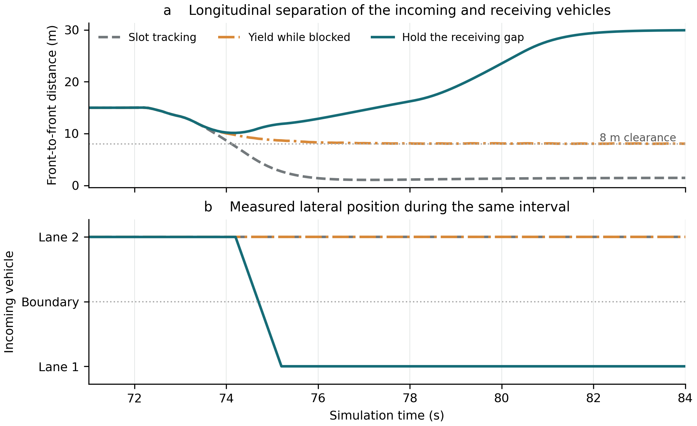

# 接收车道怎样给既定槽位让出间隙

在七车四变三、长列、种子 11254 的轨迹中，第 1 号车从道 2 补道 1 是满足“一车至多跨一道”所需的动作。它已经在第 5 号车前方，第 5 号车正是本次局部指派在同一目标道上为它排定的下一辆。车辆尚未并入时，两车按原规则互相独立调速。98.0 s 两车前后只差 1.49 m，速度都为 25.17 m/s。与它们同速的本车道前车限制了第 1 号继续向前拉开间隙。[同一时刻的真实纵向目标、间隙与指令](noon_stall7.csv)

候选方法让接收车道上的车辆先查看自己在最终交错列里的直接前槽。若前槽分给相邻道一辆已经在本车前方的车，本车在两个纵向目标中取靠后的一个。令 i 为接收车，j 为该前槽车辆，本车当前可见车辆均速为 $\bar v_i$，槽位坐标为 $y_i$，则

$$
x_i^{\rm ref}=\min\{y_i,\;x_j-[5.5+0.85\bar v_i]\}.
$$

j 的位置来自物理观测，j 的未来槽来自 i 自己算的指派。每辆车只提交自己的速度和相邻换道请求。车辆实际并入后，两者已经同道，控制回到正常的槽位跟踪和安全跟驰。

## 局部动力学

在前槽跟驰分支上，取最简单且能精确求解的情形。成员和槽位固定，j 与其他邻车保持巡航速度 $v_c$，视窗共 n 辆（含本车）。发送的速度命令未被限幅或安全上限截断。写 $e=x_j-x_i-(5.5+Hv_c)$，$w=v_i-v_c$。由于 $\bar v_i=v_c+w/n$，原有二阶控制器给出

$$
a_i=k e-cw,\qquad k=\omega^2,\qquad c=2\omega+\omega^2H/n.
$$

于是 $\dot e=-w$，$\dot w=k e-cw$。两极点是 $s^2+cs+k=0$ 的根，$k,c>0$ 即严格稳定。SUMO 以新速度推进位置，采样步长为 h。精确一步矩阵为

$$
\begin{pmatrix}1-h^2 k&-h(1-hc)\\hk&1-hc\end{pmatrix}.
$$

其行列式为 $1-hc$，迹为 $2-hc-h^2k$。二阶 Jury 判据在这里等价于 $hc>0$、$h^2k>0$、$2hc+h^2k<4$。实际 $h=0.1$、$\omega=2$、$H=0.85$，对 $n\ge2$ 皆满足。这个结论刻画固定前槽、巡航前车条件下的间距恢复。真实七车案例存在限幅和重新指派，可以直接从实车轨迹观察它们的作用。

## 真实轨迹中的第一次差别

两场仿真采用完全相同的初态。其中一场独立加入前槽跟驰。直到 73.0 s 两场全部车辆状态相同。73.1 s 唯一发生差别的是接收车第 5 号。原速度 27.1394 m/s、加速度 +2.8864 m/s²，使用前槽后为 26.3508 m/s、−5.0 m/s²，触及了原有编队纵向控制的减速度限幅。73.9 s 第 1 号车跨入道 1。下游同一批 7 辆持续完整排齐 32.2 s，实际四次跨界，每车至多一次。把参考间距只取 8 m 时仍未全齐。把两个纵向目标等权平均后也能形成，但跨线推迟到 74.6 s，最长保持为 31.3 s。这个案例能说明间隙怎样打开，也说明提前让位伴随一次明显减速；整体取舍需结合独立车队和持续流。

## 什么时候开始让，什么时候结束

接收车先按本车的指派检查直接前槽。如果待并入车辆已经位于自己前方，又确实会被自己的车身和一秒预测净空挡住，就开始使用上式。在前槽还是同一辆邻道车的期间持续留空。它实际并入、离开视野、落到本车后方，或在新指派中换了槽位，接收关系即告结束。记忆里只多保留一个本地轨迹编号。

三条线使用同一个七车初态。第一种只跟踪各自的交错槽，第二种按当帧净空判断，第三种让接收关系延续到前槽关系改变。上图给出第 1 号与第 5 号之间的实测纵向距离，下图直接画第 1 号的横向坐标。图中的 8 m 是净空检查的中心距离门槛，是否真正换道还要考虑相对速度和其他邻车。

[逐帧绘图数据](figures/receiving7.csv) · [矢量图](figures/receiving7.svg)
