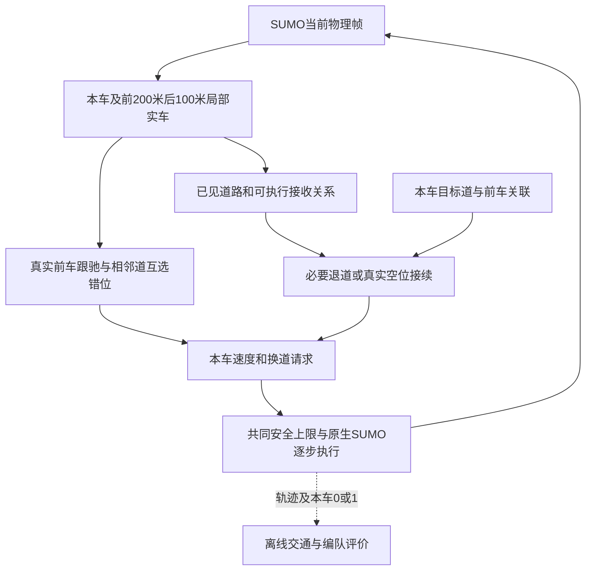

# 时距交错编队与3→2变换系统说明

当前研究方法为C12，316行车辆规则。工作目录是 `D:\yanjiu1\keyan1`，入口是根目录 `runrun.py`。完整逐条规则、所有函数与源码位置见 [规则逐条说明](experiments/2026-11-04-timegap-staggered/规则逐条说明.md)；本页按车辆实际经历说明系统怎样工作。

## 1. 方法想解决什么问题

三条车道减为两条时，终止车道车辆必须进入存续车道。若每辆车只在当前有安全空隙时独立切入，车道末端可能出现等待。本研究希望先让车辆形成相邻车道错位的关系，再在看到缩道后把这些关系改为两道接收关系，使纵向开隙与横向移动相互配合。

每辆车只看到前200米、后100米内所有车道的车辆。它能测得位置、速度、横向运动等物理状态，并记住自己正在执行的目标。每步所有车辆从同一物理帧各自决策；没有中心车辆表向它们分配编队位置。

## 2. 一套时距几何贯穿形成与变换

同道目标车头间距为：

`D(v)=车长4米+静止净距1.5米+0.85秒×本车速度`。

相邻道目标纵向错位为半D。巡航速度28.8 m/s时，同道29.98米、相邻道14.99米；速度降低后，目标随之缩短。0.85秒来自原30米巡航队形对应时距的两位小数取值，保留原队形尺度。它是当前研究参数，不是优化得到的最优时距。

例如同速时，lane0的一辆车在910米、lane1对应车在895.01米、lane2对应车在910米，构成三道交错。形成过程通过调速接近这种相对关系，而非给每车一个全局层号。

## 3. 车辆如何形成编队

同道有真实前车时，本车把目标放在前车后D米，以前车速度加位置误差反馈调节速度。普通关系在50米内建立；已经建立纵向链后，可在200米内继续跟当前真实前车。前车因切入或离开而改变时接续当前实车，不追旧编号；当前没有真实前车时释放。没有前车时回到巡航，同时保留可用的跨道错位反馈。

每车分别在左右相邻车道的50米范围内寻找错位误差最小的实车。只有双方按相同物理规则互相选中，这条错位关系才参与调速。横移中的相位根据实际横向位置连续变化。真实前车跟驰与相位修正共用速度请求和最终安全限制。

形成阶段只做纵向调整。它不会按全路车道人数给车辆分层或横向补齐；局部尾部可以不完整。因此，参与规模和完整几何都必须实际统计。

## 4. 看见缩道后怎样变换

本车距1000米车道终点200米以内时，获得道路终止信息。另一实验条件为300米公共道路预告，所有方案同时得到预告；车辆感知仍为前200米、后100米。

终止道lane2车辆进入lane1。尚未看见缩道的lane2后车，也可依据自己实际前车正在向内横移的运动继续接入。它不读取前车的计划或编队状态。

存续道车辆可把当前严格位于前方、且实际走廊允许进入的车辆视为接收前车。lane1接收lane2；lane0在局部几何支持时接收lane1，或响应lane1已经发生的横移。接收后车先按时距跟驰这个可见实车，为其进入提供纵向空间。

需要向lane0接续的lane1车辆，只追踪真实目标前车后一个编队间距的空位。目标前后均需容纳一个间距，且这次移动不增大相对原同道前车的半D位置误差。低速接入间距至少16米，使两半各容纳共同8米换道走廊。

已有本车横移优先继续，其次执行必要退道，再选择有效空位。所有编队横移仅为2→1或1→0；每车车道序号逐次减少，因此本轮最多完成两次，没有0→1回流。

## 5. 安全、执行与普通NOA

各方案共用巡航28.8 m/s、最高33.3 m/s、车长宽、加减速、原生入口和SUMO执行。换道检查使用当前及1秒外推的8米车头走廊。速度请求还要经过实车制动安全上限；已看见终点的终止道车辆受停车边界约束。

普通NOA使用真实前车时距跟驰、受阻主动超车和当前安全空隙接受。它在获得相同道路信息后发起必要合流，不追踪编队空位或合流间隙中点。暂时没有安全空隙时，车辆继续跟驰，必要时在终止道末端等待，空隙出现后再尝试。

程序没有额外Python入口队列或发车门。发车请求交给SUMO原生插入，插入等待单独记录。

## 6. 每0.1秒的数据流与代码



| 模块 | 职责 |
| --- | --- |
| `runrun.py` | 用户参数、实时窗口、自检 |
| `noa/native_rules.py` | Vehicle、Command、Memory以及全部车辆决策函数 |
| `experiments/native_sumo.py` | 伯努利来车、LocalTracks、本车执行反馈、记录与排空 |
| `run_native_flow.py` | 单次道路、流量、模式、时长与输出参数 |
| `experiments/native_comparison.py` | 实际记录复算、相同条件配对与不完整结果处理 |
| 本轮 `tools/report_trial.py` | 消费已运行案例，计算模式对比与道路差中差 |
| 本轮 `tools/plot_geometry.py` | 从实际快照生成队形图 |

每个本车数据对象含位置、速度、车道、横向速度和自身pending反馈。命令含速度、换道、目标、引用及0/1状态。记忆只有目标道与当前主前驱关联；有空位锚车时优先记锚车。邻车的pending与私有记忆不会传入决策。

每道每0.1秒按p=流量×0.1/3600独立产生请求，相同种子和流量复用同一请求序列；这沿用所提供MATLAB按时隙随机发车的思路。实际请求数可随种子变化，不以事后补车改变需求。

## 7. 怎样评价，当前走到哪一步

状态1表示本车已有跟驰、互选错位或接收关系，允许仍在调距；仅NOA为0。评价直接统计状态1人数、车辆时间参与率和连续参与时长。它们描述关系规模；完整交错另看真实位置、动态间距、全体纵序和在场数。

交通主指标为从请求到驶出的系统时间，另列路内时间与入口等待。油耗由共同HBEFA模型的逐步mg/s积分得到g/km。相同流量和种子在直路与缩道都运行，扣除直路收益后再分析瓶颈附加效果。仅形成、形成并变换和并排消融分别用于检验变换与交错的作用。

最终C12完成了24车形成、45车变换、1800秒两种子持续对照，以及211–215五种子600秒正式主135例，均安全排空。45车演示在70秒恢复完整色序，随后间距继续收敛；80秒半D平均绝对误差约0.0594米。

五种子正式结果中，200米信息下三档系统时间分别减少4.15、6.54、9.67秒；300米条件减少4.21、6.59、10.85秒，30个缩道配对均改善。直路差仅约−0.10至+0.11秒，瓶颈区域低速暴露同步减少。低流量有油耗增加，高流量600秒均值接近NOA；1800秒持续结果也逐项列出，不将油耗写成普遍下降。并排及共同最高速度、时距补充结果与主试验分列。

本轮进展、采用和失败版本、正式数据入口统一放在 [11月4日报告](experiments/2026-11-04-timegap-staggered/README.md)，指标定义见 [评价口径](experiments/2026-11-04-timegap-staggered/evaluation.md)。旧D1负荷与成本方法及其结果在Git历史和11月3日报告中保留。

## 8. 运行与下一次接续

```powershell
Set-Location -LiteralPath 'D:\yanjiu1\keyan1'
python -B runrun.py --check
python -B runrun.py
```

窗口在第一次计算时打开，每算一步推进一步。缩短演示可加 `--duration 60 --max-time 240 --no-wait`；批量运行使用无窗口CLI。

下次聊天先读取根README、本说明、完整规则和本轮报告，再看检查点末尾。代码版本通过GitHub的 `yanjiu1` 远端管理；实验保存小型规则候选和必要数据，避免整项目本地复制。新的修改从明确版本开始，不将旧D1数字合并为当前方法结论。
