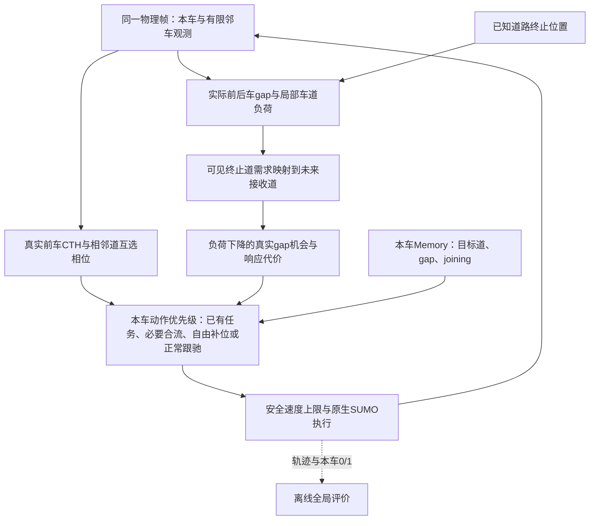

# 原生SUMO编队形成与3→2变换系统说明

版本：D1，423行规则，已装入`variants/phase5g_pure_formation/noa/native_rules.py`。
锁定SHA256为`2be889140b497b763818a35814b0f34815c7cccd309dd5007ebaddca8a91f35a`；安装验收和三档确认进度见[本轮报告](experiments/2026-11-03-midflow-staggered/README.md)。

系统由SUMO完成原生发车、纵向运动和连续横移，Python每0.1秒读取实测状态，为每辆车计算速度及相邻换道请求。真实前车时距跟驰维持纵向运动，实际相邻道互选关系形成交错，局部车道负荷决定哪些车适合横向分担。接近车道减少时，车辆把可见终止道车计入其即将使用的存续道，提前利用实际空隙完成重新分工。每车控制只计算自己的动作，所有全局统计均在评价阶段进行。

图中的互选相位用于两种编队模式，NOA只用真实前车跟驰；未来映射只在transform接收作用域启用，其他组织情况用当前可用道负荷。动作优先级决定本步实际使用哪一条速度与换道分支，第6节逐项列出。

## 1. 模式、道路与共同参数

`noa`为同车型普通自主行驶：巡航、真实前车CTH、受阻超车和必要合流，本车形成状态始终为0。
`formation`采用交错相位与局部负荷均衡；必要合流沿导航要求执行，物理车道数在1000米以后为两道。
`transform`还提前建立接收关系：本车进入准备区，或在自身±90米看到lane2车辆已进入准备区，就按两个存续资源安排横向分担。
两种形成模式在本车准备区都只向存续两道自由补位；transform的局部接收车还能在自己到640米之前作此准备。lane2车辆自身的必要合流触发仍为640米。

默认`lane_drop`路网为0–1000米三道、1000–1200米两道；`straight3`全程三道。lane0/1/2中心为y=1.65/4.95/8.25米，lane2在1000米终止，网络只为存续道建立下游连接。
`x`采用SUMO车头坐标，下游加1000米边偏移；`y`由车道中心与实测横向偏移重建，横移途中连续变化。

| 参数 | 数值与用途 |
| --- | --- |
| 仿真步长、请求横移时长 | 0.1秒、1秒 |
| 巡航、最高请求速度 | 28.8、33.3米/秒 |
| 位置增益、速度响应 | 0.3/秒、每步更新期望速度差的0.2 |
| 巡航同道距、跨道相位 | GAP=30米、GAP/2=15米 |
| 车长、车宽、道宽 | 4、1.8、3.3米 |
| 静止净距、停止包络反应时间 | 1.5米、0.2秒；跟驰响应常数为0.5秒，对应0.1秒步长下每步更新0.2 |
| CTH时距 | h=(30−4−1.5)/28.8≈0.850694秒 |
| SUMO加速、制动、紧急制动 | 5、10、30米/秒²；共同停止位置计算使用10 |
| 换道走廊 | 当前及1秒外推的车头位置差至少8米 |
| 局部观测、跨道互选 | 后100/前200米全部车道；互选纵向距离不超过50米 |
| 横向分担窗口、加入精度 | 本车±90米；既有加入目标误差2米 |
| 准备区 | 从drop_x−360米开始，默认640米 |

8米用于车头坐标差；同长4米车辆对应4米车身净距。车型统一为`CAV_ICV`，IDM、tau=0.2秒、速度因子1、speedDev=0、sigma=0，燃油模型为`HBEFA3/PC_G_EU4`。

## 2. 来车、局部观测与三个数据类

`arrival_tape`在每条道的每个0.1秒时隙独立作伯努利抽样，概率p=flow×0.1/3600，每时隙每道至多一个请求。
三道分别使用由seed和lane确定的随机流；相同seed、flow、duration生成同一请求序列，实际请求数随该序列确定。
根窗口入口默认每道1750辆/小时、请求600秒，随后默认再允许300秒排空；实验CLI的独立默认流量仍为1250，正式实验都显式给出1500/1750/2000。`max_time`是绝对仿真停止时刻。
请求从x=0、速度28.8进入原生route，实际发车时间由SUMO插入条件产生；`initial_tape`也把给定初始布局转为原生请求。

`LocalTracks.observe`从同一物理帧截取本车后100/前200米，把自车编号设为0，为邻车建立本车独立的连续跟踪号。控制按几何与速度排序，跟踪号用于对象关联和gap保持。

| 数据类 | 字段及含义 |
| --- | --- |
| `Vehicle` | `track,x,y,speed,lane,vy,acceleration,time`为本车或可见实车状态；`pending_lane`只反馈本车自己已提交的横移目标 |
| `Command` | `speed,lane,reason,target_x,reference,formation_state`为速度、相邻道请求、分支名、纵向目标、实际参考车及本车0/1关联状态 |
| `Memory` | `lane_target`保存自身目标道，`gap=(front,rear)`保存实际空隙边界，`joining`表示自身组织性横移后的纵向入列仍在进行 |

邻车输入来自当前可见物理状态，本车Memory跨步保持。一次决策只输出本车动作，实际空隙、局部负荷和预测快照都在本次局部观测内建立。

## 3. 真实前车CTH与单格空位

`_front_following`在默认50米内选当前占用本车道的最近实际前车，横移中已跨入本走廊的车也可成为前车。
令D(v)=4+1.5+h×v_ego，目标为x_target=x_front−D(v)，参考速度为前车实速。
`_request`计算v_des=v_ref+0.3×(x_target−x_ego)，再输出clip[v_ego+0.2×(v_des−v_ego),0,33.3]。
同速巡航时D=30米，低速时同道时距目标随本车速度缩短；目标和reference始终对应当前实际前车。

形成模式先采用正常50米结果。若没有前车，再以同一函数查询60米内最近实际前车f；满足下列局部证明才接入该前车：

1. 当前有相邻车道实车w，且x_ego<x_w<x_f。
2. 投影位置x_w+φ(w,3)−φ(ego,3)距x_f−30不超过2米。
3. 采用该真实f的原CTH目标D(v)，其后跟随和安全流程保持。

这是邻道实车证明的单个巡航空格。例如lane1的ego100、front160与lane0的w145，可证明目标130附近的空格。证明使用巡航几何，实际跟驰距离仍是D(v)。
没有证明时保持原50米连接；NoA和补位成本预测的前车查询继续默认50米。

## 4. 全体车辆的局部物理相位与CTH优先

`_phase`按物理lane奇偶取0/15/0米，存续两道仍为0/15米。`_physical_phase`按实测y在邻道相位之间线性插值，横移时相位连续。
对相邻道实际车i、j，`_pair_error`返回e_ij=x_j−x_i+φ(j,3)−φ(i,3)，同时给出双方共用的pair_lanes。
在指定边界以后，两车都已处于存续道时pair_lanes=2；否则为3。transform边界为640米，formation边界为1000米；直路按调用的三道构型。

每车在每个相邻物理道的±50米内选一个候选，不限于队首。排序键依次为|e|、真实|Δx|、有符号e、x、y、speed、vy；反向选择也指向本车才建立本次互选边。
真实距离作为第二键，使并列30米车串优先选同排车辆。互选边按e_ij/max(1,pair_lanes−1)累加，以u_phase=clip(0.3Σe,−2,+2)生成速度修正。

有实际front的body保留其CTH target/reference。若u_phase×(v_CTH−v_ego)<0，S把u_phase置0，避免相位反向抵消当前真实前车修正；同向或CF修正恰为0时保留相位项。
body请求为clip(v_CTH+0.2u_phase,0,33.3)。例如CF28.44而相位想加0.4时，仍请求28.44。
没有实际front的head使用目标x_ego+u_phase/0.3及CRUISE调用原_request，逐步回到巡航并处理相位。
相位过程输出本车局部修正，真实纵向前车关系、当前横移任务和最终安全上限各自保留。

## 5. 横向分担：实际空隙与未来车道负荷

这一层只解决“哪辆车换到哪条相邻道”，纵向交错形状由第4节持续维持。D1直接评估可进入的真实空隙；原版本的锚点、七层格点及完整层冻结已删除。

**规则1：确定局部车群。** `_component`把可见车辆按纵向排序，从本车向前后连接相邻位置差不超过50米的车辆，再取本车±90米参与负荷统计。其余本车可见车辆仍进入实际走廊检查、目标空隙选择及响应代价预测。

**规则2：每辆车在可用资源中最多计一次。** 横向速度绝对值不超过0.1米/秒时，按实际车道计数。已有可见横移时，用连续横向位置`z=y/3.3−0.5`和速度方向判断正在驶向的中心：向上取ceil(z)，向下取floor(z)，结果限制在0–2。依据是实际运动；邻车的pending、私有目标与加入标志均不作为输入。只有映射后的资源位于本次可用道集合才计数；例如formation已限制两道但不作future映射时，仍在终止道且未驶向存续道的车辆不计入两道负荷。

**规则3：建立接收关系。** transform中，本车处于准备区，或在±90米观察到lane2车处于[640,1000]米，就按两个存续道安排资源。准备区要求本车x≥640米，并且尚在1000米前或仍在lane2；通过1000米后的存续道车辆不再因自身位置保持准备状态。lane0计入0，lane1和lane2均计入1；已实际驶向lane0的车按0计。这样正在腾位的车辆只计一次，终止道的车也进入接收负荷。

**规则4：只接受减少不均衡的转移。** 设局部各资源人数为N，势能为`Φ=ΣN²`。一辆车从s转向相邻t的单车变化为`ΔΦ=2(Nt−Ns+1)`，只有严格小于0才成为机会。这个整数判据负责道间分工，具体接入位置直接查询目的道实际车辆形成的gap。

例如准备变为两道时，计数(3,6)允许一辆实际中道车转到lane0，变化为`2(3−6+1)=−4`；若计数已是(4,5)，继续转移变化为0，保持当前分工。

**规则5：机会必须对应实际gap。** 候选车横向速度绝对值小于0.1米/秒，实际处于可分担的道，目的道相邻。对它调用原`_merge_target`选择目的道真实F/R边界，要求目标纵向调整不超过30米，并通过原`_clear`。评分时从候选邻车表排除它自身。本车获选并发起fill_layer时，随后`_join_speed`在同帧同邻车表上重算的正是这个gap，目标位置和自身边界记忆一致。

**规则6：比较对附近车辆的响应代价。** `cf_speed`用公开单前车CTH与safe_speed预测下一步速度。把候选放到目的道实际同一纵向位置，比较候选及源/目标道直接后车的前后请求；成本为三者正降速之和，重复车辆只计一次。目的道后车还单独满足“新预测速度≥当前速度−1米/秒”，其释放收益不抵消别人的制动要求。

**规则7：按几何选择本地机会。** 先取较低响应成本，再取纵向较前车辆、较小目标调整和固定几何道序；最后用可见y、速度和横向速度破平局。track只用于认出本车及跟踪边界。每个控制器仅在所选车辆恰为自己时输出动作，其他车辆继续各自跟驰。

**规则8：必要合流优先。** 新lane0→1提案还经过`_mandatory_priority`。若与准备区实际lane2车竞争同一8米走廊，本帧让必要合流；已有实际横移继续原执行闭环。因此势能下降是被接受单车转移的局部性质，动作顺序同时服从道路优先权。

## 6. 实际gap、Memory与动作优先级

`_merge_target`按目标走廊实际横向占用排序。保存的gap边界仍可见、本车仍在两边界之间且未插入新边界车时，继续保持该gap。
否则重新选本车前方最近边界和后方最近边界；双侧齐全取位置及速度中点，单侧使用max(15,5.5+0.2v)距离，空道取本车x与巡航。
只有后边界而本车已越过其单侧目标时，目标改为本车x并参考巡航。`_join_speed`对该目标调用_request并回写自身Memory.gap。

每步先计算基础跟驰和本车关联状态，再按以下顺序返回第一个适用动作：

1. 接收自身pending_lane反馈；清理尚未启动且不相邻、在接收准备关系下仍指向终止道、或冲突于必要合流的旧请求。
2. 保持已有lane_target。到达判据为pending结束、距目标道中心≤0.15米、|vy|≤0.1；到达后清目标及gap。NoA若尚未实际横移且没有pending，也释放未执行目标，再按当前观测决策。
3. 仍执行的组织任务跟踪实际gap；已横移或走廊clear返回executing，否则返回approach_join并继续纵向调gap。
4. NoA直接清除joining；组织模式在目标为空或误差≤2米、且请求速度与实速差≤0.5米/秒时结束入列，joining期间继续当前跟随。
5. 准备区实际lane2车优先向lane1必要合流：clear则merge，否则approach_gap；一直处理到实际退出lane2。
6. 组织模式且非joining时尝试自由补位，合格后以_join_speed、lane_target和joining提交fill_layer。
7. NoA中本车和实际同道前车都低于CRUISE−2时，选择clear、合流优先允许的最空相邻道；前方可用距离须比当前道多15米。
8. 其余返回join_follow、formation_follow或normal_follow，最后由decide统一裁剪安全速度。

NoA的普通超车使用normal_overtake；形成横移后保留joining处理纵向入列。控制分支名称记录动作来源，实际换道完成由物理执行层单独记录。

## 7. 安全与本车0/1

`_occupies`用车宽和当前至1秒后实测横向外推区间判断走廊占用；_clear要求当前及1秒预测车头差至少8米，并拒绝前后次序穿越。
`safe_speed`先找本车当前/预测会占用的道，再检查前200米共享走廊车辆。令s=max(0,Δx−4−1.5)，每车上限为sqrt[(10×0.2)²+v_front²+20s]−10×0.2，逐一取min并以33.3封顶。
`decide`对所有动作应用该上限；执行器再次按同一物理帧检查，SUMO继续完成实际加减速及横移。

形成模式有实际front、50米内实际同道后车或实际跨道互选边时，formation_state为1，其余为0；NoA始终0。60米witness桥接采用的仍是真实front关系。
该状态描述本车当前局部关联；完整队形规模、同道时距与跨道几何由实测轨迹分别计算。

## 8. 全部规则方法索引：输入、用途与返回

| 方法 | 输入、用途与返回 |
| --- | --- |
| `_occupies` | car、lane、horizon；车体横向扫掠是否与该道相交，返回bool |
| `_clear` | ego、rows、目标lane；当前/1秒走廊检查，返回bool |
| `_request` | ego、纵向target、参考速度；位置/速度反馈，返回有界速度 |
| `_phase` | lane、lanes；返回固定物理巡航相位 |
| `_physical_phase` | car、lanes；按y插值，返回连续相位 |
| `_component` | ego、rows；返回本车所在可见50米相邻链tuple |
| `_pair_error` | car、peer、lanes、边界；返回实际相位误差及共同pair_lanes |
| `_front_following` | ego、rows、可选distance；返回CF速度、真实target、reference、关系位 |
| `_following` | ego、rows、构型、边界；组合实际witness、全体互选、CTH优先，返回同样四元组 |
| `_following.nearest/order` | 当前car和相邻lane/候选车；分别返回互选候选及几何排序键 |
| `_merge_target` | ego、rows、目标lane、held gap；返回实际gap目标、参考速度和边界对 |
| `_join_speed` | ego、rows、自身Memory、目标lane；返回请求速度、target及更新gap的Memory |
| `cf_speed` | 实车car、当前快照rows；返回CTH与安全共同约束下的预测速度 |
| `_fill` | ego、rows、可用lanes、future；计数未来资源并比较实际gap及成本，返回本车目标lane或None |
| `_fill.cf_cached` | car、快照、当前缓存；返回本次纯CF预测并复用结果 |
| `_fill.response_cost` | 候选car、目标lane；返回正降速成本或不合格None |
| `_mandatory_priority` | ego、rows、目标lane、drop_x；返回是否须为实际终止道合流让行 |
| `_decide` | 本车、邻车、Memory、mode、drop_x；按动作优先级返回Command和Memory |
| `_decide.action/free_distance` | 动作字段或lane；分别包装含本车状态的Command、返回该道前方可用距离（空道默认200米） |
| `safe_speed` | ego、neighbors；返回所有共享走廊前车的最小停止安全上限 |
| `decide` | 与_decide同输入；返回经最终安全裁剪的Command及Memory |

## 9. SUMO引擎与实时GUI路径

默认运行链为`runrun.py → native_sumo.run_case → LocalTracks.observe → native_rules.decide → TraCI.setSpeed/changeLane`。
每步先推进SUMO，再处理实际发车/离场和订阅状态，从同一物理帧形成各车局部视角，计算并提交下一步请求，同时写轨迹与事件。
速度模式31、换道模式512和1秒changeLane请求保留原生安全执行。执行层只提交相邻目标；已有请求、正在横移或目标道越界时维持当前执行过程。
`lane_request_is_safe`用当前实测车体检查目标道8米间距；`lane_change_is_complete`要求正确道号、距中心<0.05米且|vy|<0.05。
`active_lane_request`在严格完成前反馈本车目标，保留1.2秒请求等待期和仍在进行的实际横移；LocalTracks.discard在本车离场后清理其私有表。

| 引擎方法 | 输入、用途与输出 |
| --- | --- |
| `_ticks/arrival_tape/initial_tape` | 校验时长并生成相同种子请求，或校验给定初始请求，返回tick数/请求列表 |
| `write_json/_write_xml` | 路径与内容；写JSON/XML，后者返回文件路径 |
| `build_network/write_routes` | 场景或requests；调用netconvert/写原生route，返回网络/route路径 |
| `PhysicalState/LocalTracks.observe` | 引擎物理帧和ego身份；保存实测字段并返回私有Vehicle局部视角 |
| `FormationStateStats.update/summary` | 时间及本车flags；累计车辆秒/连续段，返回直接0/1统计 |
| `_source_snapshot/runtime_metadata` | 运行目录或环境；返回源码SHA及Python/依赖环境记录 |
| `gui_view_boundary` | 当前前方车辆x；返回600米宽视野，最终固定600–1200米 |
| `_read_tripinfo/_summary` | tripinfo及行程记录；补全最终数值并返回完成/安全/性能汇总 |
| `run_case` | mode、seed、flow、时长、场景、GUI等参数；完成本次计算并返回独立结果目录 |

在项目根目录使用`python runrun.py --check`检查依赖与配置，`python runrun.py`启动本次实时GUI计算。
GUI每仿真步默认延时40毫秒；`--gui-delay-ms 0`加快显示，`--headless`无窗口，`--duration`修改请求时长，`--max-time`修改绝对结束时刻。
`--no-wait`结束后直接封存；交互运行默认保留最后画面，按Enter后关闭并完成tripinfo封存。
`NativeDemoConfig/build_config`读取根脚本配置，`_validate/_check`校验参数和工具路径，`main/_debug_friendly_entry`处理命令行、UTF-8输出及运行结果。
研究CLI为`variants/phase5g_pure_formation/run_native_flow.py`，可选三种S模式、道路、种子、初始请求和diagnostic；历史集中参考入口另见历史资料。

## 10. 输出与指标定义

每次创建独立目录，保存input、原生请求、source快照/SHA、SUMO命令日志、positions/events、trips和result；diagnostic增加每车请求/执行速度、安全cap、目标gap及动作接受记录。
`drained`表示全部请求完成，`time_limit`为到上限仍有未完成，`unsafe`为接触/瞬移，`error`为执行错误；请求、实际发车、完成和剩余车辆分别记录。

| 指标 | 定义 |
| --- | --- |
| 入口等待、行程TT、系统时间 | entered−requested、exited−entered、exited−requested |
| 排空时间、需求期出口流量 | 最后离场晚于请求结束的时长；需求期内离场数/请求时长×3600 |
| 燃油g/km | 最终tripinfo fuel_abs毫克总量/实际行程米数，数值单位为g/km |
| 换道及完成 | 道号跨线事件和严格横移完成事件分别统计 |
| 车辆秒、参与率 | 前帧人数积分至下一帧；状态1车辆秒/全部车辆秒 |
| 同时参与人数、连续1段 | 状态1人数的时间均值/峰值；连续段平均和最大已观测时长 |
| 区域拥挤 | 默认800≤x<1000米、三道、[100,600)秒，按车辆秒计算密度和速度，v<5米/秒计低速车辆秒 |
| 1000米流率及分段时间 | 同车相邻0.1秒观测插值首次越线，[100,600)秒越线数/500×3600；各段使用该车实际越线时刻 |

0/1最后一帧不向后外推，离场或状态0结束连续段。队形另核实际同道D(v)与跨道相对位置，同时列出每帧实际在场车辆及变化曲线。
正式五种子均值要求预定配对矩阵全部安全排空并核验输入和源；不完整组的均值保持空值，逐例状态与完成子集继续保留。

## 11. 实现与记录入口

规则文件为`variants/phase5g_pure_formation/noa/native_rules.py`，引擎为`experiments/native_sumo.py`，根GUI入口为`runrun.py`。
本轮安装、91–95五新种子及1800秒持续流的进度与数值统一见[本轮报告](experiments/2026-11-03-midflow-staggered/README.md)。本轮仅研究1500、1750、2000辆/h/车道。

D1的新增部分是实际gap均衡和局部接收准备；原真实前车CTH、15米交错反馈、实际gap跟踪及物理安全均沿用原稳定实现。[D1方法与同gap推导](experiments/2026-11-03-midflow-staggered/candidates/real_gap_balance_D1/method.md)记录23个函数（含6个局部函数）的来源和改变范围。[文献与研究主线](experiments/2026-11-03-midflow-staggered/literature/README.md)给出Cai启发与相关期刊的实际要求。
原S两行优先规则及源身份见[S方法记录](experiments/2026-11-03-staggered-bottleneck/candidates/cth_priority_phase/method.md)；既有跟驰与补位研究见[历史报告](experiments/2026-10-30-rule-trials/研究结果与采用说明.md)。
