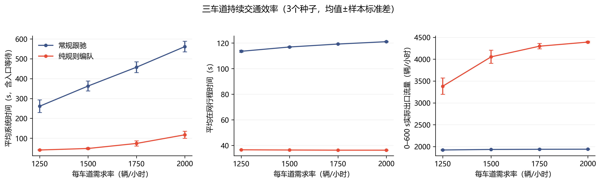
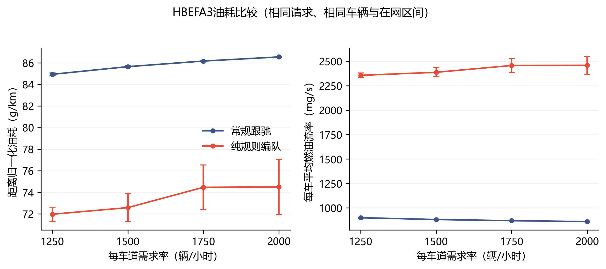
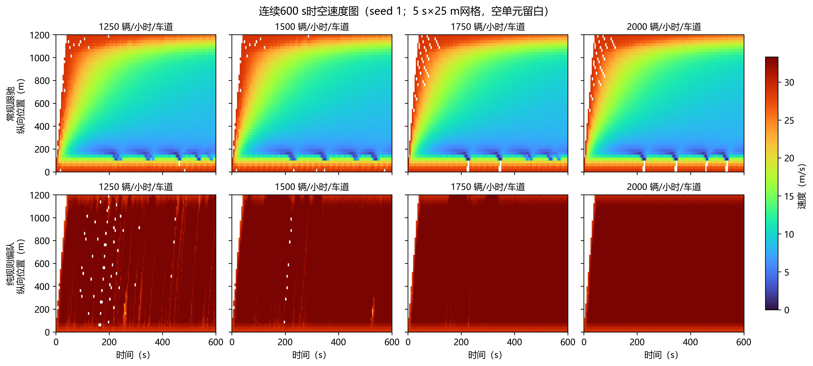

# 持续大交通流的效率与燃油验证

完成日期：2026年10月28日。工作目录：`D:\yanjiu1\keyan1`。

本轮已完成54个预定工况，研究当前纯规则编队在持续来车中的交通效率与燃油消耗。主场景采用用户选定的MATLAB三车道直路，长1200 m，每车道1250、1500、1750、2000辆/h，连续产生600 s请求，随后继续入口队列和道路排空。

三车道主实验的24例全部完整排空，车体接触与驶出道路均为0。与本工程常规跟驰及车道保持相比，编队组的系统时间和距离归一化油耗在四种需求下均降低。四车道扩展及本轮参数变化的编队例也全部安全排空；两车道扩展有2/3例出现车体接触。因此，当前持续流验证支持三、四车道的这些测试条件，两车道规则仍有明确的安全失效。

进一步代码审计确认：两组纵向制动判据不同，常规组受到更强的制动距离限速，编队组还允许追赶加速。因此，下述改善率衡量当前两套完整控制实现的差异，包含入口排队、纵向安全约束和实际车速的影响；编队排列本身的独立收益需要在统一这些条件后评价。

## 1. 实验怎样进行

| 项目 | 本轮设置 |
| --- | --- |
| 参照 | Cai2024的需求率和600 s时空观察尺度；车辆生成采用用户MATLAB逐车道独立随机方式。 |
| 道路 | 主场景恒定三车道、1200 m；车道扩展为恒定二、四车道。 |
| 请求 | 每车道每0.1 s以q×0.1/3600概率生成请求，车数由600 s内的随机结果决定。 |
| 共同条件 | 同一来车表、入口初速度28.8 m/s、最大速度33.3 m/s、同一车辆与运动积分。 |
| 对照 | 本工程常规跟驰、车道保持；两组普通主动超车均关闭。 |
| 编队 | 当前局部跟驰、交错对齐和分层补位规则。默认同车道30 m、车道相位15 m。 |
| 重复 | 每个条件seed 1、2、3，开关编队逐种子配对。 |
| 时间 | 600 s后停止新请求，继续安全入场和驶离；记录上限2400 s。 |
| 油耗 | HBEFA3/PC_G_EU4，按实际速度和加速度在0.01 s积分子步累计。 |

固定矩阵为主需求24例、车道扩展12例、目标速度变化12例、层距变化6例，共54例。层距24、36 m使用相同种子的主场景对照，车道相位保持15 m。完整定义和文献原始依据见[评价方法](持续交通流评价方法.md)。本轮对应恒定车道直路；Cai2024论文图4使用的3→2车道瓶颈在该文献中单独描述。

## 2. 三车道交通效率

系统时间从“产生请求”计至“驶离1200 m出口”，包括实际入口等待。下表时间为三个种子的均值；改善率先逐种子配对计算，再求均值。

| 每车道需求率（辆/h） | 常规跟驰系统时间（s） | 编队系统时间（s） | 配对减少（%） |
| --- | --- | --- | --- |
| 1250 | 261.26 | 40.77 | 84.28 |
| 1500 | 362.90 | 48.37 | 86.68 |
| 1750 | 457.60 | 73.74 | 83.96 |
| 2000 | 561.48 | 117.29 | 79.18 |

| 需求率 | 常规/编队在网时间（s） | 常规/编队实际出口流量（辆/h，全路） | 600 s入口队列：常规/编队（辆） |
| --- | --- | --- | --- |
| 1250 | 113.52 / 36.64 | 1922 / 3382 | 205.7 / 6.3 |
| 1500 | 116.88 / 36.47 | 1934 / 4054 | 334.0 / 17.7 |
| 1750 | 119.17 / 36.35 | 1938 / 4298 | 454.0 / 92.0 |
| 2000 | 121.02 / 36.34 | 1940 / 4392 | 583.7 / 207.0 |

出口流量由0–600 s实际离场数折算，单位是全路车辆数/小时；需求率单位是每车道车辆数/小时。入口队列是在600 s时已经请求、尚未入场的车辆数，表中给出三个种子的均值。

编队组在高需求下仍会产生入口积压。队列继续释放至全部请求车辆完成通行，因此总系统时间保留了这部分等待。三车道编队12例的最终记录终点为644.7–823.1 s；全部有效案例最终均无入口队列和在网余车。

### 常规组为什么耗时长

| 每车道需求率（辆/h） | 常规入口等待（s） | 常规在网时间（s） | 常规系统时间（s） |
| --- | --- | --- | --- |
| 1250 | 147.73 | 113.52 | 261.26 |
| 1500 | 246.01 | 116.88 | 362.90 |
| 1750 | 338.42 | 119.17 | 457.60 |
| 2000 | 440.46 | 121.02 | 561.48 |

以1500辆/h/车道为例，约246 s来自入口等待，约117 s是在道路内行驶；实际全网平均速度10.27 m/s。按28.8 m/s匀速通过1200 m只需41.67 s，因此时间偏长同时包含低速跟驰与入口积压两部分。

常规纵向控制在1.8 s时距跟驰反馈之外，还用`comfortable_speed()`反求舒适停车速度上限，并考虑响应、执行滞后和jerk。对同速28.8 m/s、净距`3+1.8×28.8=54.84 m`的状态代入实际参数，舒适速度上限只有16.27 m/s；另一条最坏制动距离判据要求净距73.27 m，同样会触发制动。也就是说，当前时距目标与额外停车约束在这一速度下不一致，车辆到达时距目标后仍被要求减速。低速沿车队传播，道路通过量降低，入口队列随需求增加而积压。计算依据保存在`baseline_diagnosis.json`。

普通编队跟驰在没有活动换道计划时，以当前净距/TTC重新判断紧急状态；有有效编队跟踪目标且未触发紧急状态时，用编队位置跟踪加速度替换常规纵向指令，见`noa/controller.py`第131–133行、`noa/simple_controller.py`第269–278行。它与常规组的最坏制动距离约束不同。活动换道和道路终点分支另有保护。这也是当前结果差异较大的重要实现原因。



## 3. 燃油消耗

燃油统计区间是实际入场至实际出口。距离归一化油耗用相同车辆、相同行程的燃油质量除以里程；燃油流率用燃油质量除以车辆在网时间。入口等待时间另列在系统时间中。

| 每车道需求率（辆/h） | 常规油耗（g/km） | 编队油耗（g/km） | 配对减少（%） | 常规/编队燃油流率（mg/s） |
| --- | --- | --- | --- | --- |
| 1250 | 84.94 | 71.97 | 15.27 | 897.9 / 2357.5 |
| 1500 | 85.65 | 72.59 | 15.26 | 879.4 / 2388.4 |
| 1750 | 86.17 | 74.47 | 13.58 | 867.7 / 2458.2 |
| 2000 | 86.55 | 74.50 | 13.93 | 858.2 / 2460.0 |

两种油耗指标回答不同问题：g/km描述通过单位里程需要的燃油，mg/s描述每车每秒的平均燃油消耗强度。车速提高时，每秒燃油消耗可以增加，同时单位里程燃油减少。本轮以g/km比较完成同一1200 m通行任务的耗油量，逐例总燃油kg也完整保存在结果表。



## 4. 持续600 s的时空运行状态

下面展示seed 1的四种需求率。上排是常规跟驰，下排是编队；横轴为时间、纵轴为位置，颜色为5 s×25 m网格内的实际平均车速，白色表示没有车辆样本。



常规跟驰在入口附近形成低速区域，编队组在测量路段内保持较高速度。四个需求组各自跨3个种子的平均全网速度为32.76–33.02 m/s，12个编队案例的逐例范围为32.73–33.06 m/s，高于局部领航车的28.8 m/s巡航设定。现有后车位置跟踪允许追赶参考位置时加速，最高33.3 m/s。这里的结果反映整套跟驰、补位与追赶规则相对本工程常规跟驰的综合效果；时空速度图展示运行效率，队形几何的独立结果见前一轮[有限车群验证](编队多工况验证报告.md)。

## 5. 车道数与参数变化

车道数比较固定每车道1500辆/h、目标28.8 m/s、层距30 m。

| 车道数 | 编队有效运行 | 编队系统时间（s） | 编队油耗（g/km） | 实际结果 |
| --- | --- | --- | --- | --- |
| 2 | 1/3 | — | — | 2例车体接触，1例完整安全排空 |
| 3 | 3/3 | 48.37 | 72.59 | 3例完整排空、0接触 |
| 4 | 3/3 | 50.66 | 71.56 | 3例完整排空、0接触 |

两车道的单个安全种子仍保留在逐例和配对表中。上表不以这个种子代表整个两车道条件的性能均值。

参数比较固定三车道、每车道1500辆/h。以下五组均为3/3有效编队运行，表中数值为跨种子均值。

| 目标速度（m/s） | 同车道层距（m） | 系统时间（s） | 油耗（g/km） | 实际全网平均速度（m/s） |
| --- | --- | --- | --- | --- |
| 28.8 | 30.0 | 48.37 | 72.59 | 32.90 |
| 24.0 | 30.0 | 49.03 | 68.26 | 32.32 |
| 32.0 | 30.0 | 48.09 | 75.15 | 33.05 |
| 28.8 | 24.0 | 48.33 | 72.79 | 32.92 |
| 28.8 | 36.0 | 48.35 | 72.75 | 32.91 |

在本轮数值中，24 m/s巡航设定的单位里程油耗最低；提高到32 m/s时，系统时间略有缩短，油耗上升。层距24、30、36 m三组的系统时间十分接近，油耗差异也较小。对应速度各有自己的相同速度对照，完整配对改善率见`pair_groups.csv`。

## 6. 两车道失效记录

| 案例 | 首次接触（s） | 记录终点（s） | 计划请求/实际入场/出场 | 处理 |
| --- | --- | --- | --- | --- |
| 两车道，seed 2 | 36.7 | 36.7 | 502/22/0 | 保存接触拍后停止，安全无效 |
| 两车道，seed 3 | 36.2 | 642.3 | 499/499/499 | 保留既有完整记录，安全无效 |

两例均记录1对车体接触，完整事件保存在各自`incidents.json`中。旧批次seed 3在首次接触后继续排空，原记录保留；接续批次seed 2在接触拍结束时停止。seed 2计划502个请求，在36.7 s终点已释放并入场22辆，未来尚未释放480辆，入口等待0辆；未来请求与入口队列分别统计。

54例中52例完整且安全，2例安全失效，未发现驶出道路。30个预定编队配对中28个有效，2个安全无效；失效例的改善率为空，原始时间、燃油和未完成数仍保留。

## 7. 本轮具体补了什么

1. **持续请求：** 将固定车数实验扩展为600 s内各车道持续生成请求，空场时钟也继续运行。
2. **入口队列：** 各车道按FIFO入场，同时检查原时距和包含控制、执行响应的制动间距。两组使用同一入口规则。
3. **开放出口：** 在1200 m精确登记离场，出口后的可见道路继续延伸；离场子步中的时间、里程和燃油同步截断。
4. **效率与燃油：** 记录请求、实际入场与出口三个时刻，积分实际燃油，并分别汇总入口等待、在网时间和系统时间。
5. **安全事件记录：** 新运行遇到首次接触或驶出道路，保存该拍后结束，分别保留已释放和未来请求。
6. **等价读取：** 数值记录改用缓存字段读取，积分算式与车辆规则保持原样。1000组随机完整积分摘要相同，既有600个局部场景及1250拍闭环摘要相同，另一次完整短测的两模式轨迹摘要和逐车燃油台账逐项相同。

本轮新增的是上述实验与统计机制，现有编队跟驰和换道代码没有改动。新增方法逐项见[方法索引](纯规则系统方法索引.md#持续交通流与燃油评价新增方法)。

## 8. 核验与成果文件

最终独立复算覆盖54例、41282条计划车辆台账、324个文件摘要、54例逐拍累计和30个配对请求表。时间、距离、燃油、数量与原记录一致。相关回归124项通过，完整编队测试150项通过。油耗模型与本机SUMO 1.27.1官方工具47个平路参考点交叉核对，最大差0.005 mg/s。

便携结果位于[数据目录](experiments/2026-10-28-continuous-traffic/README.md)：`cases.csv`保留54例，`groups.csv`保留18组，`pairs.csv`保留30配对，`pair_groups.csv`保留10组配对统计；JSON保留完整精度，三组图各有300DPI PNG和SVG。

原始记录由两个批次共同组成，`verification.json`逐例列出实际证据目录和两份源码存档摘要：

- 原批次：`variants/phase5g_pure_formation/results/continuous_traffic/20261028T031206451914Z`，保留30个已封存条件及中断前缀。
- 接续批次：`variants/phase5g_pure_formation/results/continuous_traffic/20261028T041744709217Z`，完成其余24个条件。

接续前按摘要确认已封存案例，尚未完成的条件从相同请求重新执行，每个条件只进入总表一次。全部早期探针和失效记录保留。代码、报告与便携成果由GitHub版本管理，压缩原始轨迹留在本机结果目录。

重新运行整套实验：

```powershell
Set-Location -LiteralPath 'D:\yanjiu1\keyan1'
python -B scripts/run_logged.py --label continuous-traffic --timeout 7200 -- python -B variants/phase5g_pure_formation/run_traffic_flow.py --workers 8
```

从本轮两个批次重新导出到一个尚不存在的新目录，并绘图：

```powershell
python -B variants/phase5g_pure_formation/summarize_traffic_flow.py variants/phase5g_pure_formation/results/continuous_traffic/20261028T031206451914Z tmp/continuous-recomputed --additional-root variants/phase5g_pure_formation/results/continuous_traffic/20261028T041744709217Z
python -B variants/phase5g_pure_formation/plot_traffic_flow.py tmp/continuous-recomputed
```
