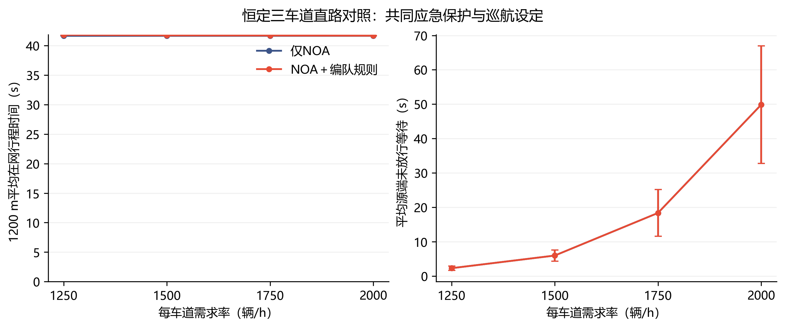
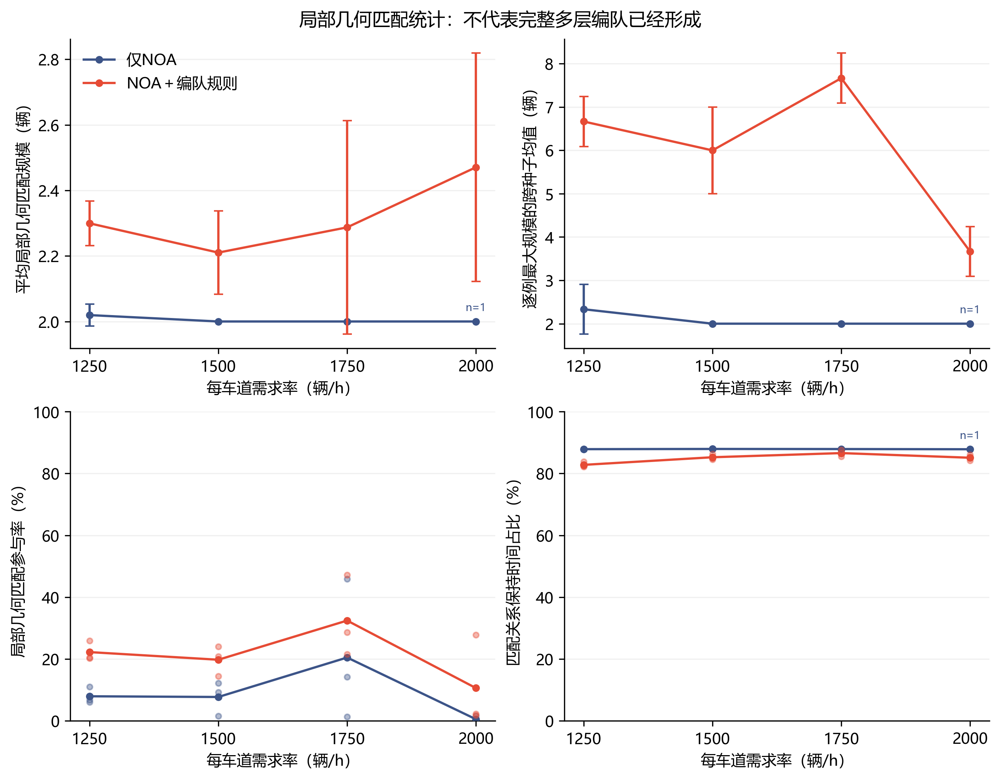
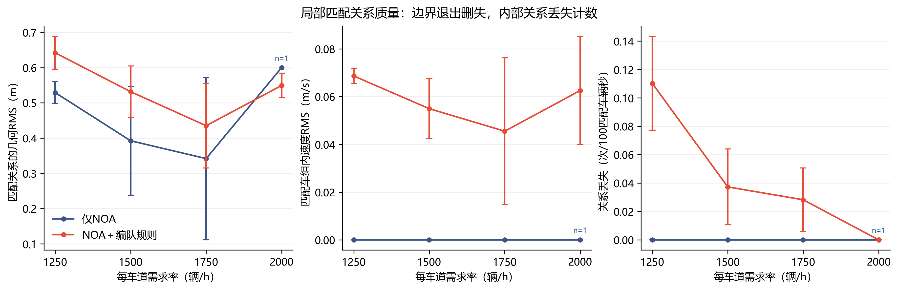

# 直路NOA对照与局部几何匹配统计

完成日期：2026年10月28日。工作目录：`D:\yanjiu1\keyan1`。

**口径更正：**本页规模、参与和关系保持统计来自局部几何匹配，不代表完整编队已经形成。原始数值保留，图表标签已更正。最新逐帧复查显示，高流量补位未启动，完整多层形成尚未实现；原因和证据见[最新诊断](仅NOA误计与大流量小车组诊断.md)。

本轮先修正基础NOA和入口边界，再完成54个600s持续车流工况。本页保留局部几何匹配的规模、参与、相对误差和关系保持统计，完整队形须另按实际车群检查。直路行程时间用于检验基础行驶，两组结果按相同条件直接比较。

旧版把常规NOA的强制动、入口积压和编队追赶速度差混入了效果。旧批次保留为[历史诊断](持续大交通流验证报告.md)。本报告使用修正后的独立新批次。

三车道主实验中，仅NOA通过1200m均为41.67s，编队为41.71–41.85s，直路通行略慢。编队规则组的平均几何匹配规模为2.21–2.47辆，观察最大8辆，参与率10.60%–32.44%；规模与参与有所增加，关系稳定性没有同步改善。这些局部匹配值没有验证完整队形。最新结构复查发现高流量补位为0，完整多层形成尚未实现。

## 1. 基础行驶与入口做了哪些修正

1. 常规跟驰保留3m+1.8s常时距反馈，去掉运动前车的额外舒适停车罩和瞬间硬刹停车差。
2. 两种模式共用当前车身与投影切入候选，统一净距、TTC和闭合速度响应制动；静止前车与道路终点保留停车逻辑。
3. 编队期望速度封顶为相同巡航设定，避免参考车速度逐层抬升。
4. 在−300m物理上游段接入车辆，两组上游均用普通NOA。源端按实际局部前车匹配速度，短空隙仅保留请求，不制造低速插入。
5. 请求、源端放行、0m测量入场、1200m出口四时刻分别记录。源端排队、上游运动和在网通行分开统计，燃油与里程只累计0至1200m。

完整公式与执行顺序见[基础NOA与入口规则](基础NOA与入口修正规则.md)。静止前车停车再启动、横向切入、同中心重叠、远处静止车、物理终点、积分边界和车辆守恒均纳入回归。

## 2. 实验设置

主场景为MATLAB当前的1200m恒定三车道直路，车道宽3.3m。每车道每0.1s独立Bernoulli请求，概率q×0.1/3600，持续600s；之后继续放行和排空。主需求率1250、1500、1750、2000辆/h/车道，seed1、2、3，两种模式共享同一请求表。主巡航速度28.8m/s，同道目标层距30m、跨道相位15m。

主实验24例；2/4车道1500辆/h扩展12例；巡航24/32m/s配对12例；同道层距24/36m扩展6例，共54例。层距变化保持相位15m，并使用对应主场景对照。最高记录2400s，安全事件保存当拍后结束，所有结果均保留。

## 3. 原局部几何匹配指标的含义

| 指标 | 回答的问题 |
| --- | --- |
| 平均与观察最大规模 | 一个几何匹配车组包含多少辆车，是否出现更大的队伍。人数包含全部成员。 |
| 局部几何匹配参与率 | 全部在网车辆时间中，有多少时间处于合格的物理车组。 |
| 邻接几何RMS | 已成队关系的实际同道间距、同层相位与目标偏差多大。 |
| 队内速度RMS | 同一局部队伍内的实际速度是否一致。 |
| 匹配关系保持时间占比 | 已匹配车辆时间中，有连续保持至少5s物理关系的占比；稳定参与率另用全部在网车辆时间作分母。 |
| 内部断裂率 | 排除正常出界后，几何或速度关系在道路内部多频繁丢失。 |

每秒由实际位置和速度建立物理图：同道只连相邻D±2m，跨道只连相同层的相位差±2m，边端速度差≤0.5m/s、距车道中心≤0.3m。至少两辆车的连通分量为局部车组；分量不重叠。跨层连接必须有真实同道D邻接，不能通过对角匹配绕过缺层。

双车或同层小队是局部组织事实；完整多层编队还需要层间的同道连接。指标由同一物理标准识别两组，普通NOA偶然出现的有序小队也如实计入。几何误差只评价已识别关系，必须结合参与率与规模一起阅读。

0.3m、2m、0.5m/s及5s是本研究公开设定。5s是关系稳定统计窗口，形成过程不设末车发出后的固定期限。边界驶离与记录终点记删失，内部关系消失才记断裂。定义、公式、阈值和Su2017、Cai2019、ADEPT2024等原文依据见[规模与稳定度协议](编队规模与稳定度评价.md)。这里评价观测到的组织持续性。

## 4. 直路交通效率对照

下表均为三个种子的均值。测量路段为0至1200m；按28.8m/s匀速通过需要41.67s。源端等待是请求尚未放行的时间，已经行驶的上游车辆另有运动时间记录。

| 每车道需求（辆/h） | 在网行程（s）：仅NOA / ＋编队规则 | 源端未放行等待（s）：仅NOA / ＋编队规则 | 实际均速（m/s）：仅NOA / ＋编队规则 |
| --- | --- | --- | --- |
| 1250 | 41.67 / 41.85 | 2.30 / 2.30 | 28.80 / 28.68 |
| 1500 | 41.67 / 41.76 | 5.97 / 5.97 | 28.80 / 28.74 |
| 1750 | 41.67 / 41.73 | 18.36 / 18.36 | 28.80 / 28.75 |
| 2000 | 41.67 / 41.71 | 49.85 / 49.85 | 28.80 / 28.77 |



两组使用相同请求和源端规则。主实验的车长、3m静距、1.8s时距和车身余量合计要求源端中心间距59.14m；28.8m/s、0.1s放行步长下，饱和放行间隔约2.1s，折合约1714辆/h/车道。2000辆/h已经超过这个共同源端供给，因而仍有未放行需求。余队继续释放至排空，已经在道路上行驶的车辆没有被这份需求表人为叫停。交通效率、燃油与最终余车均保留在逐例表，评价编队效果的主表使用下面的直接组织指标。

## 5. 局部匹配规模与参与、保持

| 每车道需求 | 有车组统计次数（各3次）：仅NOA / ＋编队规则 | 平均几何匹配规模（辆）：仅NOA / ＋编队规则 | 逐例观察最大规模（辆）：仅NOA / ＋编队规则 |
| --- | --- | --- | --- |
| 1250 | 3 / 3 | 2.02 / 2.30 | 3 / 7 |
| 1500 | 3 / 3 | 2.00 / 2.21 | 2 / 7 |
| 1750 | 3 / 3 | 2.00 / 2.29 | 2 / 8 |
| 2000 | 1 / 3 | 2.00 / 2.47 | 2 / 4 |

“逐例观察最大规模”取该需求下安全案例中实际观察到的最大值；曲线中的最大规模则按每例最大值求跨种子均值。没有车组时平均规模与条件质量指标为空，参与率为0。2000辆/h仅NOA有两个种子没有合格车组，所以该组规模和条件稳定统计只含一个种子，表中次数、图中n及CSV各指标的`_n`均明确列出；三个安全运行均保留。图中占比面板给实际种子点，其他面板给均值±样本SD。

| 每车道需求 | 局部几何匹配参与率（%）：仅NOA / ＋编队规则 | 匹配关系保持时间占比（%）：仅NOA / ＋编队规则 | 稳定参与率（%）：仅NOA / ＋编队规则 | 内部断裂（次/100匹配车辆秒）：仅NOA / ＋编队规则 |
| --- | --- | --- | --- | --- |
| 1250 | 7.95 / 22.23 | 87.87 / 82.79 | 6.98 / 18.43 | 0.000 / 0.110 |
| 1500 | 7.72 / 19.77 | 87.94 / 85.26 | 6.79 / 16.85 | 0.000 / 0.037 |
| 1750 | 20.48 / 32.44 | 87.91 / 86.60 | 18.01 / 28.15 | 0.000 / 0.028 |
| 2000 | 0.53 / 10.60 | 87.84 / 85.10 | 0.46 / 9.01 | 0.000 / 0.000 |

参与率按车辆秒加权；关系连续保持5s确认后开始累计稳定车辆时间，确认前不回填。稳定时间占比以已匹配车辆时间为分母，稳定参与率以全部在网车辆时间为分母。它们区分了参与多少与已参与成员关系的持续性。正常出界、记录结束和采样缺口不算内部断裂。先逐例计算；参与率汇总全部3个种子，条件指标只汇总有定义观测，数量见表及`_n`。

参与率随流量并非单调变化。2000辆/h编队组的三个种子分别为27.80%、1.77%、2.24%，平均10.60%仍包含较大重复差异。匹配关系保持时间占比为82.79%–86.60%；前三档需求还存在内部关系断裂。最大规模增加反映了局部增长，稳定大队还需要持续的关系保持与较低内部断裂共同支持。



## 6. 局部队形与速度精度

| 每车道需求 | 邻接几何RMS（m）：仅NOA / ＋编队规则 | 队内速度RMS（m/s）：仅NOA / ＋编队规则 |
| --- | --- | --- |
| 1250 | 0.529 / 0.642 | 0.000 / 0.069 |
| 1500 | 0.392 / 0.532 | 0.000 / 0.055 |
| 1750 | 0.342 / 0.435 | 0.000 / 0.046 |
| 2000 | 0.600 / 0.549 | 0.000 / 0.063 |



几何RMS按邻接关系时间加权，队内速度RMS按编队成员时间加权。仅少数精确小队就能得到低误差，因此低误差本身不代表大规模编队已经形成。

## 7. 车道数与参数扩展

| 编队条件（每道1500辆/h） | 完整安全运行 | 平均规模（辆） | 参与率（%） | 稳定参与率（%） | 在网行程（s） |
| --- | --- | --- | --- | --- | --- |
| 2车道 | 3/3 | 2.11 | 18.20 | 14.96 | 41.79 |
| 3车道基准 | 3/3 | 2.21 | 19.77 | 16.85 | 41.76 |
| 4车道 | 3/3 | 2.15 | 11.16 | 9.65 | 41.71 |
| 巡航24m/s | 3/3 | 2.21 | 13.37 | 11.86 | 50.06 |
| 巡航32m/s | 3/3 | 2.27 | 28.25 | 23.48 | 37.61 |
| 同道24m | 3/3 | 2.19 | 19.37 | 16.51 | 41.76 |
| 同道36m | 3/3 | 2.24 | 20.09 | 17.11 | 41.76 |

表中只汇总完整且安全的运行，实际有效数量逐组列出；全部预定案例和未完成数量保存在逐例表。源端需求率按每车道给出，改变车道数时全路需求随车道数变化。

## 8. 安全、核验与工程状态

本轮54个工况均完整排空，检测到的车体接触和驶出道路均为0。

独立复算核验378个文件摘要、41282条计划车辆台账、54例逐拍累计和30个配对来车表；直接编队指标还从每例物理位置重新计算。受影响回归141项、完整编队与记录链路150项通过。

成果在[数据目录](experiments/2026-10-28-noa-platoon/README.md)，包括54例、18组、30配对、10组配对统计，完整数值、有效数量、源码摘要和三组300DPI PNG/SVG。原始压缩数据在`variants/phase5g_pure_formation/results/continuous_traffic_v3/20261028T100105100032Z`。源码每批一份zip，轨迹按gzip存储；便携表格与图随GitHub提交保存。

当前工程具备直路NOA对照、物理上游入场、统一响应保护和局部匹配统计。完整持续流形成存在追赶与补位问题，见最新诊断。后续规则应先实现完整多层队形，再评价其规模与稳定。

## 9. 运行与复算入口

本机正式批次使用16个并发进程，完成耗时4161.719s。重新运行同一54条件：

```powershell
Set-Location -LiteralPath 'D:\yanjiu1\keyan1'
python -B scripts/run_logged.py --label noa-platoon --timeout 7200 -- python -X faulthandler -B variants/phase5g_pure_formation/run_traffic_flow.py --workers 16
```

从本轮原始数据复算到一个尚不存在的新目录，再生成图表：

```powershell
python -B variants/phase5g_pure_formation/summarize_traffic_flow.py variants/phase5g_pure_formation/results/continuous_traffic_v3/20261028T100105100032Z tmp/noa-platoon-recomputed
python -B variants/phase5g_pure_formation/plot_noa_platoon.py tmp/noa-platoon-recomputed
```
