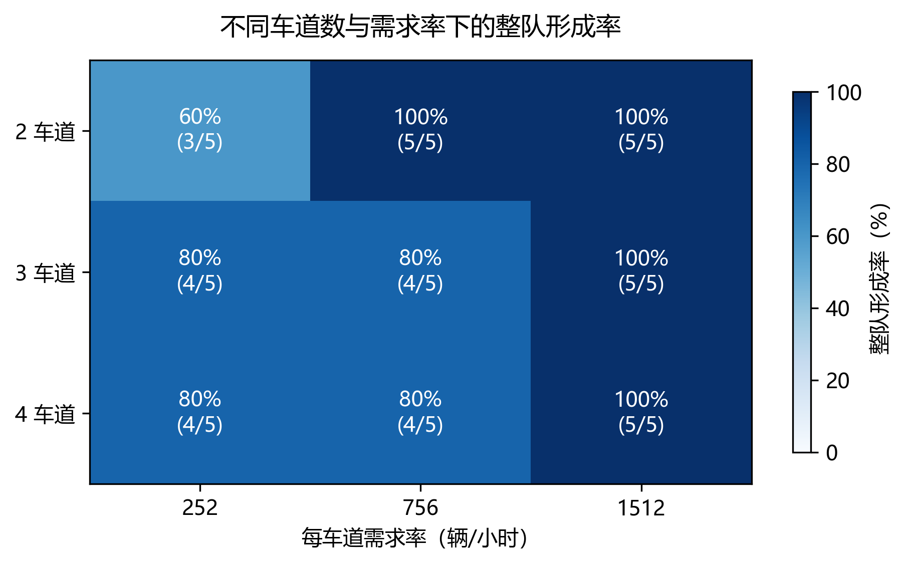
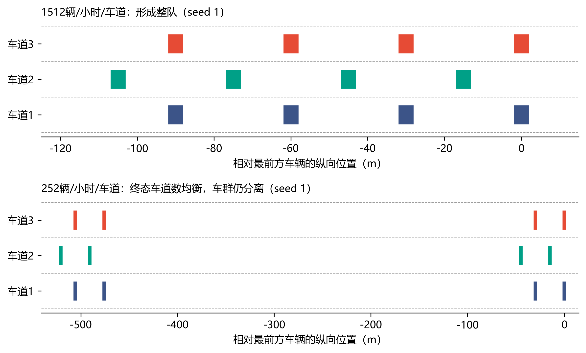
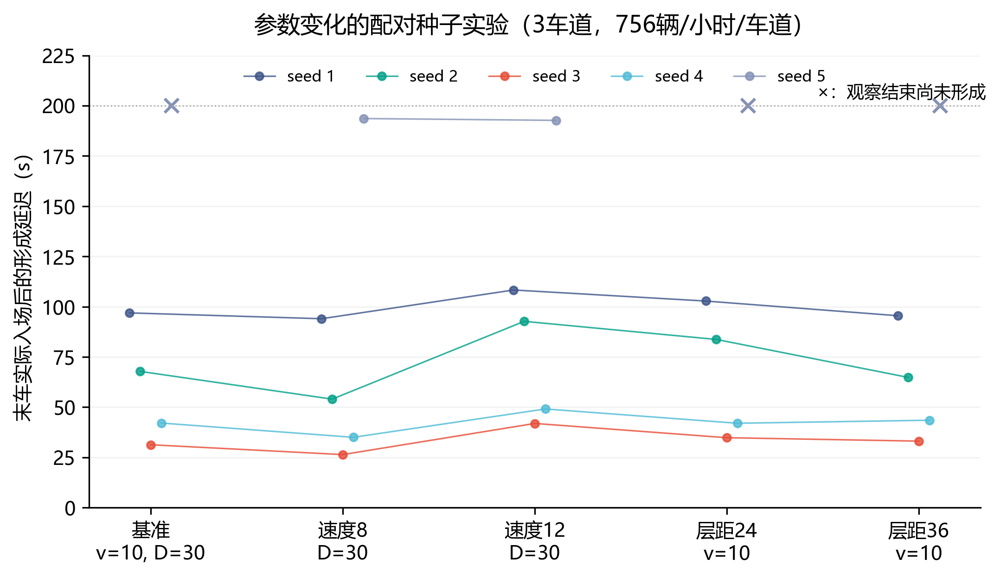

# 纯规则编队的多工况验证

2026 年 10 月 28 日

本轮完成了不同车流量、2/3/4 车道和关键参数变化下的 65 例实验。**57 例形成完整交错编队，8 例在观察结束时尚未形成；65 例记录完整，全部积分子步未检测到车体接触。** 当前规则在较密集的来车条件下表现较好，低流量的远距车群汇合和部分占位调整是剩余的主要问题。

车辆跟驰、分层判断、补位换道、感知范围和运动模型使用当前研究版本。本轮增加随机发车、入口排队、紧凑记录与独立评价，并完成了原推进方式与紧凑推进方式的动作、状态和私有记忆等价检查。

## 1. 实验怎样安排

### 随机车辆生成

参考 `D:\matlab_huipu_2000\mainmain.m` 的有效生成段：仿真步长为 0.1 s，每条车道每拍独立执行一次 `rand<VGR`。每车道需求率 q 与生成概率 p 的关系为：

\[
p=q\times0.1/3600.
\]

本轮采用 p=0.007、0.021、0.042，分别对应每车道 252、756、1512 辆/小时。MATLAB 当前有效赋值为 0.042。本轮复现其独立随机来车机制，在 Python 中固定并保存实际请求表。

每例生成 N=4L 辆车，L 为车道数；请求可能出现在任意车道，同一拍可以有多条车道来车。车辆初速度独立取 8–12 m/s。每条车道的随机数流单独固定，同一 seed 的参数实验共享完全相同的来车时刻、车道和初速度。

首个真实请求平移至 t=0，保存平移前时刻。车辆在各车道入口依次等待，满足现有静止间距加安全时距后进入道路；全部请求均保留。最大实际入口等待为 20.2 s。文中的流量表示请求需求率，实际入场时刻逐车记录在输入表中。

### 工况与观察过程

| 项目 | 设定 |
| --- | --- |
| 车道数 | 2、3、4；道路全长 10 km，车道宽 3.3 m。 |
| 每车道需求率 | 252、756、1512 辆/小时。 |
| 每例总车辆数 | 8、12、16，随车道数取 4L。 |
| 随机种子 | 1、2、3、4、5，每个工况完整运行 5 次。 |
| 基准编队参数 | 目标速度 10 m/s、同车道层距 30 m、相邻相位后移 15 m。 |
| 参数变化 | 在 3 车道、756 辆/小时/车道下，分别将目标速度改为 8、12 m/s，或将同车道层距改为 24、36 m；其他参数保持基准值。 |
| 仿真步长 | 控制与观测 0.1 s，运动积分 0.01 s。 |
| 观察终点 | 全部车辆实际入场后继续运行 200 s，每例均运行到该终点。 |
| 实验规模 | 车道与流量 45 例，参数变化 20 例，共 65 例。 |

这一设计以有限车群形成作为实验单元，比较来车稀疏程度、车道规模和控制目标对形成效果的影响。2、3、4 车道的目标终态分别为 `4:4`、`4:4:4`、`4:4:4:4`。

## 2. 怎样评价编队

参考本机 Cai2019 的交错几何与距离、速度误差，及 ADEPT2024 对加入编队、达到目标速度、达到目标间距的时间评价，采用四类指标：

1. **整队形成率：** 每个工况 5 例中，完整交错队形形成的次数和比例。
2. **形成延迟：** 首次连续达标 1 s 的确认时刻，减最后一辆实际入场时刻。
3. **交错几何误差：** 同车道层距、同相位车道对齐及相邻相位 15 m 偏移的误差。
4. **速度一致性与目标偏差：** 全队速度极差，以及各车相对目标速度的最大偏差。

整队形成要求所有车辆属于同一连通车群、目标占位完整、几何误差不超过 2 m、全队速度极差不超过 1 m/s，并连续满足 1 s。形成判定由实际位置和速度计算。详细公式、文献页码和实现映射见[评价标准](编队效果评价标准.md)。

下文的形成延迟中位数和范围只针对已经形成的案例；未形成案例的时间留空，实际观察终点保存在逐例表中。终态占位不完整时，总几何误差记为缺测，实际车道分布照常列出。

## 3. 不同车道数和流量的结果



| 车道数 | 每车道需求（辆/h） | 形成次数 | 形成率 | 形成延迟中位数（s） | 成功例延迟范围（s） |
| --- | --- | --- | --- | --- | --- |
| 2 | 252 | 3/5 | 60% | 105.7 | 53.3–118.7 |
| 2 | 756 | 5/5 | 100% | 64.0 | 45.6–100.7 |
| 2 | 1512 | 5/5 | 100% | 35.0 | 10.1–46.9 |
| 3 | 252 | 4/5 | 80% | 88.8 | 72.5–152.3 |
| 3 | 756 | 4/5 | 80% | 55.0 | 31.3–96.9 |
| 3 | 1512 | 5/5 | 100% | 58.8 | 19.4–98.6 |
| 4 | 252 | 4/5 | 80% | 127.3 | 115.0–159.2 |
| 4 | 756 | 4/5 | 80% | 68.1 | 55.9–113.5 |
| 4 | 1512 | 5/5 | 100% | 97.1 | 39.1–153.4 |

三个需求水平的形成总数依次为 11/15、13/15、15/15。1512 辆/小时/车道下，三种车道数均完成 5/5；成功案例的形成延迟中位数随车道数从 35.0 s 增至 58.8 s、97.1 s。较多车道带来更多车辆和占位调整，形成过程相应变长。

252 辆/小时/车道下的 4 个未形成案例，终态仍有多个分离车群，最大纵向空隙为 305.3–430.9 m，已经超过前向 200 m 的观测范围。各车群能够同速巡航，但无法通过当前局部观测继续相互接近。下图给出同为三车道 seed 1 的实际终态：较密集来车形成一支队形，稀疏来车形成两支相距较远的局部队形。两图横轴均为实际米数。



756 辆/小时/车道下，三车道和四车道各有一例未形成。两例都已组成一个连通车群，终态车辆数分别为 `5:3:4` 和 `6:3:3:4`，问题集中在占位调整。

## 4. 改变参数的结果

下表与三车道、756 辆/小时/车道的基准组比较。速度单位为 m/s，层距单位为 m。

| 参数设置 | 形成次数 | 形成率 | 延迟中位数（s） | 成功例延迟范围（s） |
| --- | --- | --- | --- | --- |
| 基准：v=10，D=30 | 4/5 | 80% | 55.0 | 31.3–96.9 |
| v=8，D=30 | 5/5 | 100% | 54.0 | 26.4–193.6 |
| v=12，D=30 | 5/5 | 100% | 92.7 | 41.9–192.7 |
| v=10，D=24 | 4/5 | 80% | 62.9 | 34.8–102.8 |
| v=10，D=36 | 4/5 | 80% | 54.1 | 33.1–95.5 |



降低目标速度到 8 m/s，原基准中 seed 5 的未形成案例在 193.6 s 形成；提高到 12 m/s，该案例在 192.7 s 形成。两组各为 5/5。对基准与速度变化均已形成的 seed 1–4，较低目标速度的形成延迟均缩短，配对差值中位数为 −6.0 s；较高目标速度的形成延迟均增加，差值中位数为 +11.0 s。目标速度改变会影响跟驰接近与补位过程，较快巡航并不对应较快形成。

层距 24 m 和 36 m 的形成次数都为 4/5。24 m 组的 seed 5 仍为 `5:3:4`，36 m 组的 seed 5 已达到 `4:4:4`，但终态同车道层距最大误差为 17.33 m、速度极差为 1.85 m/s，仍处于位置与速度调整过程。这说明完整占位和动态收敛需要分别核查。

## 5. 形成后的精度与未形成案例

57 个已形成案例，在统一观察终点的最大几何误差均不超过 **0.274 m**，全队速度极差均不超过 **0.073 m/s**，相对目标速度的最大偏差也不超过 **0.073 m/s**。这些数值为已形成案例中的最差终态值，完整精度数据保存在逐例 CSV 中。

8 个未形成案例如下。表中车群规模从前向后排列。

| 案例 | 终态车道车辆数 | 终态车群规模 | 直接观察到的问题 |
| --- | --- | --- | --- |
| 2车道、252、seed1 | 4:4 | 4+4 | 两车群之间最大纵向空隙305.3 m。 |
| 2车道、252、seed3 | 4:4 | 6+2 | 两车群之间最大纵向空隙366.8 m。 |
| 3车道、252、seed1 | 4:4:4 | 6+6 | 两车群之间最大纵向空隙430.9 m。 |
| 4车道、252、seed1 | 4:4:3:5 | 5+6+5 | 多个车群分离，最大纵向空隙367.7 m，同时占位不均。 |
| 3车道、756、seed5 | 5:3:4 | 12 | 一个车群，车道占位不均。 |
| 4车道、756、seed5 | 6:3:3:4 | 16 | 一个车群，车道占位不均。 |
| 层距24、seed5 | 5:3:4 | 12 | 一个车群，车道占位不均。 |
| 层距36、seed5 | 4:4:4 | 12 | 占位完整，层距与速度尚在调整。 |

## 6. 研究结论

当前纯规则方法已在 2、3、4 车道上形成完整交错编队。对于本轮较密集来车条件，1512 辆/小时/车道的全部 15 例都形成；改变目标速度和同车道层距后，也分别观察到了完整形成。形成后的终态位置与速度误差较小。

当前适用性主要受车群可见性和占位调整影响。稀疏车流形成的远距车群超出观测范围后，现有规则会分别保持巡航；部分连通车群则停留在不均衡占位，或仍在收敛。下一步方法改进应围绕这两类实际问题开展，并继续使用本轮固定请求表做配对验证。

## 7. 文件、代码与复现

- [评价标准及文献页码](编队效果评价标准.md)。
- [65例逐例结果 CSV](experiments/2026-10-28-formation/cases.csv)、[13组汇总 CSV](experiments/2026-10-28-formation/groups.csv)。
- [逐例结构化结果](experiments/2026-10-28-formation/results.json)、[固定实验协议与源码摘要](experiments/2026-10-28-formation/protocol.json)。
- [8个未形成案例的终态物理数据](experiments/2026-10-28-formation/unformed_cases.json)、[逐例复算核验记录](experiments/2026-10-28-formation/verification.json)。
- `formation_study.py`：随机请求、入口等待、紧凑推进和批量运行；`formation_metrics.py`：独立物理评价；`summarize_formation_study.py`：摘要核对、逐例复算和导出；`plot_formation_study.py`：三张图及 PNG/SVG 输出。

批量仿真与评价使用 Python 标准库；绘图脚本使用 Matplotlib 和 NumPy。

完整本机原始轨迹位于：`D:\yanjiu1\keyan1\variants\phase5g_pure_formation\results\formation_study\20261027T170127795643Z`。每例保存压缩轨迹、请求/实际入场表、参数、接触检查事实和文件摘要。批次共享一份源码存档，整个批次约 **54.2 MiB**。本轮完整运行约 **10.3 分钟**，离线复算约 **71.7 s**。

```powershell
Set-Location -LiteralPath 'D:\yanjiu1\keyan1'
python -B scripts/run_logged.py --label formation-study --timeout 7200 -- python -B variants/phase5g_pure_formation/run_formation_study.py --workers 6
```

复算本轮原始轨迹并写入一个新的输出目录：

```powershell
python -B variants/phase5g_pure_formation/summarize_formation_study.py variants/phase5g_pure_formation/results/formation_study/20261027T170127795643Z docs/experiments/formation-recomputed
python -B variants/phase5g_pure_formation/plot_formation_study.py docs/experiments/formation-recomputed
```

本轮 107 项相关回归全部通过，包含推进等价、真实换道过程、随机请求、入口队列、评价手算例、缺失占位、形成时间以及既有规则与多车道检测。65 例共 260 个结果文件摘要核验通过，所有形成、入场、车道分布和速度指标从保存轨迹复算一致。几何汇总对 4 个占位不完整的案例记为缺测；原运行结果保留，最终表格采用复核后的评价。
